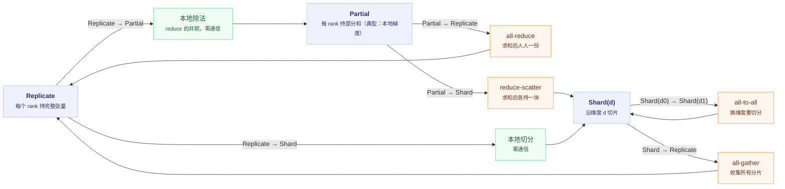

# 集合通信原语：all-gather、reduce-scatter 与它们的亲戚

## 一句话理解

> 集合通信（collective communication）是"一组 rank 一起调用的、语义确定的通信操作"：每个原语定义了**数据如何从 N 份变成 N 份**。训练里最常用的两个是 `all-gather`（把 N 份分片拼成 N 份完整拷贝）和 `reduce-scatter`（把 N 份完整数据归约成 N 份分片）——它们的通信形状互为对偶，但不是严格可逆。FSDP 前向用前者取回参数、反向用后者归约并分片梯度，是这种布局配对的典型应用。

## 为什么重要

- **它是所有并行策略的词汇表**：DDP 反向归约梯度；FSDP/ZeRO-3 按需 AG 参数、RS 梯度，前向后 reshard 时反向还需 AG；经典无 SP 的 Megatron TP 每个 Transformer 层前向/反向各 2 次 AR；常见 EP dispatcher 用 A2A 完成 dispatch/combine。看到一种并行范式，第一反应应该是“它用了哪些原语、各多少次”。
- **通信量公式直接决定设计选择**：一次 ring all-reduce 可分为 RS+AG，每 rank 发送量为 $2S\frac{N-1}{N}$。ZeRO-2 可将梯度 RS 与更新后的参数 AG 分开调度；两者字节数相同时，总发送量与 DDP 同量级，但中间驻留状态不同。FSDP 若采用前向后 reshard，常见序列为参数 AG、参数 AG、梯度 RS，在同字节数假设下约为 DDP 的 1.5 倍；不是仅因“按层重复”就必然增加 1.5 倍。
- **性能分析要落到原语粒度**：[07 号 profiling 笔记](../../../engineering/profiling/07-pytorch-distributed-profiling.md)里"NCCL kernel 占比高"的下一步就是分清**是哪种原语、消息多大、有没有被计算掩盖**，而这些都建立在认识每个原语的语义与代价之上。

## 核心概念

### 一张表看全部原语

先固定符号口径，否则后面每个公式都会被误读：

- **$S$ = 每个 rank 在该次通信里的「完整数据量」**——all-reduce 的输入/输出、all-gather 的**输出**、reduce-scatter 的**输入**、all-to-all 的输入/输出。所以 all-gather 每个 rank 贡献的分片是 $S/N$。
- **通信量 = 每 rank 的发送字节数**。收发对称时接收量相同；若要算"发送 + 接收"总量，再乘 2（正文会明确标注是哪一种口径）。

| 原语 | 输入（每 rank） | 输出（每 rank） | 每 rank 发送量（注意算法与角色） | 输出语义 |
|---|---|---|---|---|
| **broadcast** | 仅 root 有 $S$ | $S$ | 依拓扑；链式实现非末端发 $S$，树形按下游数转发 | 根 rank 的数据人人有 |
| **scatter** | 仅 root 有 $S$（切成 $N$ 份） | $S/N$ | 直接发送时 root 发 $S(N-1)/N$，其余 0 | 根的数据切成 N 份，各拿一份 |
| **gather** | $S/N$ | 仅 root 有 $S$ | 直接汇聚时非 root 发 $S/N$，root 发 0 | 所有数据汇聚到根一个 rank |
| **reduce** | $S$ | 仅 root 有 $S$ | 依算法；树形每个非 root 通常发 $S$，root 发 0 | 归约结果只在根 rank |
| **all-reduce** | $S$ | $S$ | $2S\frac{N-1}{N}$ | 归约结果人人有 |
| **all-gather** | $S/N$ | $S$ | $S\frac{N-1}{N}$ | 拼接后的完整数据人人有 |
| **reduce-scatter** | $S$ | $S/N$ | $S\frac{N-1}{N}$ | 归约结果切 N 份，各拿一份 |
| **all-to-all** | $S$ | $S$ | $\sim S\frac{N-1}{N}$（要求各方向均衡） | 每 rank 把自己的分片发给目标 rank，人人"换货" |

读表的三条规律：

1. **all-X = X + broadcast，reduce-scatter = reduce + scatter**，且都不必经过根 rank（ring 实现里没有根的概念，这是它高效的原因）。
2. **all-gather 与 reduce-scatter 互为对偶**：前者把 N 份分片拼成 N 份全量，后者把 N 份全量归约成 N 份分片；两者的每 rank 发送量都是 $S\frac{N-1}{N}$。注意它们**不是严格意义的互逆**——all-gather 不丢信息，reduce-scatter 会把 N 份输入压成 1 份（做 SUM 时无法还原出各自的输入）。真正成立的是"通信形状互逆、代价相同"。
3. **all-to-all 是唯一"重排数据"的原语**：其余原语对所有 rank 做同样的事，all-to-all 允许每个 rank 指定"我这块给谁"，是 MoE 专家分发、TP 重分片（`Shard(i) → Shard(j)`）的底层支撑。

### 一个 4-rank 的具体例子

设 $N=4$，每 rank 持有一个各不相同的 4 元向量：

```text
r0: [1,1,1,1]   r1: [2,2,2,2]   r2: [3,3,3,3]   r3: [4,4,4,4]
```

各原语（SUM）之后每 rank 手里的数据：

```text
broadcast(src=0)   每 rank: [1,1,1,1]          ← 只有 r0 那份，复制
reduce(dst=0)      r0: [10,10,10,10]             ← 求和但只有 dst 拿到，其余 rank 的接收缓冲区未定义
all_reduce         每 rank: [10,10,10,10]       ← 求和 + 人人一份
scatter(src=0)     rank r 得 r0 输入的第 r 块    ← 切开分发
gather(dst=0)      r0 收齐 4 个向量               ← 收集到一人，其余 rank 无输出
all_gather         每 rank: 16 元拼接向量        ← 人人持全量
reduce_scatter     rank r 得 [10] 的第 r 个元素  ← 求和 + 各拿一块
all_to_all         rank r 得「各 rank 输入的第 r 块」拼接 ← 重排，无算术
```

两组最容易混淆的对照：

- **broadcast vs all-gather**：broadcast 传播的是**同一份**数据（人人结果相同，信息量 = 1 份）；all-gather 收集的是 **N 份不同的**分片（人人结果相同，但信息量 = N 份）。FSDP 前向恢复参数用的是 all-gather（分片本来就在各 rank 手里），推理权重同步才是 broadcast。
- **reduce vs reduce-scatter**：reduce 的结果只落在 dst 一个 rank；reduce-scatter 把归约结果**切开**，每 rank 得到一块。普通 DDP 每个副本更新全部参数，仍需要完整梯度；改用 ZeRO 式 owner 更新后，各 rank 才只需对应的梯度分片，并在更新后同步新参数。不能只把 DDP 的 AR 换成 RS 而省略后续参数同步。

### 关键洞察：all-reduce = reduce-scatter + all-gather

ring all-reduce 的内部实现恰恰是两步：先 reduce-scatter（每 rank 得到全量归约结果的 $1/N$ 分片），再 all-gather（把分片拼成全量）。这个分解在三个地方反复出现：

- **DDP 的桶 all-reduce**：一次 ring all-reduce，内部即 RS+AG。
- **ZeRO-2 的优化**：DDP 梯度 all-reduce 时，**各 rank 只需要自己参数分片对应的梯度分片**（更新优化器状态用），所以只需要 reduce-scatter 半程；优化器步之后新参数再 all-gather 回去。ZeRO-1 只要求持久分片优化器状态，但分片 owner 更新后也必须把新参数同步给其他副本；其梯度归约可以按 owner 优化，不能仅从 stage 名称推断只做一次 AR。ZeRO-2 进一步持久分片梯度；FSDP/ZeRO-3 则连参数也分片，按参数组反复 AG/RS（常见 reshard 策略下前向 AG、反向 AG+RS）。
- **FSDP**：前向按需 AG 参数、反向 RS 梯度，用参数/梯度分片换显存。**不能据此断言整步通信总量不变**：若前向后立即 reshard，反向还要再 AG 参数；在参数与梯度字节数相同的简化模型下，$2\text{AG}+\text{RS}$ 约为 DDP 一次 AR 的 1.5 倍。关闭部分 reshard、混合精度或预取会改变具体代价。

因此要分清**一次 AR 的 RS+AG 分解**与**整步中对参数、梯度分别通信的调度**。ZeRO 的阶段划分主要说明哪些状态持久分片，不能仅凭出现了 AG/RS 就断言整步通信量相同。

### 通信量公式的直觉：为什么 ring 是 $\frac{N-1}{N}$

以 all-gather 为例，$S$ 为拼接后的完整数据量，每 rank 初始只持有 $S/N$ 的一个 chunk。

```text
step 1: 把「自己那个 chunk」发给右邻，同时从左邻收一个
step 2: 把「上一步收到的那一个」转发给右邻，再收一个新的
...
step N-1: 转发出最后一个，同时收齐最后一个
```

**每步每 rank 只发 1 个 chunk**（转发上一步刚收到的那个），不是把已持有的全部 chunk 都发出去。所以：

$$
\text{每 rank 发送量} = (N-1)\cdot\frac{S}{N} = S\cdot\frac{N-1}{N}
$$

收发对称，接收量相同；若统计"发送 + 接收"总量则为 $2S\frac{N-1}{N}$。

<RingAllGatherDemo />

上面的动画把 ring all-gather 固定为 4 个 rank：第 $k$ 步每个 rank 只转发一个刚拥有的 chunk，三步后拼齐。all-reduce 还包含前置的 reduce-scatter 阶段，下面用公式核算两段的发送量。

all-reduce 是同样步长的两个阶段串联——reduce-scatter $N-1$ 步 + all-gather $N-1$ 步，每 rank 发送量：

$$
\underbrace{S\frac{N-1}{N}}_{\text{reduce-scatter}} + \underbrace{S\frac{N-1}{N}}_{\text{all-gather}} = 2S\frac{N-1}{N}
$$

要点：

- **这个量是下界，也是 ring 的实际上限**：每 rank 至少要收 $S - S/N$ 才能凑齐全量，ring 一步不多送。朴素做法（每个 rank 把自己的 chunk 直推给其余 $N-1$ 个对端）字节数相同，但需要 all-pairs 通路；ring 只依赖左右邻居，因此在任意拓扑上都能跑，也正是它能与 reduce-scatter 首尾相接拼成 all-reduce 的原因。
- **固定 $S$、$B$ 时带宽项趋近 $2S/B$，延迟项则随 $N$ 近似线性增长**：$N-1$ 步意味着 $N-1$ 次链路握手（$2(N-1)t_{\text{latency}}$ 量级），消息小时固定开销占主导，所以**小消息用 ring 划不来**（NCCL 对小消息会自动选 Tree 一类协议，见 [07 号笔记](../../../engineering/profiling/07-pytorch-distributed-profiling.md)的 NCCL 调参表）。常用的近似是 $T \approx \frac{2S(N-1)}{NB} + 2(N-1)L$。
- 公式里的 $S$ 始终是**该次通信的完整数据量**，不是每 rank 的分片。bucket 越小、调用次数越多，延迟项占比越高——这是"不要把 bucket 调太小"的数学依据。

## PyTorch API 全景

### 三组 API 的分工

| API 家族 | 位置 | 特点 | 用途 |
|---|---|---|---|
| **传统 collective** | `torch.distributed.distributed_c10d` | 输入输出是**独立的 tensor 参数**，返回 work handle | 命令式调用，DDP/FSDP/手写通信 |
| **functional collectives** | `torch.distributed._functional_collectives`（`funcol`） | 通信是 **tensor 上的运算**：`tensor ALL_GATHER(group)` 返回新 tensor，可进 autograd 图、可被 torch.compile 捕获 | DTensor、torch.compile 下的分布式 |
| **Coalescing** | `with _coalescing_manager(group, work): ...` | 一个上下文里打包多个 collective，一次后端提交，摊薄 CPU 发起开销 | 小消息聚合、Gloo 优化 |

源码位置（`torch/distributed/distributed_c10d.py`）：`broadcast` :2785、`all_reduce` :2835、`reduce` :3005、`all_gather` :3791、`all_gather_into_tensor` :3891、`gather` :4130、`scatter` :4213、`reduce_scatter` :4318、`reduce_scatter_tensor` :4361、`all_to_all_single` :4490、`all_to_all` :4639、`barrier` :4761。

### ReduceOp 与后端支持

归约算子：`SUM` / `PRODUCT` / `MIN` / `MAX` / `AVG` / `PREMUL_SUM`。注意 **`AVG` 与 `PREMUL_SUM` 仅 NCCL 支持**，Gloo 只有前四种——CPU 上用 gloo 调试、GPU 上用 nccl 生产时，归约算子的可用面不同，切后端要检查。

### `all_gather` 家族：两个变体的差别

```python
# 变体 1：all_gather —— 输出是 tensor 列表（每 rank 一个元素）
tensor_list = [torch.zeros_like(x) for _ in range(world_size)]
dist.all_gather(tensor_list, x)          # tensor_list[r] = rank r 的 x

# 变体 2：all_gather_into_tensor —— 输出是单个拼接/堆叠 tensor（更快，无 Python 列表开销）
out = torch.empty(world_size * x.numel(), dtype=..., device=...)
dist.all_gather_into_tensor(out, x)      # out = cat([x_rank0, x_rank1, ...])
```

- 变体 2（`_allgather_base`，`ProcessGroup.hpp:339`）要求各 rank 输入**同形**，输出是连续缓冲区，NCCL 实现更高效——**训练热路径一律用它**；变体 1 适合收集元数据、指标等异构小张量。
- `all_gather_object` 是 PyObject 序列化版，仅限低频控制流（如收集评估结果），绝不要出现在训练 step 里。

### `reduce_scatter` 家族

```python
# 输入 = world_size × output，按 dim-0 切 N 份；对第 r 份做全 rank 归约，结果落在 rank r
out = torch.empty(numel // world_size, ...)
dist.reduce_scatter_tensor(out, inp, op=ReduceOp.AVG)
```

两个易错点：

1. **语义不是"scatter 我的结果"**，而是"对每个 chunk 归约，第 r 个 chunk 的归约结果只留在 rank r"。沿用全文符号：每 rank 输入 $S$，输出 $S/N$。
2. `op=ReduceOp.AVG` 与手动 pre-divide 有数值差异（见下文 FSDP 一节），且 NCCL 的 AVG 在 world_size=1 时有已知问题（PyTorch 源码注释明确警告）。

### all-to-all：唯一需要"每个 rank 都不同逻辑"的原语

```python
# split 计数单位是 dim-0 长度：input_split_sizes[r] 行发给 rank r，
# output_split_sizes[r] 行从 rank r 收来；同步调用写入 out_tensor，返回 None。
dist.all_to_all_single(out_tensor, in_tensor,
                             output_split_sizes, input_split_sizes)
```

MoE 的 token 分发（token → 专家所在 rank）、TP 的 `Shard(i)→Shard(j)` 重分片都用它。注意 split 是 **dim-0 的长度**而非字节数或总元素数（仅一维缓冲区时等于元素数），且各 rank 的 split 列表必须互相自洽，否则可能报错或挂起。

拆开看这次调用在每对 rank 之间做了什么（没有算术，纯数据搬运）：

- **发送侧**：本 rank 的 `input` 沿 **dim-0** 按 `input_split_sizes` 切成 N 段，第 $j$ 段（`input_split_sizes[j]` 行）发给 rank $j$；其余维度形状各 rank 必须一致——切分只发生在 dim-0。
- **接收侧**：`output` 沿 dim-0 按**来源 rank 顺序**拼接收到的 N 段，来自 rank $i$ 的那段长 `output_split_sizes[i]`。
- **"自洽"的确切含义**：对任意一对 $(i, j)$，rank $i$ 的 `input_split_sizes[j]` 必须等于 rank $j$ 的 `output_split_sizes[i]`——我发你的必须正好是你声明要从我这收的。此外，本地两个列表的和必须分别等于 `input.size(0)` 与 `output.size(0)`；本地长度匹配是必要条件，但不能替代跨 rank 的逐对匹配。
- 两个列表都传 `None`（或空）时退化为**均匀切分**：`input.chunk(N)` 发一圈、按来源拼回，效果是沿 dim-0 的"转置"（docstring 里 `[0,1,2,3]→[0,4,8,12]` 那个例子）。它也等价于 N 次以各 rank 为根的 `scatter` 的集体化版本。
- 名字里的 **single** 指单 tensor 进出（列表版是 `all_to_all`）；它落到 `group.alltoall_base`，与 `all_gather_into_tensor` 一样是连续缓冲、NCCL 友好的路径。

关键关系一句话：**发送矩阵与接收矩阵互为转置**——本 rank 的 `output_split_sizes` 就是发送矩阵里指向自己的那一列。用官方文档的 4-rank 不均匀例子（矩阵每行 = 该 rank 发给各对端的元素数）：

```text
发送矩阵 input_split_sizes              接收侧 output_split_sizes = 对应"列"
        →r0 →r1 →r2 →r3
r0       2   2   1   1     (dim0=6)    r0: [2,3,2,2] → out = [0,1 | 10,11,12 | 20,21 | 30,31]
r1       3   2   2   2     (dim0=9)    r1: [2,2,1,2] → out = [2,3 | 13,14 | 22 | 32,33]
r2       2   1   1   1     (dim0=5)    r2: [1,2,1,2] → out = [4 | 15,16 | 23 | 34,35]
r3       2   2   2   1     (dim0=7)    r3: [1,2,1,1] → out = [5 | 17,18 | 24 | 36]
```

（来源：`all_to_all_single` 官方 docstring，`distributed_c10d.py:4548`。自洽校验只有两条：① 任一列 = 对应行的接收列表——"→r1"列 [2,2,1,2] 正是 r1 的 output_splits；② **全局**守恒 $\sum_r \dim_0^{in} = \sum_r \dim_0^{out} = 27$。注意**单 rank 不守恒是正常的**：r0 发 6 收 9、r2 发 5 收 6——all-to-all 是"换货"不是"切自己的"，输出的总长由"别人想给我多少"决定，与自己的输入长度无关。逐 rank 守恒是读这个例子时最容易产生的误判。）

<AllToAllMatrixDemo />

交互表格沿用上面的 4-rank 不均匀 split：点击发送矩阵中的格子，就能在接收列表中定位对应项。它强调的是逐对自洽与矩阵转置，不是单 rank 的输入/输出长度相等。

值的流向以 r0 为例：`output_splits=[2,3,2,2]` = "我依次从 r0/r1/r2/r3 各收 2、3、2、2 个"。来自 r1 的那段 `[10,11,12]` 由发送侧矩阵唯一确定——r1 的 `input_splits[0]=3`，即 **r1 把自己输入的前 3 个元素发给 r0**（输入的十位数就是来源标签：r1 的元素都是 1x）。四行输出与 docstring 完全一致（已用矩阵模拟逐元素验证）。

实践中 split 大小往往**事先不可知**：MoE 的 router 决定了"我发给别人多少"，但"别人发给我多少"只有别人的 router 知道。所以标准做法是**两段式**——先做一次 tiny all-to-all 交换计数，再做真正的数据 all-to-all：

```python
# ① 元数据交换：每 rank 发出自己的 input_split_sizes（每对端 1 个数，天然均匀 split）
counts = torch.tensor(my_input_split_sizes, device=device)   # shape [N]
recv = torch.empty_like(counts)
dist.all_to_all_single(recv, counts)                         # recv[i] = rank i 要发给我的数量

# ② 有了 output_split_sizes 才能预分配 out、发起合法的数据 all-to-all
out = torch.empty((recv.sum().item(), *inp.shape[1:]), dtype=inp.dtype, device=device)
dist.all_to_all_single(out, inp, output_split_sizes=recv.tolist(),
                       input_split_sizes=my_input_split_sizes)
```

TP 的 `Shard(i)→Shard(j)` 重分片也可由 `all_to_all_single` 实现，但 split 必须按**实际参与通信的 dim-0 缓冲区**推导。例如，另记全局逻辑张量有 $M$ 个元素，若每 rank 的本地**一维打包缓冲区**有 $M/N$ 个元素，再均匀发给 $N$ 个对端，则每个发送 split 是 $M/N^2$，不是 $M/N$；这里也要求相关长度可整除。多维缓冲区则要按行数而非总元素数计数。接收 split 由对端发送布局决定；只有各 rank 的本地输入/输出可均匀切分且逐对长度匹配时，才能把两个列表都设为 `None`。

### 同步语义：async_op 与 stream

- `async_op=False`：CPU 阻塞直到通信入队完成（GPU 上只是入队，真正等齐仍由 stream 语义保证）。
- `async_op=True`：返回 work handle，之后 `work.wait()`。**等价但不推荐**——PyTorch 更惯用的做法是独立通信 stream + event 同步（FSDP2 与 DDP 都是这么做的），让 CPU 永不阻塞、通信与计算在 GPU 上自然重叠。
- 传统 API 之外还有 **functional collectives** 的 `AsyncCollectiveTensor`：返回一个"懒 tensor"，用到时才 `wait()`，DTensor 的 `redistribute` 就靠它把通信藏进算子图。

## 工作原理

### 底层：ProcessGroup 抽象

所有 Python API 最终落到 `c10d::ProcessGroup` 的虚函数（`torch/csrc/distributed/c10d/ProcessGroup.hpp`）：`broadcast`/`allreduce`/`reduce_scatter`/`alltoall_base`，以及 base 变体 `_allgather_base`（:339）、`_reduce_scatter_base`（:521）。后端（NCCL/Gloo/MPI/UCC）各自实现这些虚函数；NCCL 的实现基本是"把参数翻译成 `nccl*` 调用"，所以 **NCCL 层的算法选择（Ring/Tree）对 PyTorch 透明**——你能控制的是消息大小、调用次数与 stream 调度，算法/协议交给 `NCCL_ALGO`/`NCCL_PROTO` 干预（一般不需要）。

### NCCL ring 的一步流程（以 all-gather 为例）

```text
全量数据 S 字节 = N 个 chunk，每份 S/N；rank r 初始持有 chunk r：
step 1：把 chunk r 发给右邻，同时从左邻收一个      → 持有 2 个
step 2：把「上一步刚收到的那个」转发给右邻，再收一个 → 持有 3 个
...
step N-1：转发最后一个，同时收齐最后一个          → 持有 N 个
```

每步只发 1 个 chunk（转发上一步刚到的那个），收发同时进行、流水线满载。$N-1$ 步后每个 rank 集齐全部 $N$ 份——自己那份一开始就有，无需传递，所以步数不是 $N$。

对应到硬件：节点内走 NVLink 的 P2P（一跳直达），跨节点走 IB/RoCE/TCP。链路选择由 NCCL 自动探测（`nvidia-smi topo -m` 可提前看拓扑，见 [07 号笔记](../../../engineering/profiling/07-pytorch-distributed-profiling.md)）。

### FSDP2 如何消费这两个原语（源码实证）

FSDP2 的全部通信集中在 `torch/distributed/fsdp/_fully_shard/_fsdp_collectives.py`，只有两个入口：

**前向参数 all-gather（`foreach_all_gather` :164）**：

```python
# ① copy-in：把组内各参数的分片 flat成一维输入（自定义算子 fsdp::all_gather_copy_in）
all_gather_input, all_gather_output = torch.ops.fsdp.all_gather_copy_in(...)
# ② 通信：单个 base 版 all-gather，输出连续缓冲
all_gather_work = dist.all_gather_into_tensor(
    output_tensor=all_gather_output,
    input_tensor=all_gather_input,
    group=group, async_op=async_op,
)
# ③ copy-out：把连续输出再切开还原成各参数的完整形状（foreach_all_gather_copy_in :274）
```

要点：**一个参数组一次 all-gather**（不是每参数一次）——把整层参数 flat 成一个大消息，摊薄延迟项；输入输出都是一维连续缓冲，通信结束后再切分还原。

**反向梯度 reduce-scatter（`foreach_reduce` :376）**：

```python
# ① copy-in：组内各参数梯度 flat 成一维输入（foreach_reduce_scatter_copy_in :571）
foreach_reduce_scatter_copy_in(unsharded_grads, reduce_scatter_input, world_size)
# ② 除法因子处理（见下）后发起通信
dist.reduce_scatter_tensor(output=reduce_output, input=reduce_scatter_input,
                           group=reduce_scatter_group, op=reduce_scatter_op)
# ③ HSDP 时在独立 stream 再 all_reduce（节点内 RS + 节点间 AR，见下）
```

**梯度除法因子（`_get_gradient_divide_factors` :605）——数值正确性的细节**：

梯度归约要算 $(g_1 + \dots + g_N)/N$，FSDP2 的实现分三档：

| dtype | 做法 | 原因 |
|---|---|---|
| fp32 / bf16 | 直接 `ReduceOp.AVG`（或 premul $1/N$） | 动态范围大，归约中除不会溢出；**省掉单独的除法 kernel** |
| fp16 | pre-divide $\approx\sqrt{N}$ + post-divide $\approx\sqrt{N}$ | 避免 $N$ 个大梯度相加溢出 fp16 上限（$65504$） |
| 用户显式传 factor | 按用户的 factor 分摊 | MoE 等场景梯度路径不均匀时手动控制 |

这个细节解释了 [03 号显存笔记](../../../engineering/profiling/03-pytorch-memory-profiling.md)里"bf16 训练梯度为什么推荐 bf16 存储"的另一半原因：除了省显存，还省了归约路径上的除法 kernel。

**HSDP 的两段式归约（`foreach_reduce` :469 起）**：reduce-scatter 在**节点内** shard group 上做（省 NVLink 带宽），结果再 all-reduce 到**节点间** replica group 上（走 IB）。对应"数据并行两层嵌套"的拓扑——节点内分片、节点间复制。这就是 `HYBRID_SHARD` 策略的通信结构。

### DTensor：placement 语义到原语的自动翻译

[DTensor](./pytorch-distributed.md) 用三种 placement 描述"张量在 mesh 上怎么放"：`Replicate` / `Shard(i)` / `Partial`。任意两个 placement 之间的转换自动选原语（`torch/distributed/tensor/_redistribute.py` + `placement_types.py`）：

```text
Shard(i) → Replicate()   all-gather（_to_replicate_tensor, placement_types.py:227）
Partial  → Replicate()   all-reduce（_reduce_value,           placement_types.py:674）
Partial  → Shard(i)      reduce-scatter（_reduce_shard_value, placement_types.py:683）
Shard(i) → Shard(j)      all-to-all（_to_new_shard_dim,       placement_types.py:281）
Replicate → Shard(i)     本地切片，无通信
Replicate → Partial      本地除以 N（_partition_value，reduce 的共轭），无通信
```

#### 为什么 `Replicate → Partial` 要除以 $N$？

这里的 `Partial` 默认指 `Partial("sum")`：每个 rank 持有一份**部分贡献**，之后通过逐元素求和恢复逻辑张量。它不是在这里直接执行 `AVG`。

假设逻辑张量为 $X$，有两个 rank。`Replicate` 的状态是每个 rank 都有一份完整的 $X$：

```text
转换前：Replicate                转换后：Partial("sum")

rank 0: X              →         rank 0: X / 2
rank 1: X              →         rank 1: X / 2
```

后续执行 `Partial("sum") → Replicate` 时：

$$
X/2 + X/2 = X
$$

如果不先除以 $2$，而是直接把两份 $X$ 当作 `Partial("sum")`，后续 all-reduce 求和会得到 $2X$，逻辑值就被重复计算了。一般有 $N$ 个 rank 时，每个 rank 本地计算 $X/N$，后续求和得到：

$$
\underbrace{X/N + X/N + \dots + X/N}_{N\text{ 个 rank}} = X
$$

所以这里的除法是为了**保持布局转换前后的逻辑值不变**，不是把归约操作从 `SUM` 改成 `AVG`。在 PyTorch 当前实现中，`_partition_value` 只支持 `Partial("sum")`，源码也明确把它称为 `_reduce_value`（all-reduce 求和）的共轭操作。

要区分两种情况：

- `Replicate → Partial`：已有 $N$ 份相同的完整副本，先各除以 $N$，构造出可相加的部分贡献；无通信。
- `Partial → Replicate`：各 rank 的部分贡献做 all-reduce 求和，人人得到完整结果；不再额外除以 $N$。

同一份关系画成图：



#### backward 的例外：为什么梯度可以直接保持 Replicate

`redistribute_local_tensor` 里有一段专门的注释（`_redistribute.py:249`）：**反向传播时，`Replicate → Partial` 的本地变换被跳过**，梯度直接保留 Replicate 形态。这是"placement 推导必须考虑 autograd 上下文"的典型例子，值得拆开看。

**先回到一个具体场景：前向的 `Partial → Replicate`。**

两个 rank 各持一份梯度贡献（`Partial("sum")`），前向需要完整值，于是 all-reduce 求和：

```text
rank 0: x₀ = 2 ─┐
                ├─ all-reduce(SUM) ─→ rank 0: 5
rank 1: x₁ = 3 ─┘                     rank 1: 5
```

逻辑值 $x = x_0 + x_1$。`all_reduce` 是**不可逆**的——原 forward 算完就丢掉了 $x_0$/$x_1$ 各自是多少，只剩它们的和。

**反向往回传，梯度天然是 Replicate。**

设损失对输出的梯度为 $g$。由 $x = x_0 + x_1$ 和链式法则：

$$
\frac{\partial L}{\partial x_0} = \frac{\partial L}{\partial x_1} = g
$$

也就是说，**每个 rank 都应该拿到同一个完整的 $g$**——这正好是 `Replicate(g)`。求和的伴随（adjoint）是"给每个输入各复制一份梯度"，而不是再做一次通信。

**如果机械地按目标 placement 转成 Partial，会发生什么？**

对 2 个 rank，可以构造 `Partial(g)`：

```text
rank 0: g/2
rank 1: g/2      →  逻辑值 g/2 + g/2 = g
```

逻辑值没错，但这是一条**负收益**路径：

```text
Replicate(g)  ──本地除以 N──→  Partial(g)  ──all-reduce──→  Replicate(g)
    （本来就好用）                 （多一次除法）              （多一次通信）
```

先把完整的梯度拆开，再花一次 collective 拼回去。所以源码的注释说得很直接：

> converting the gradients back to partial is actually useless as you would have to do reduce later which would be more expensive than keeping it replicate

这里是"**这份梯度上做这次转换没有收益**"，不是"`Partial` 这个 placement 没用"，也不是"反向传播整体不需要梯度同步"。

**同一段代码里还有一个对称的分支。** 当 `current.is_shard()` 且目标也是 Partial 时，前向根本不允许（抛 `RuntimeError`），反向则只做 `Shard → Replicate`（`_to_replicate_tensor`，一次 all-gather），并不继续走到 Partial。两个分支合起来说明：

> 反向的 placement 目标是**按梯度语义选的**，不是把前向的转换机械倒放。前向为了得到正确的值布局做重分布；反向只要能得到正确且便宜的梯度布局就行，中间形态不必与"目标 placement"逐字对应。

**能因此推出什么、不能推出什么：**

| 能推出 | 不能推出 |
|---|---|
| 该分支跳过了"把 replicated gradient 再 partition 成 partial"的本地变换 | 所有 backward 的 `Replicate → Partial` 都无需通信（这里本就无通信，省的是后续归约） |
| 反向的 redistribution 决策依赖 `is_backward` 上下文 | `Partial` 和 `Replicate` 语义等价（本地张量含义仍不同） |
| 已经完整可用的梯度应尽量保留，避免"拆开—合并"的往返 | DTensor 反向一律不做 collective（`Shard→Replicate` 分支就明确做 all-gather） |

> 注：`Redistribute.backward`（同文件 :336）会把上游梯度按 `current_spec` 反向重分布回原 spec，具体的 spec 归一化逻辑以源码为准——上面这段只讨论 `redistribute_local_tensor` 内部针对 `target.is_partial()` 的分支，不代表整条 autograd 链路的全部行为。

## 与训练范式的对应关系（速查）

| 范式 | 通信模式 | 原语序列（每 step） |
|---|---|---|
| **DDP** | 梯度 all-reduce | 反向：$B$ 个桶各一次 all-reduce（内部 = RS+AG） |
| **ZeRO-1** | 只持久分片优化器状态，参数保持复制 | 归约梯度到 owner（或 AR）→ owner 用分片优化器更新 → 广播/AG 同步新参数；总通信依实现而定 |
| **ZeRO-2** | 再分片梯度，**参数仍全量常驻** | 反向 RS 梯度分片 → owner 更新参数 → 步末按桶 AG/广播同步新参数；不必在每层前向前 AG，物理调用不保证仅一次 |
| **FSDP/ZeRO-3** | **参数也分片，按策略 reshard** | 常见前向后 reshard：每参数组前向 AG → 计算 → reshard；反向 AG → 计算与 RS 梯度 → reshard。参数与梯度等字节数时，$2\text{AG}+1\text{RS}$ 约为 DDP 的 1.5 倍 |
| **HSDP** | 节点内 FSDP + 节点间 DDP | RS(节点内) → AR(节点间) |
| **TP（Megatron 式）** | 经典无 SP 实现每层前向/反向各 2 次 AR | f: identity → g: AR；反向按逻辑梯度语义配对，SP 使用边界 AG/RS → [TP 详解](../parallelism/tensor-parallel-megatron.md) |
| **PP** | 邻居间点对点 | send/recv（activation & gradient），非集合通信 → [PP 详解](../parallelism/pipeline-parallelism.md) |
| **EP/MoE** | token 重路由 | all-to-all ×2（dispatch + combine）→ [EP/MoE 详解](../parallelism/expert-parallel-moe.md) |
| **序列/上下文并行** | SP 的 token-local 激活分片 / CP 的 attention 上下文分片 | SP 常用边界 RS/AG；CP 通信实现各异 → [SP/CP 独立专题](../parallelism/sequence-context-parallelism.md)，另见 [TP 笔记的 SP 例子](../parallelism/tensor-parallel-megatron.md#变体与工程细节) |

> 通信原语是**名词**，训练范式是**句子**。读论文里的并行图时，先把它翻译成"这个箭头是哪种原语、消息多大、在哪个 mesh 维度上"，就完成了从"看懂结构"到"看懂代价"的跨越。各范式的完整展开见[并行策略（5D）系列](../parallelism/index.md)。

**ZeRO-2 与 ZeRO-3 极易混淆**：两者都会使用 RS/AG，但**整步序列并不相同**；还要区分通信对象、参数组粒度、参数常驻形态与 reshard 策略。下面采用参数与梯度等字节数、FSDP 前向后 reshard 的简化模型：

```text
ZeRO-2（参数常驻全量）              FSDP / ZeRO-3（参数常驻 1/N）
  ══ 一整步 ══                        ══ 每层各来一遍 ══
  反向 RS 梯度                        forward:  AG 参数 → 算 → reshard
  optimizer step                      backward: AG 参数 → 算梯度 → RS → reshard
  步末 AG 参数（补齐全量）            （同一层在 fwd/bwd 各 AG 一次，所以是 2AG+1RS）

参数驻留：全量参数                     参数驻留：分片 + 计算时临时恢复当前参数组
通信量   ≈ DDP 同量级                   通信量   ≈ 1.5× DDP
```

一句话判据：**ZeRO-3/FSDP 的参数常驻为分片，计算时会临时恢复当前参数组；ZeRO-2 的参数保持复制、梯度与优化器状态分片。** “参数从来没有完整存在过”不是 FSDP 的正确描述。上图只对比参数驻留与通信调度，不是显存峰值公式；真实峰值还需计入优化器状态、梯度、激活、通信缓冲与预取。

## 我的理解

- **原语选择 = 显存/带宽/延迟的三方议价**：一次 AR 拆成 RS+AG 可以保留中间的分片状态；ZeRO 再把梯度归约与参数同步分开，FSDP 则按需恢复参数并 reshard。常驻显存、总字节数和调用次数是三个指标，不能用“同一套原语”或“频次翻倍”替代具体调度分析。
- **"base 版 API 存在的理由"是连续大消息**：`all_gather_into_tensor` / `reduce_scatter_tensor` 把"列表 + 拼接"的工作交给 NCCL 在一块连续缓冲上做，省掉多次小 kernel 的启动开销与 Python 层拼接成本。凡是训练热路径，都应该走 base 版 + 独立 stream。
- **除法因子是容易被忽略的正确性细节**：fp16 pre/post-divide 的 $\sqrt{N}$ 技巧、bf16 直接 AVG、world_size=1 时 NCCL AVG 的坑——这类知识不出现在任何并行策略图里，却决定训练会不会 NaN。
- **DTensor 的 placement 表是"通信语法书"**：与其记"TP 用几次 all-reduce"，不如记 `Shard↔Replicate = AG`、`Partial→Shard = RS`、`Shard(i)↔Shard(j) = A2A`，任何并行组合的通信代价都能自己推出来。

## 常见误区

1. **混用完整量与分片量来算 AG 流量** → 本文 $S$ 是拼接后的完整大小，输出缓冲区就是 $S$，每 rank 的发送量和接收量各为 $S(N-1)/N$。若另用 $s$ 表示本地分片大小，才有输出大小 $Ns$；不能在同一推导里把两种口径都写成 $S$。
2. **把 reduce-scatter 理解成"先 reduce 后 scatter 到根再分发"** → ring 实现里没有根，归约与分发是同一圈轮转的两个视角；也正因如此它才能与 all-gather 对偶。
3. **在热路径用 `all_gather`（列表版）或 `all_gather_object`** → 前者有逐元素调度开销，后者走序列化 + gloo 通道，两者都比 base 版慢一个量级；只有控制流才配用它们。
4. **手动 pre-divide 与 `ReduceOp.AVG` 混用** → AVG 是归约内嵌除法（省一次 kernel），手动除是独立 kernel；重复除会静默把梯度缩小 $N$ 倍，loss 曲线"看起来正常但发散得莫名其妙"。
5. **fp16 直接用 AVG 或 SUM** → 大梯度相加可能溢出 fp16 上限；要么 pre/post-divide $\sqrt{N}$（FSDP2 的做法），要么用 bf16/fp32 归约。
6. **认为 FSDP 每个参数各做一次 all-gather** → 是每个**参数组**一次：组内参数 flat 成一条大消息，这正是逐层 `fully_shard` 要自底向上调用的原因（组越小消息越小，延迟项占比越高）。
7. **async_op=True 就自动与计算重叠了** → async 只是让 CPU 不等；真正的重叠靠独立通信 stream + event 同步（DDP/FSDP2 内部做法），手写代码若在发起后立刻在默认 stream 上用结果，照样串行。
8. **在 `Shard(i)` 未经 padding 时直接 reduce-scatter 非整除维度** → $S$ 不整除 $N$ 时输出形状对不上；DTensor 会自动 pad（`placement_types.py:210`），手写代码要自己处理。
9. **分支里跳过一次集合操作** → 所有 rank 必须以**相同顺序**发起相同的集合调用；某个 rank 走了分支没调 all_reduce，其余 rank 永远等在环上——分布式"挂死"十有八九源于此（排查流程见 [07 号笔记](../../../engineering/profiling/07-pytorch-distributed-profiling.md)）。
10. **`async_op=True` 忘记 `work.wait()`** → 句柄被 GC 或直接读输出缓冲都会读到未定义数据，表现为"偶发读到旧值"类 bug；funcol 的 `AsyncCollectiveTensor` 同理，读之前必须 `wait_tensor()`。
11. **在通信完成前改写输入缓冲** → NCCL 异步读它。同 stream 写是安全的（排队序），别的 stream 写必须先同步；FSDP2 源码里大量 `stream.wait_stream(...)` 就是在维护这条纪律。
12. **`reduce_scatter_tensor` 的尺寸契约不满足** → `input.numel()` 必须恰好等于 `output.numel() × N`；FSDP2 的 `_get_dim0_padded_size` 就是为此存在的。

## Related

- [torch.distributed 分布式训练](./pytorch-distributed.md) — 集合通信所处的整体栈：ProcessGroup/Store/Reducer 四层
- [FSDP 源码阅读指南](./pytorch-fsdp.md) — 这两个原语最大的消费者：钩子驱动状态机与通信调度
- [Reducer 类设计详解](./pytorch-reducer.md) — DDP 的 all-reduce 消费者：桶调度、按序归约、comm hook
- [PyTorch 分布式训练性能分析](../../../engineering/profiling/07-pytorch-distributed-profiling.md) — 原语粒度之上的性能方法论：占比、重叠、nccl-tests
- [GPU 算子优化方法论](../gpu-kernel-optimization-methodology.md) — "通信"维度的理论框架，本笔记是其分布式特化
- [分布式系统核心理论基础](../../../distributed-systems/distributed-systems-foundations.md) — 集合通信在更广义分布式系统中的位置（注意区分：那里讲的是消息传递与共识，这里是数据面通信）

## References

- 源码：`torch/distributed/distributed_c10d.py`（collective API 层）、`torch/csrc/distributed/c10d/ProcessGroup.hpp`（`_allgather_base` :339、`_reduce_scatter_base` :521）
- FSDP2 通信：`torch/distributed/fsdp/_fully_shard/_fsdp_collectives.py`（`foreach_all_gather` :164、`foreach_reduce` :376、`_get_gradient_divide_factors` :605）
- DTensor 重分片：`torch/distributed/tensor/_redistribute.py`、`placement_types.py`（各 `_to_*`/`_reduce_*` 方法）
- functional collectives：`torch/distributed/_functional_collectives.py`（`all_gather_tensor`、`reduce_scatter_tensor`、`AsyncCollectiveTensor`）
- NVIDIA NCCL 文档（Ring/Tree 算法、协议选择）与 [nccl-tests](https://github.com/NVIDIA/nccl-tests)
