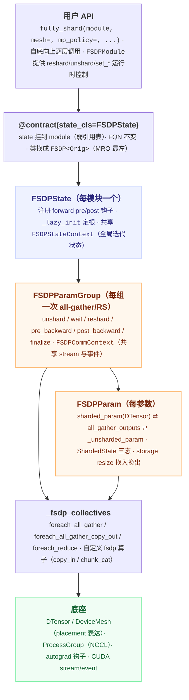
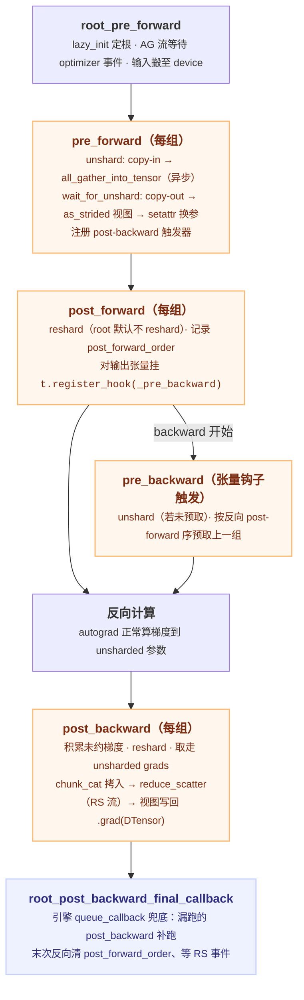
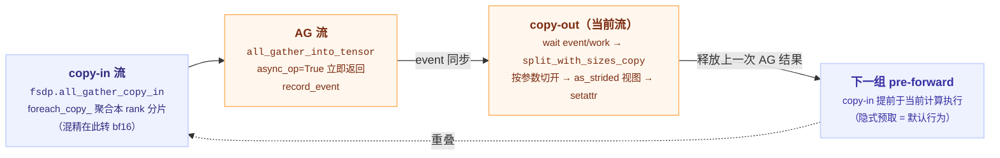

# FSDP 源码阅读指南

> 基于 `D:\project\pytorch` 仓库源码静态阅读（version.txt: `2.8.0a0`，2025-08）。覆盖 FSDP1（`FullyShardedDataParallel`）与 FSDP2（`fully_shard`），以 FSDP2 为主线。

## 一句话理解

> FSDP 把"参数/梯度/优化器状态分片"实现为一个**基于钩子的参数换入换出状态机**：前向/反向的关键节点上，钩子把模块参数从"分片 DTensor"换成"all-gather 出来的完整参数"再换回去，通信（all-gather / reduce-scatter）用独立 CUDA stream 与计算重叠；FSDP2 用逐参数 DTensor 分片重写了这一切，使其可组合、可编译。

## 为什么重要

- FSDP 是当前大模型训练的主流显存方案（ZeRO-3 的 PyTorch 原生实现），torchtitan、HF Trainer、NeMo 等训练栈都以它为底座。
- FSDP2 是 PyTorch 官方主推方向：逐参数 DTensor 分片 + 可组合 API + 与 torch.compile/activation checkpointing/流水线并行的原生协同，读懂它就读懂了新一代分布式训练 API 的设计范式。
- 它是理解"**钩子驱动的运行时**"的最佳样本：没有 wrapper、没有 C++ 引擎（对比 [Reducer 类设计详解](./pytorch-reducer.md)），全部逻辑都在 Python 钩子 + 状态机里，代码量小（`_fully_shard/` 全部 ~3900 行）而密度极高。

## 两个实现，先分清

| | FSDP1 `FullyShardedDataParallel` | FSDP2 `fully_shard` |
|---|---|---|
| 形态 | `nn.Module` wrapper，包一层 | 可组合函数，原模块原地改类，**FQN 不变** |
| 分片单位 | 一组参数 flatten+concat 成一维 `FlatParameter` 再 chunk | 逐参数 dim-0 chunk，每参数一个 DTensor |
| 核心状态 | `_FSDPState` + `FlatParamHandle` | `FSDPState` + `FSDPParamGroup` + `FSDPParam` |
| 注册时机 | 构造函数里 eager/lazy init | `@contract` 挂 state，首次 forward 才 lazy init |
| 内存管理 | `record_stream` + `_FreeEventQueue` 限流 | storage resize（对象复用、别名保持），确定性释放 |
| 与 compile | 需要图断裂配合 | Traceable FSDP2（compiled autograd）全图编译 |
| 状态 | 维护模式 | 主推方向 |

结论：**精读 FSDP2，FSDP1 只读对比所需的部分**（`_flat_param.py` 的扁平化、`_runtime_utils.py` 的钩子注册、`_limiter_utils.py` 的限流队列——后两者与 FSDP2 互为参照）。

## 架构地图

### 源码文件地图（FSDP2 `torch/distributed/fsdp/_fully_shard/`，共 ~3900 行）

| 文件 | 行数 | 职责 | 关键符号 |
|---|---|---|---|
| `_fully_shard.py` | 672 | 入口 API + `FSDPModule` 运行时控制面 | `fully_shard`（:86）、`FSDPModule`（:259）、`register_fsdp_forward_method`（:631） |
| `_fsdp_state.py` | 403 | 每模块状态 + 全部模块级钩子 | `FSDPState`（:73）、`_lazy_init`（:153）、`_pre_forward`（:229）、`_post_forward`（:255）、`_pre_backward`（:282）、`_root_post_backward_final_callback`（:293） |
| `_fsdp_param_group.py` | 769 | 参数组：通信调度与训练状态机 | `FSDPParamGroup`（:111）、`unshard`（:263）、`wait_for_unshard`（:288）、`post_backward`（:391）、`FSDPCommContext`（:49）、`RegisterPostBackwardFunction`（:743） |
| `_fsdp_param.py` | 896 | 单参数：分片/换入换出/梯度积累 | `FSDPParam`（:193）、`_init_sharded_param`（:259）、`init_unsharded_param`（:452）、`ShardedState`（:147）、`alloc_storage`/`free_storage`（:867/:873） |
| `_fsdp_collectives.py` | 661 | 通信原语 + 流水线化拷贝 | `foreach_all_gather`（:164）、`foreach_all_gather_copy_out`（:274）、`foreach_reduce`（:376）、`_get_gradient_divide_factors`（:605） |
| `_fsdp_init.py` | 242 | 收集被管模块/参数、reshard 网格计算 | `_get_managed_modules`（:133）、`_get_post_forward_mesh_info`（:20）、`_move_states_to_device`（:211） |
| `_fsdp_common.py` | 181 | Mesh 信息与共享工具 | `FSDPMeshInfo`/`HSDPMeshInfo`（:60/:82）、`TrainingState`（:88） |
| `_fsdp_api.py` | 75 | 策略数据类 | `MixedPrecisionPolicy`（:9）、`CPUOffloadPolicy`（:59） |

FSDP1 `torch/distributed/fsdp/`（~14.6k 行）：`fully_sharded_data_parallel.py`（:117 类定义）、`_flat_param.py`（`FlatParameter` :202、`FlatParamHandle` :455）、`_runtime_utils.py`（全部钩子实现）、`_init_utils.py`（初始化）、`_exec_order_utils.py`（预取顺序）、`_limiter_utils.py`（`_FreeEventQueue` :7）、`wrap.py`（auto-wrap 策略）、`api.py`（`ShardingStrategy` :33）。

## 核心概念（读懂代码前的最小词汇表）

### 三层对象模型
- **`FSDPState`**：每个 `fully_shard` 调用产生一个（`@contract` 挂到模块，弱引用表存取，见 `torch/distributed/_composable_state.py`）。持有一个 `_fsdp_param_group`，注册模块级 forward 钩子；根状态还共享出 `FSDPStateContext`（所有 state 的列表、迭代根、final callback 去重标志）。
- **`FSDPParamGroup`**：通信分组单位。一次 `fully_shard` 调用把"尚未被任何组认领的参数"收进一组，**组内参数合成一次 all-gather / 一次 reduce-scatter**——所以必须自底向上调用，逐层切组才能做逐层预取与通信/计算重叠。
- **`FSDPParam`**：单参数生命周期。核心是三个张量的换入换出：`sharded_param`（DTensor，注册在模块上、优化器可见）⇄ `all_gather_outputs`（1D 通信缓冲）⇄ `_unsharded_param`（as_strided 视图，前反向计算用）。

### 两套状态机

| `ShardedState`（`_fsdp_param.py`:147，参数级） | 含义 |
|---|---|
| `SHARDED` | 分片参数注册在模块上，参数显存 = 分片大小 |
| `SHARDED_POST_FORWARD` | `reshard_after_forward` 为 int 时，前向后 reshard 到更小 world size 的中间态 |
| `UNSHARDED` | 完整参数注册在模块上（分片数据仍在，参数显存 = 两者之和） |

| `TrainingState`（`_fsdp_common.py`:88，组级） | 驱动钩子行为 |
|---|---|
| `IDLE` → `FORWARD` → `IDLE` | pre/post-forward 钩子窗口 |
| `IDLE` → `PRE_BACKWARD` | pre-backward 钩子窗口（unshard + 预取） |
| `PRE_BACKWARD` → `POST_BACKWARD` → `IDLE` | post-backward（reshard + reduce）窗口 |

### 关键不变量（源码注释明说的三条）
1. **[Note: FSDP and autograd]**（`_fsdp_param.py`:58）：unsharded 参数被动态 free/alloc，autograd 可能已保存其引用——所以用 **storage resize**（`resize_(0)` / `resize_(full)`）而不是换对象，保持别名不变、对象只构造一次。
2. **[Note: Overlapping all-gather copy-in and all-gather]**（`_fsdp_param_group.py`:37）：all-gather 输入是输出的视图，因此下一次 copy-in 必须写到不同内存——把当前 AG 结果的引用延迟到下一次 copy-out 之后再释放。
3. **[Note: Avoiding functionalization]**（`_fsdp_param.py`:84）：`fsdp.copy_` 与 `inductor.resize_storage_bytes_` 保持非函数化（图中间的 mutation op），规避 AOTAutograd 对"别名+mutation+subclass"组合的不支持；性能损失由 Inductor 后处理 pass 删掉 `resize_(full)→copy_→resize_(0)` 模式找回。

## 工作原理：一次迭代的完整生命周期

### 1. 初始化：两段式

**构造期**（`fully_shard`，`_fully_shard.py`:86）：`@contract` 装饰器把 `FSDPState` 挂到模块 → `_get_managed_modules` DFS 收集"没被内层 fully_shard 认领"的子模块（遇内层组即停，这就是自底向上分组的实现）→ `_move_states_to_device` 搬参数/buffer 到 device → 构造 `FSDPParamGroup`（每个 `FSDPParam._init_sharded_param` 立即做 dim-0 chunk + pad，把模块参数原地换成 sharded DTensor）。最后把模块 `__class__` 换成动态生成的 `FSDP<Orig>`（`FSDPModule` 放 MRO 最左，`:242-249`）——**不换类就拿不到 `reshard()/unshard()` 等方法，但不换类就无法保持 FQN 与 isinstance 兼容，这是个精巧折中**。

**lazy init**（首次 forward，`_fsdp_state.py`:153）：第一个跑 forward 的 state 自封为根，遍历模块树找出所有 state，共享 `FSDPStateContext` + `FSDPCommContext`，根组的 `post_forward_mesh_info` 置 None（root 前向后立即反传，reshard 纯浪费）。

### 2. unshard：两阶段异步 all-gather

`FSDPParamGroup.unshard`（`:263`）只是发通信不等结果；`wait_for_unshard`（`:288`）才做 copy-out 并换参：

`FSDPCommContext.lazy_init`（`_fsdp_param_group.py`:52）建 4 条高优先级流：`all_gather_copy_in_stream`、`all_gather_stream`、`reduce_scatter_stream`、`all_reduce_stream`（HSDP 用，与 RS 走不同网络资源可并行）。预取两级：**前向隐式预取**（每组 pre-forward 顺带发起下一组的 copy-in）+ **反向显式预取**（`_backward_prefetch` 按 `post_forward_order` 的逆序发起上一组 unshard，`:512`）。用户可用 `set_modules_to_forward_prefetch/backward_prefetch` 覆盖为手动调度。

### 3. reshard 与 `reshard_after_forward`

- `True`（非根默认）：post-forward 即 `to_sharded()`，`free_unsharded_param()` 把 AG 输出 storage `resize_(0)`，反向重新 all-gather——显存最低、通信最多。
- `False`（根默认）：反向免 all-gather。
- `int k`：`_get_post_forward_mesh_info`（`_fsdp_init.py`:20）构造一个 k 列的 post-forward DeviceMesh，post-forward 只 clone 出本 rank 在小网格里的分片（`to_sharded_post_forward`），反向只需在小网格内 all-gather——**用 $1/k$ 的额外显存换反向通信量降为 $1/k$**，典型取值是节点内卡数。

### 4. post_backward：reduce-scatter 流水线

`FSDPParamGroup.post_backward`（`:391`）在"该组最后一个参数梯度算完"时触发（触发机制见下节），依次：
1. 合并混精积累的梯度（`accumulate_unsharded_grad_if_needed`）；
2. 先 reshard 再取走 unsharded 梯度引用（顺序刻意如此：先释放参数显存，再为通信分配缓冲）；
3. `foreach_reduce`（`_fsdp_collectives.py`:376）：`chunk_cat` 一次性把所有梯度拷进 1D RS 输入 → RS 流上 `reduce_scatter_tensor` → 除法/换 dtype → `as_strided` 直接把 RS 输出的分片**视图**赋给 `sharded_param.grad`（包成 DTensor，零拷贝）。

除法策略（`_get_gradient_divide_factors`，`:605`）值得细读：fp32/bf16 直接用 NCCL `ReduceOp.AVG`（零额外 kernel）；自定义 factor 走 `_make_nccl_premul_sum`；fp16 有溢出风险时按 $\sqrt{N}$ 拆成 pre/post 两次除。HSDP 在此之上于 `all_reduce_stream` 上做跨节点 all-reduce，还可积累部分约简结果（`set_requires_all_reduce(False)` 实现"只 RS 不 AR"的梯度积累）。

### 5. 触发机制：三种 post-backward 入口

这是 FSDP2 最容易迷惑的地方——谁来调 `post_backward`？三条路按场景择一：
1. **`RegisterPostBackwardFunction`**（`_fsdp_param_group.py`:743）：pre-forward 把 forward 输入包进一个 `autograd.Function`，其 `backward` 调 `post_backward`。这是 eager 默认路径（`skip_fsdp_hooks=True` 时经 `_register_post_backward_hook` 注册，`:585`）。
2. **引擎回调兜底**：`_pre_backward` 通过 `Variable._execution_engine.queue_callback` 排 `root_post_backward_final_callback`（`_fsdp_state.py`:293），补跑没被触发的组（如 forward 输入不 require grad）。
3. **Traceable FSDP2**：编译场景下不能动态插 autograd.Function，改为在下一次 `pre_backward` 里补触发上一次未执行的 `post_backward`（`pre_backward` 开头的 compiled-autograd 分支，`:372-379`）。

## FSDP1 对照读法（只看四件事)

1. **FlatParameter 扁平化**（`_flat_param.py`:202, :812）：多参数 concat → pad → chunk，`_param_infos`/`_shared_param_infos` 记录还原映射；`_use_unsharded_views`（`:1914`）用视图 setattr 还原原参数——对比 FSDP2 的 per-param as_strided，理解为什么"分片表示复杂、state dict 要 all-gather"。
2. **钩子注册**（`_runtime_utils.py`:1412）：FSDP1 挂钩在 **AccumulateGrad 节点**上（`flat_param.expand_as().grad_fn.next_functions[0]` 拿节点再 `register_hook`）——与 [Reducer 类设计详解](./pytorch-reducer.md) 同款手法；FSDP2 换成对**输出张量** `t.register_hook` + `autograd.Function`，两者对照着看能体会"参数侧钩子"与"数据侧钩子"的取舍。
3. **`limit_all_gathers` 限流**（`_limiter_utils.py`:7 `_FreeEventQueue`，最多 2 个 in-flight AG）：FSDP2 用 storage resize + 延迟释放引用替代了 CPU 限流，官方文档明确说这是为了确定性内存与不阻塞 CPU。
4. **执行顺序记录**（`_exec_order_utils.py`）：FSDP1 用 FX trace 预推执行序；FSDP2 直接运行时记录 `post_forward_order`——简化是 FSDP2 的主旋律。

## 与编译栈的协同（进阶专题）

- **默认路径**：`torch._dynamo.config.skip_fsdp_hooks = True`（`torch/_dynamo/config.py`:335），FSDP2 钩子整体 `torch._dynamo.disable`，Dynamo 在钩子处断图（`torch/_dynamo/trace_rules.py`:3364 控制 inline 白名单）。FSDP 逻辑留在 eager，被包的 forward 进图。
- **Traceable FSDP2**：`skip_fsdp_hooks=False` + compiled autograd，反向整图捕获。三条不变量见 `init_unsharded_param` 的 [Note: Invariants for torch.compile Traceable FSDP2]（`_fsdp_param.py`:452）：每轮重建 AG 输出、unsharded 参数走 `resize_(full)→fsdp.copy_→resize_(0)` 慢路径。性能由 Inductor 后处理 `remove_fsdp2_unsharded_param_graph_input_usage`（`torch/_inductor/comms.py`:567，经 `fx_passes/post_grad.py`:96 挂载）删除这对 resize/copy 找回。
- **行为规范在测试里**：`test/distributed/_composable/fsdp/test_fully_shard_compile.py`（1155 行）是"FSDP2 × compile 语义"的权威规约，比文档细得多。AOTAutograd 侧的子类处理另见 [07 AOTAutograd 中间层](./torch-compile-wiki/07-aotautograd.md)。

## 读码路线图

由外到内、由主径到分支，预计 5 个阶段：

**阶段 0：先建立用户视角（半天）**
- `docs/source/distributed.fsdp.fully_shard.md`——官方用户契约（FQN 不变、自底向上、DTensor 参数）。
- `test/distributed/_composable/fsdp/test_fully_shard_state.py` + `test_fully_shard_training.py`——最小行为样本。

**阶段 1：入口与初始化**
1. `_fully_shard.py:86-250` `fully_shard` 主体（构造期全貌）。
2. `_fsdp_init.py` 全文（分组、managed states、post-forward mesh）。
3. `_fsdp_param.py:259-393` `_init_sharded_param`（分片 + pad + DTensor 包装；DTensor 入参的 TP 分支可先跳过）。
4. `_fsdp_state.py:153-201` `_lazy_init` + `_init_shared_state`。

**阶段 2：前向主径（核心）**
5. `_fsdp_state.py:120-280` 三个 forward 钩子。
6. `_fsdp_param_group.py:263-342` `unshard` / `wait_for_unshard` / `reshard`——本阶段最难，对照 [Note: Overlapping all-gather copy-in and all-gather]。
7. `_fsdp_param.py:437-589` AG 输出初始化、`init_unsharded_param`、三态切换。
8. `_fsdp_collectives.py:164-372` 两个 foreach 函数。

**阶段 3：反向主径**
9. `_fsdp_state.py:282-352` pre-backward / final callback。
10. `_fsdp_param_group.py:372-524` `pre_backward` / `post_backward` / `finalize_backward` / 预取。
11. `_fsdp_collectives.py:376-660` `foreach_reduce` + 除法策略。
12. `_fsdp_param.py:629-674` 梯度积累与释放。

**阶段 4：进阶分支（按需）**
13. 编译协同（上文专题）+ `test_fully_shard_compile.py`。
14. HSDP（2D mesh）、`reshard_after_forward=int`、CPU offload、`ignored_params`。
15. all-gather 扩展协议 `fsdp_pre_all_gather`/`fsdp_post_all_gather`（量化/FP8 参数接入点，`_fsdp_param.py:677`）。
16. FSDP1 对照（四件事清单）+ `_fully_shard` 之外被依赖的 `contract.py`。

## 实验与调试手段

- **日志**：`TORCH_LOGS=fsdp` 打印每次迭代的 `FSDP::root_pre_forward / pre_forward (i) / post_forward / pre_backward / post_backward / root_post_backward`，标签带组 FQN（`_with_fqn`），是验证钩子顺序的第一工具（测试样例 `test_fully_shard_logging.py`）。
- **profiler**：所有关键函数包了 `torch.profiler.record_function`，同名字段直接出现在 trace 里。
- **显存归因**：`torch/distributed/_tools/fsdp2_mem_tracker.py`（`FSDPMemTracker`）按 Sharded/Unsharded Param、AG/RS 缓冲等类别统计。
- **单测即规约**：`test/distributed/_composable/fsdp/` 16 个文件按主题切分（init/training/comm/overlap/memory/mixed_precision/frozen/compile…），改代码前先读对应主题的测试。

## 我的理解

- **FSDP2 的本质是"参数的 swap-in/swap-out 缓存管理器"**：分片参数是" home"，unsharded 参数是按需换入的缓存，storage resize 让换出零拷贝且不破坏 autograd 已存的引用。整个 `_fully_shard/` 就是在管理这个缓存的命中率（预取）与生命周期（三态状态机）。
- **可组合性是靠"三分离"买来的**：API 层（contract + 原地改类）与状态分离、通信分组（ParamGroup）与模块层次解耦、分片表示（DTensor placement）与通信实现解耦。代价是正确性完全押在钩子触发顺序与状态机上——所以有三条 post-backward 入口互相兜底。
- **与 DDP 的镜像关系**：DDP 参数常驻、梯度临时归约（C++ Reducer 事件驱动）；FSDP 参数临时组装、梯度即时分片（Python 钩子驱动）。两者钩子挂点（AccumulateGrad vs 输出张量）、通信原语（all-reduce vs all-gather/reduce-scatter）正好互补，合起来才是完整的数据并行图景。
- **内存确定性是硬需求**：FSDP1 的 `record_stream` + 限流队列在多流场景下显存不可预期；FSDP2 用"对象只建一次 + resize 换入换出 + 显式 event 传递"把每字节的生灭都写成确定性的——这是它能成为训练大模型默认方案的工程底座。

## 开放问题（我尚未验证）

- `_StridedShard` 在 FSDP×TP 2D/3D mesh 下的 placement 运算细节（`_init_sharded_param` 的 DTensor 分支）。
- `fsdp_pre_all_gather`/`fsdp_post_all_gather` 扩展协议与 FP8 量化的实际接入方式。
- Traceable FSDP2 在 partial-graph（前向部分编译）时的退化行为，`RegisterPostBackwardFunction._assert_not_tracing_fsdp` 报错信息暗示有约束。
- post-forward mesh（int reshard）与 HSDP replicate 维度合并的网格 view 逻辑（`_get_post_forward_mesh_info`）。

## Related

- [torch.distributed 分布式训练](./pytorch-distributed.md) — FSDP 所处的整体分布式栈与 c10d 底座
- [Reducer 类设计详解](./pytorch-reducer.md) — DDP 的对照实现：同样是钩子驱动，C++ vs Python 两种写法
- [torch.compile 编译栈](./pytorch-compile.md) — skip_fsdp_hooks / Traceable FSDP2 / Inductor 后处理 pass
- [07 AOTAutograd 中间层](./torch-compile-wiki/07-aotautograd.md) — DTensor 子类在编译下的处理
- [torch.autograd 自动微分](./pytorch-autograd.md) — 张量钩子、AccumulateGrad、queue_callback 的机制基础

## References

- 源码：`torch/distributed/fsdp/_fully_shard/`（FSDP2，8 文件）、`torch/distributed/fsdp/`（FSDP1）
- 底座：`torch/distributed/_composable/contract.py`、`torch/distributed/_composable_state.py`、`torch/distributed/tensor/`（DTensor/DeviceMesh）
- 编译协同：`torch/_dynamo/config.py`（skip_fsdp_hooks）、`torch/_dynamo/trace_rules.py`、`torch/_inductor/comms.py`（remove_fsdp2_unsharded_param_graph_input_usage）
- 官方文档：`docs/source/distributed.fsdp.fully_shard.md`（用户契约）、`docs/source/fsdp.md`（FSDP1 API）、FSDP2 RFC（pytorch/pytorch#114299）
- 测试规约：`test/distributed/_composable/fsdp/`（16 文件，~8.9k 行）
