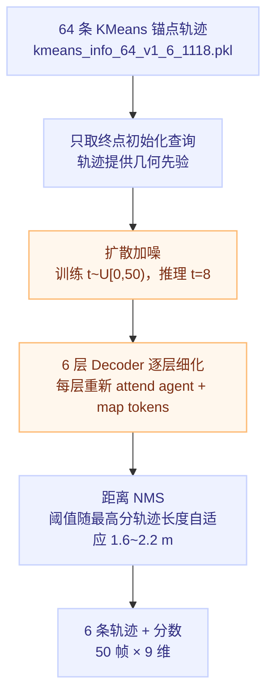

# 锚点扩散解码器：64 条锚点怎么变成 6 条轨迹

## 一句话理解

Encoder 负责"看懂场景"，Decoder 负责"写出答案"：用 KMeans 从训练集聚出 **64 条常见走法（锚点）**当查询先验，加轻噪声后经 **6 层 cross-attention 逐层细化**（扩散式去噪），每层输出 64 条候选轨迹，最后 NMS 挑出差异最大的 **6 个 mode**。

## 为什么重要

- 展示了扩散模型在**判别式预测任务**（而非图像生成）上的用法：未来本身是多峰的（等灯/变道/绕行），锚点提供先验，加噪迫使模型学会"从模糊锚点收敛到精确轨迹"
- 训练与推理的不对称设计（训练随机 t、6 层全监督；推理固定 t=8、只走 1 步 DDIM）是工程上很典型的一课
- "evolving anchors"——用上一层的预测当下 一层的锚点——是逐层细化思想的具体实现

## Decoder 流程



每层解码器内部：

- **Agent Cross-Attention**：64 个查询 attend 周围 agent tokens
- **Map Cross-Attention**：查询 attend 地图/箭头/导航 tokens
- **Time Modulation**：扩散时间步 embedding 经 AdaLN 注入每层
- **预测头**：分数 / $(x, y, \sigma_x, \sigma_y, \rho)$ / 速度 / 朝向 sin-cos

## 训练与推理的不对称

| | 训练 | 推理 |
|---|---|---|
| 时间步 t | 随机 $t \in [0, 50)$ | 固定 $t = 8$（轻噪声） |
| 采样步数 | 6 层都预测干净轨迹 | **1 步 DDIM** |
| 加噪空间 | 归一化坐标 $[-1,1]$（轨迹先仿射、加噪、clamp，再 inverse 回米制） | 同左 |
| 监督 | 每层各算一次 loss 取平均 | 无 |

三个容易误解的细节：

1. **这里的 6 层是 Decoder 层，不是 6 次扩散采样**。扩散调度器虽有 1000 步，但训练只在最前面 50 步采样——锚点本身已是"像样的轨迹"，只需学轻噪声下的去噪，高噪声区不训练。
2. **正样本逐层换**（`num_inter_layers = 2`）：第 1~2 层拿 KMeans 锚点终点和 GT 终点比距离；第 3~4 层改用第 2 层的预测、第 5~6 层改用第 4 层的预测。所以正样本不是固定某一条，而是逐层演进的（evolving anchors）。
3. **扩散发生在归一化空间**：轨迹先仿射到 $[-1,1]$（$x \in [-64, 160]$ / $y \in [-32, 32]$）再加噪并 clamp，然后 inverse 回米制才做位置编码送进注意力。网络算的仍是米制轨迹。

## Encoder / Decoder 命名辨析

- **Encoder 把"东西"变成"理解"，Decoder 把"理解"变成"答案"**
- 两个常见误会：① 编码≠压缩变小——377×256 比原始输入还大，只是换格式；② 这里的 Decoder 不复原输入——经典 autoencoder 的 decoder 做"解压还原"，而它生成的是输入里根本不存在的未来轨迹。名字来自机器翻译：中文进、英文出，本来就是两种东西。

## 代码映射

```python
# 解码器的 64 个查询分别去 attend 两组 token
diffusion_decoder.py:288
apply_cross_attention(query, kv, ...)
# 训练时随机时间步加噪；推理固定 t=8 只走 1 步 DDIM
diffusion_decoder.py:642
timesteps = torch.randint(0, 50, ...)
# 推理见 diffusion_decoder.py:788 :812
# 逐层监督：6 层各算一次 loss 再取平均
predictors/diffusion_bst.py:345
get_decoder_loss()
```

## 我的理解

- **"为什么用扩散"的答案不是生成质量，而是多峰未来**：单点回归会在等灯/变道的分叉处取平均，输出一条谁都不是的轨迹；锚点+分数+扩散让每种走法各占一条候选。
- **1 步 DDIM 的底气来自锚点质量**：起点已经是合理轨迹，模型只需学"轻微扰动→干净轨迹"的映射，所以不需要迭代采样。这和图像扩散从纯噪声起步完全不同。
- **逐层监督是 1 步推理能成立的隐含前提**：每一层都被迫能给出合理结果，否则最后一步拿到的 $x_{start}$ 会很差。

## Limitations

- 当前配置 `skip_prediction: true`，只规划自车，不预测其他 agent（代码支持联合预测）
- 锚点集是离线 KMeans 聚的，分布外场景（锚点没覆盖的走法）只能靠扩散细化补救
- NMS 阈值按最高分轨迹路径长度自适应（1.6~2.2 m），密集等灯场景可能把真实不同的慢速候选合并掉

## Related Knowledge

- [六路 token 注意力编码](./six-modality-attention-encoder.md) — 本篇的输入来源
- [轨迹预测的 Loss 与评测指标](./trajectory-loss-and-metrics.md) — 正样本怎么选、GMM NLL 在罚什么
- [DDIM](../ai/foundations/diffusion/ddim-paper.md) — 1 步采样的理论来源（非马尔可夫前向过程、训练-推理解耦）
- [Attention 头变体](../ai/attention-head-variants.md) — cross-attention 的 Q 来自 64 查询、K/V 来自编码器输出
