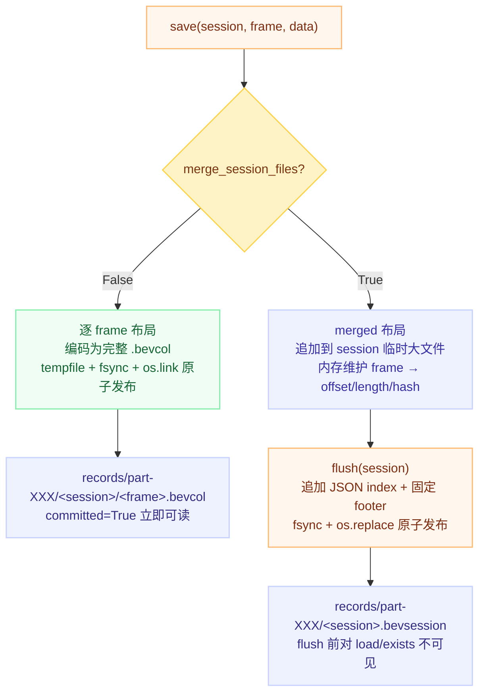

# BEV Data Manager：本地版本化列式存储设计解析

## 一句话理解

一个只依赖 CPU、基于 POSIX 文件系统的小型**版本化列式存储**：把"一个数据字段"抽象为带不可变 schema 的 `column`，每条数据由 `(column, version, session_id, frame_id)` 四元组唯一寻址，写入后字节不可变、五道校验可独立验证、`fsync + os.replace` 原子发布——让 BEV 离线特征导出这种"每个实验几十万条小记录"的数据，像代码一样有版本、可复现、损坏可检测。

## 为什么重要

- **实验可复现靠数据可复现**：训练不可复现的根因大头是数据版本混乱；`(name, version)` schema 一旦落盘不可变，旧实验永远不会在无提示下读到不同编码的特征。
- **离线特征导出是小文件灾难现场**：几十万 frame × 每 frame 一个 array，直接落盘会制造海量小文件 + 宽目录；hash 分桶 + merged session 把它变成可控的顺序大文件。
- **训练侧对 IO 有硬契约**：temporal 模型要连续帧窗口，缺一帧就会静默学错——"严格窗口、绝不返回短窗口"把缺帧从隐式 bug 变成显式异常。
- **工作项目落地**：它是[自动驾驶训练数据管理](./data-management.md)原则（版本化、清单驱动、原子发布）在单机存储层的具体实现。

## 核心契约与四条不变量

> 每条记录由 `(column_name, column_version, session_id, frame_id)` 唯一寻址，写入后字节不可变、可独立校验、可原子读取。

所有模块都为这四条不变量服务：

1. **Schema 不可变**：`(name, version)` 落盘后永不修改，改行为 → 新 version；digest 不一致抛 `ColumnSchemaConflictError`。
2. **写入原子**：读方永远看不到半写文件（`tempfile + fsync + os.link/os.replace`）。
3. **读前必验**：`load` 过 magic/版本 → 长度 → SHA-256 → schema digest → codec 五道校验，损坏抛 `DataCorruptionError`，绝不"尽量还原"。
4. **复现性**：decode 只依赖 record 自身 metadata + schema，不依赖写方进程状态。

## 三种 serialization 模式

| 模式 | payload | dtype/量化 | `logical_nbytes` 语义 |
|---|---|---|---|
| `array`（默认） | 裸 C-order 字节，可量化/压缩 | `fp16/fp32/int32` 逻辑 × `fp16/fp32/int8/int32` 物理 | 数组字节数 |
| `pickle` | protocol 5 pickle 流（支持自定义 `serialize()`/`deserialize()` 协议） | 必须 `dtype=None` | 未压缩 pickle 流长度 |
| `image`（v0.2.0） | save 时 OpenCV 编码 JPEG/PNG 字节 | 必须 `dtype=None`；通道序原样保存不转换 | **源 uint8 字节数**（保持"逻辑→物理"比值语义统一） |

关键设计：**payload 模式与信封正交**。所有模式共享同一个 record 信封 `[magic][version][长度][SHA-256][canonical JSON metadata][payload(可 zstd 压缩)]`，信封不懂 payload 内容——所以 image 模式接入时，信封、checksum、压缩、session 存储层零改动。

## 两种物理布局

布局由 schema 字段 `merge_session_files` 决定，创建后不可变；"record 格式"和"record 如何组织成文件"是两个层次，两种布局里的 record 都是同一个信封格式。



| | 逐 frame | merged session |
|---|---|---|
| 正式文件 | 每 frame 一个 `.bevcol` | 每 session 一个 `.bevsession` |
| 覆盖策略 | `error` / `idempotent` / `replace` | 必须 `replace`（整 session 重建后原子替换） |
| append 顺序 | 不持久化 | 持久化在 index 中 |
| `load_sequence()` | 不支持 | 支持，严格窗口 |
| 适合 | 单帧独立重试/替换 | session 多、减少小文件、连续读 |

**连续性由 append offset 定义，与 frame_id 字典序无关**——`load_sequence(start, count)` 从 start 开始按追加顺序取严格 `count` 条，不足即抛 `DataNotFoundError`，绝不返回短窗口。frame ID 因此不必是数字。

**读旧 inode snapshot**：`load()` 从打开 fd 的文件末尾读 footer/index——持有 fd 期间即使另一个 writer `os.replace` 了同路径，当前 reader 仍看到完整自洽的旧版本，不混读新旧。

## Hash 分桶

```python
slot = int.from_bytes(hashlib.sha256(session_id.encode()).digest(), "big") % 256
bucket = f"part-{slot:03d}"   # part-000 ... part-255
```

对**完整 session_id 字符串**（可含 `route/one` 这类嵌套相对路径）做 hash，同一 session 全部 frame 落同一分桶；`records/` 不再是宽目录，session 目录仍可读。绝对路径、`.`、`..` 被拒绝；旧未分桶布局 `records/<session>/...` 不做静默回退。

## 分层架构

```text
DataMgr（门面：URI 分派 + schema JSON 持久化 + digest 冲突检查，不碰 record 字节）
  → ColumnHandler（唯一 IO 层：四元组寻址、encode→原子发布、load→校验解码）
      ├─ SessionFileStorage（仅 merged 模式组合：追加/索引/flush 原子替换）
      └─ codec.py 纯函数层（无 IO：值 ↔ bytes + 五道校验）
          └─ schema.py ColumnSchema（frozen dataclass：校验+归一化+digest，无状态）
storage.py RecordStore 接缝（0.3.0）：LocalRecordStore / S3RecordStore，key 布局一致、字节跨后端兼容
```

**越往下越"纯"**：codec 无 IO、schema 无状态、字节落位集中在 RecordStore 接缝——所以 S3 backend 接入时 ColumnHandler/SessionFileStorage/codec 零改动，测试可在任意一层切入。

**Schema 的 digest 即身份**：`digest = sha256(canonical_json(to_dict()))`，重开 column 只比 digest 不比字段。这意味着新增 schema 字段时 `to_dict()` 必须对旧模式 pop 掉新 key（如 `merge_session_files`、`serialization`、`image_*`），否则所有历史 column 第二次打开就冲突。三种模式共享的校验留在 `__post_init__`，差异收敛到各自的 `_validate_*`；新增第四种模式要同步改五处（常量集 → 分支 → `_validate_*` → `create()` → `to_dict` pop），漏一处就在 digest 或校验上出洞。

**错误模型按语义划分，missing ≠ conflict ≠ corruption**：

| 异常 | 语义 | 调用方反应 |
|---|---|---|
| `DataValidationError` | 输入/配置不合法（写前失败） | 修代码，不该重试 |
| `ColumnNotFoundError` / `DataNotFoundError` | 目标不存在 | 跳过或报缺 |
| `DataAlreadyExistsError` / `DataConflictError` | 写冲突（error / idempotent 策略） | 换 key 或核实内容 |
| `ColumnSchemaConflictError` | schema 冲突 | 新建 version |
| `DataCorruptionError` | 落盘字节过不了校验 | 告警 + 定位损坏源 |

看到 `DataCorruptionError` 就意味着字节曾经写成功、后来变了——排查数据链路的强信号。

## 存储模式与量化

int8 对称 per-tensor 量化（有损，`scale = max(abs(x)) / 127`）；float→int32 量化（`scale = max(abs(x)) / 2147483647`，高精度有损）；`int32→int32` 是无损原始整数。scale 与 zero point 存进每条 record metadata，`load()` 恢复逻辑 dtype。**int8 拒绝 NaN/Inf**（该格式无法无损表示）；压缩固定 Zstandard level 3。

## BEV 特征导出集成

`save_bev_feats_singleframe` 启用独立于通用 postprocess 的 dump 路径，数据流：

```text
model output → 推理主线程显式 detach().cpu() → 有界 queue(2)
  → 单个后台 writer thread（无多进程、无 session→worker 映射、不跨进程 pickle Tensor）
  → 可同时持有多个 active session，dataset 的 is_last_frame_in_session=True 触发 flush
```

- 单 writer thread 主动满足"同一 session 不允许并发 writer"的约束；
- `--nf` 截断路径保留已 flush 的完整 session、abort 未收到末帧的 session，不发布缺帧文件、不把截断误判为 writer failure;
- 异常时显式 `abort()`，不依赖析构；
- 遗留 `.tmp` = 未完成 writer 的信号，不能手动改名为 `.bevsession`。

## 并发边界与安全边界

- **单 writer 假设**：同一 `(column, version, session_id)` 不允许多 writer 并发构建（本地靠 `os.link` 保证一方失败；S3 head-then-put 有 TOCTOU 窗口）；跨进程协调交给任务调度层。
- **pickle 只限可信链路**：`pickle.loads()` 能执行任意代码，SHA-256 只防意外损坏，不建立安全边界。
- **S3 语义差异**：merged 追加仍写本地 temp、flush 整体 `upload_fileobj`（失败保留暂存文件，重调 `flush` 即重试）；读取整对象进内存；网络错误原样上抛、不映射为 corruption。

## 我的理解

- **这个包的本质是"把数据库的三条保证（寻址、不可变、原子）搬进 POSIX 文件系统"**，但没有 catalog、没有事务、没有锁——每个保证都由文件系统原语（rename/link/fsync）+ 文件格式（checksum/footer）+ 调用纪律（单 writer）拼出来。它清楚的知道自己不是分布式系统：并发边界、S3 的 TOCTOU、pickle 的安全边界都显式声明为"调用方负责"，而不是假装能兜住。
- **schema digest + `to_dict` pop 是"向后兼容的代价"最具体的样本**：身份只看 digest 意味着 canonical 表示必须从第一天起就稳定——后来者每加一个字段，都要替所有历史模式写 pop 规则。这提示我：设计持久化格式时，"什么不进 digest"和"什么进 digest"同等重要。
- **"严格窗口、绝不返回短窗口"是接口设计里"fail loud"哲学的好例子**：返回 `[]` 或短列表的接口会把缺帧变成下游 temporal 模型的静默 bug；抛异常则把数据完整性问题推到正确的层暴露。
- **信封与 payload 正交是扩展性来源**：image 模式零改动接入、S3 backend 零改动接入，都因为字节格式和字节去向是两个独立变化维度。判断改动安全的三问——旧 digest 变了吗？旧 record 还能 decode 吗？错误语义还对吗？——适用于任何持久化格式演化。

## Limitations

- 单机/单 writer 组件：无跨进程锁、无 revision 合并、无 catalog/快照/manifest 服务（均列入计划扩展，不能当作现有 API 依赖）。
- merged writer 为每个 active session 保留完整内存 frame index，极长 session 或大量并发 active session 会占内存与 fd。
- 无预取、跨 session batch I/O、本地 SSD cache；S3 读取是整对象进内存，大 session 占 RAM。

## Related Knowledge

- [自动驾驶训练数据管理最佳实践](./data-management.md) — 本组件遵循的通用原则版（版本化、清单驱动、分层存储）
- [自动驾驶数据集 Meta DB V2 设计解析](../engineering/meta-db-v2-design.md) — 同一数据体系的元数据索引层；本组件管"数据本体字节"，Meta DB 管"哪些 session/frame/label 可用"
- [端到端轨迹预测的训练闭环与数据管线](./e2e-training-pipeline.md) — 消费侧：训练循环如何按 rank 预分片读列存
- [面向 AI 训练与多云场景的存储工程地图](../distributed-systems/distributed-storage/ai-training-and-multicloud-storage-map.md) — 对象存储/并行文件系统/缓存的底层原理
- [对象存储](../distributed-systems/distributed-storage/object-storage.md) — S3 backend 语义差异（head-then-put、TOCTOU）的通用背景
