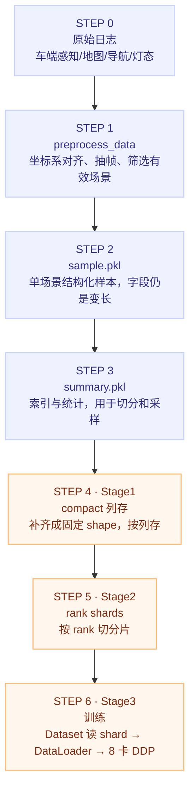

# 端到端轨迹预测的训练闭环与数据管线

## 一句话理解

训练 = **step 级循环**（batch → 前向 → 6 层平均 loss → 8 卡 all-reduce → 裁剪 → AdamW → lr 前进一格）× **epoch 级循环**（验证 → 指标聚合 → Excel → checkpoint）跑 16 轮；数据 = 三阶段预处理，把变长原始日志变成每个 GPU rank 预先分好的列存 shard。

## 当前训练配置

| 项 | 值 | 说明 |
|---|---|---|
| 并行 | 8 × DDP | 反向时梯度 all-reduce，等效 batch = 2048 |
| batch size | 256 / 卡 | lr 不会随卡数自动放大，仍是 5e-6 |
| 精度 | 32-true | 不启用混合精度——扩散的加噪/去噪对精度较敏感 |
| 优化器 | AdamW | lr 5e-6，weight decay 0.01 |
| lr 调度 | step 单位 | 前 12.5% step 线性升温，之后余弦降到 0（`lr_update_unit: "step"`） |
| epochs | 16 | 每 epoch 跑一次 val |
| 梯度裁剪 | 0.5 | |
| 历史 / 未来 | 11 帧（1.1s）/ 50 帧（5s @10Hz） | |

## 两个频率的循环

**每个 step**（每卡每批一次）：

```text
取 batch(256 样本) → 组六路输入 [B,377,256]
→ Encoder 6 层自注意力
→ Decoder 6 层, t~U[0,50) 加噪
→ 6 层 loss 取平均
→ 反向(8 卡 all-reduce 梯度)
→ 梯度裁剪 0.5
→ AdamW 更新
→ lr 前进一格
```

**每个 epoch**：

```text
跑完所有 step → val 集跑一遍 → 指标跨卡聚合(sync_dist)
→ 写 metrics Excel → 存 checkpoint
```

lr 是逐 step 走的：总 step 数由 `estimated_stepping_batches` 算出，不是每个 epoch 调一次。

## 数据管线：从原始日志到可训练 shard



**为什么要分阶段**：原始日志变长、读取慢、不方便按 rank 均分。Stage1 把 shape 固定下来，Stage2 把数据切好，训练时每个 rank 只读自己那份，避免多卡抢同一批文件——这也是"清单/引用驱动训练"原则的落地：summary.pkl 记录 `sample_path + tags + 速度统计 + aug 元数据`，训练时通过 `exclude_tags / include_tags / tag_combinations / target_ratios` 做选行与配比（如左/右转 ×5 上采样）。

数据侧的其他关键件：

- **采样**：`SlidingWindowSampler`、`scene_weighted_sampler`、`boost_weights`（左/右转 ×5）
- **增强**（InputBuilder）：场景中心化、刹车重定时、坡道/加塞/VRU 交互、状态扰动
- **一个真实样本**：77 agent × 61 帧 × 12 维；46 条折线 × 20 点 × 6 维；200m 导航线；14 个箭头；红绿灯；50 帧 GT
- **parity 校验**：`verify_compact_parity.py` 逐行对比源 pkl，保证列存转换无损

## 代码地图（职责速查）

| 目录/文件 | 职责 |
|---|---|
| `run.py` | 入口，按 action 分发 fit/finetune/validate/test/inference/export_onnx/shadow_test（Hydra 覆盖任意配置） |
| `configs/experiment/*.yaml` | 每个实验一份自包含配置，注释记录实验归因 |
| `preprocess_data/` | 原始日志 → 场景 pkl |
| `datasets/` + `datamodules/` | 解析 summary、compact 索引、rank shard、采样与 collate |
| `transforms/` | InputBuilder 生成模型输入；数据增强与场景中心化 |
| `predictors/` | 模型元架构：组装 Encoder + Decoder，计算 loss（`DiffusionBstModel`） |
| `modules/encoders/` · `modules/decoders/` | 各模态编码 + 全局 Transformer；锚点/扩散/逐层细化/NMS |
| `lightning_wrapper/` | Lightning 训练循环、优化器、指标聚合、checkpoint |
| `losses/` · `metrics/` | NLL/BCE/辅助损失；minADE/minFDE/MissRate/Comfort/Progress |
| `scripts/` | 三阶段数据与训练启动（`aliyun_convert.sh → prepare → train`） |
| `utils/export_onnx.py` | 导出动态轴或静态融合 ONNX，供车端 TensorRT（`E2EDStaticFLOATModel`） |
| `tools/shadow_badcase_mining.py` | 离线 badcase 挖掘（`action=shadow_test`） |

## 我的理解

- **三阶段数据管线的核心动机是"解耦预处理与训练"**：训练循环里最怕的是 IO 抖动，把变长解析一次性做完、按 rank 均分列存，训练时 IO 就是可预测的顺序读。
- **rank shard 是"数据并行"在存储维度的对偶**：梯度按卡 all-reduce，数据按 rank 预先切分——两边的切分粒度对齐后，worker 之间才没有共享文件竞争。
- **32-true 是个值得记住的反直觉选择**：默认直觉是上 bf16 省显存，但扩散训练的加噪/去噪链路对小数值误差敏感，这里用精度换稳定。
- **配置即实验归因**：每个实验一份自包含 yaml、注释记录归因，这和"数据像代码一样版本化"是同一个工程哲学——可复现性靠约定而不是靠记忆。

## Limitations

- 配置与文件名对齐 `v2_5_12_f2_13` 实验，随迭代演进
- 管线描述基于该仓库结构，通用经验是"固定 shape + 列存 + rank 预分片"，具体脚本名不通用

## Related Knowledge

- [六路 token 注意力编码](./six-modality-attention-encoder.md) — 训练循环里前向的内容
- [锚点扩散解码器](./anchor-diffusion-decoder.md) — step 级循环里 Decoder 的细节
- [轨迹预测的 Loss 与评测指标](./trajectory-loss-and-metrics.md) — "6 层 loss 取平均"的具体构成
- [自动驾驶训练数据管理](./data-management.md) — 本篇数据管线的通用原则版
- [Muon 优化器](../ai/foundations/training-optimization/muon-optimizer.md) — AdamW 之外的优化器谱系
