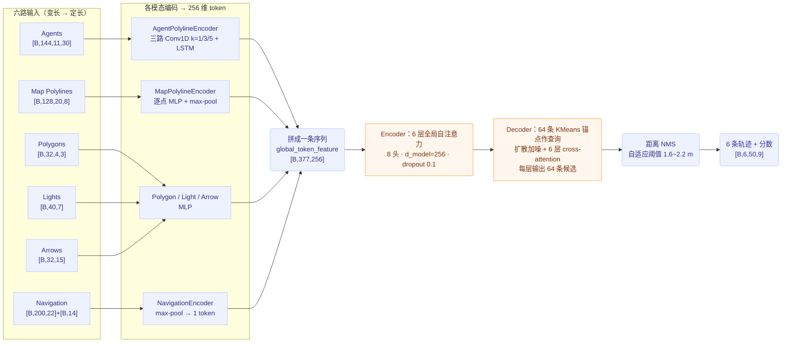

# 端到端轨迹预测：多模态注意力编码 + 锚点扩散解码

## 一句话理解

把一个场景里的**所有异构元素**（车、地图、红绿灯、箭头、导航）编码成同一条 token 序列，用 6 层全局自注意力互相"看"来融合理解；再用 **64 条 KMeans 锚点轨迹**当查询，经**扩散加噪 + 6 层 cross-attention 细化**，最后 NMS 出 6 条候选轨迹。

> **可信度说明**：本文的结构、维度与代码位置均来自一份对齐真实代码库（配置 `v2_5_12_f2_13`）生成的讲解材料；具体数字（token 数、帧数、层数）随实验配置变化。动画里的注意力权重是为讲解构造的**示意值**，不是模型 dump 的真实数值。

## 系统总览



从原始场景到 6 条轨迹，中间只发生两类事情：**变长数据补齐成固定 shape**，以及**特征维度统一到 256**。

## 六路输入与 token 化

| 模态 | 模型输入 shape | 每单元特征 | token 数 | 编码后 |
|---|---|---|---|---|
| Agents | $[B, 144, 11, 30]$ | 30 维 × 11 帧 | 144 | $[B, 144, 256]$ |
| Map Polylines | $[B, 128, 20, 8]$ | 8 维 × 20 点 | 128 | $[B, 128, 256]$ |
| Polygons | $[B, 32, 4, 3]$ | 3 维 × 4 点 | 32 | $[B, 32, 256]$ |
| Traffic Lights | $[B, 40, 7]$ | 7 维 | 40 | $[B, 40, 256]$ |
| Arrows | $[B, 32, 15]$ | 15 维 | 32 | $[B, 32, 256]$ |
| Navigation | $[B, 200, 22] + [B, 14]$ | 22 维/点 + 14 维 TTS | 1（max-pool） | $[B, 1, 256]$ |

**为什么 token 数是 377**：$144 + 128 + 32 + 40 + 32 + 1 = 377$。padding 位置虽然占 shape，但被 mask 掉，不参与注意力。

**显存直觉**：单样本 `global_token_feature` 是 $377 \times 256$ 个 float32 ≈ 377 KB；训练 B=256 时约 94 MiB/层。解码器每层还会额外保留 $[B, 64, 50, 9]$ 的预测供逐层监督。

### 各模态编码方式

- **Agents**：$[144, 11, 30] \to [144, 256]$。三路 Conv1D（kernel = 1/3/5）+ LSTM，各取最后时刻，拼成 $3 \times 256$ 再过 MLP。
- **Map**：$[128, 20, 8] \to [128, 256]$。逐点 MLP + max-pool 得到折线级特征，PointNet 风格。
- **Navigation**：$[200, 22] \to [1, 256]$。逐点编码后 max-pool 压成整条路线的 1 个 token；TTS 14 维做 AdaLN 条件。

**自车状态**被编码后放到 agent token 的第 0 位——所以"自车"和"其他车"走同一套交互，没有单独分支。

## Encoder：一个注意力池里的六路信息

来源材料用一个"开会"类比讲 Q/K/V：每个 token 是参会者，**Query 是"我现在最需要什么"，Key 是名片"我能提供什么"，Value 是笔记"我具体携带什么"**。匹配度 $= \mathrm{softmax}(Q K^\top / \sqrt{d})$，新特征 $= \sum \text{匹配度} \times V$，再残差叠加 + FFN 整理。公式层面就是标准 MHA，见 [Attention 头变体](../ai/attention-head-variants.md)。

关键结构事实：

- 六路 token 拼成一条序列（`torch.cat` 六路 feature / mask / pos 各自对齐拼接），做 **6 层全局自注意力**，每层有独立的 Q/K/V 权重。
- **mask 拼接**：每路自己的 padding mask 也拼起来，padding 位置不参与注意力。
- **位置编码单独拼接**：告诉注意力"谁在哪里"。
- 这**不是六个独立的分支**，而是一条序列里的 6 类元素在同一个注意力池里互相交换信息。6 层各做一遍，每层在上一层的理解上继续修正——比如"导航要左转"与"本车道箭头是直行"这类跨模态冲突就是在池子里被"看见"并融合的。
- 编码后切回两组：**agent tokens** 和 **map-side tokens**（地图/多边形/灯/箭头/导航），供解码器分别做 cross-attention；导航全局意图 `navi_global_intent` 单独保留，作为 AdaLN 条件。

对应代码位置（模型仓库，非本仓库）：

```text
# 六路 token 拼成一条序列                    diffusion_encoder.py:582
global_token_feature = torch.cat((obj, map, polygon, light, arrow, navi), dim=1)
# 每路 mask 拼接：padding 不参与注意力        diffusion_encoder.py:594
# 位置编码拼接                              diffusion_encoder.py:606
# 6 层全局自注意力                          diffusion_encoder.py:618 → :214 的 for 循环
# 输出切分 agent / map-side 两组             diffusion_encoder.py:638
```

## Decoder：64 条锚点怎么变成 6 条轨迹

1. **64 条锚点**：用训练数据做 KMeans 得到 64 条常见走法（$[64, 50, 2]$）。只有**终点**被拿来初始化查询，轨迹本身提供几何先验。
2. **扩散加噪/去噪**：训练时随机取 $t \in [0, 50)$ 加噪，6 层都被要求预测干净轨迹；推理只加 $t=8$ 的轻微噪声，再做 **1 步 DDIM**。调度器共有 1000 步，但训练只采样最前面 50 步——锚点本身已经是"像样的轨迹"，只需学轻噪声下的去噪。
3. **加噪发生在归一化空间**：轨迹先仿射到 $[-1, 1]$（原始范围 $x \in [-64, 160]$、$y \in [-32, 32]$）加噪并 clamp，再 inverse 回米制做位置编码送进注意力。**扩散在 $[-1,1]$ 空间，网络算的仍是米制轨迹**。
4. **6 层解码器**：每层都重新做 agent cross-attention（attend 144 个 agent token）+ map cross-attention（attend 233 个 map-side token）+ 扩散时间步 AdaLN 调制，输出 64 条候选。上一层输出轨迹作为下一层 anchor（**evolving anchors**，逐层细化）。
5. **距离 NMS**：按分数排序，抑制终点太近的重复轨迹，阈值随最高分轨迹的路径长度自适应（1.6~2.2 m），选出差异最大的 **6 个 mode**，各带一条轨迹和一个置信度。

**为什么用扩散**：未来本身是多峰的（等灯 / 变道 / 绕行）。锚点提供先验，加噪迫使模型学会"从模糊锚点收敛到精确轨迹"。注意**这里的 6 层是 Decoder 层，不是 6 次扩散采样**。

对应代码位置：

```text
# 64 个查询 attend agent/map 两组 token      diffusion_decoder.py:288
# 训练随机时间步加噪                         diffusion_decoder.py:642  timesteps = torch.randint(0, 50, ...)
# 推理固定 t=8、1 步 DDIM                    diffusion_decoder.py:788 / :812
```

### 为什么叫 Encoder 和 Decoder

Encoder 把"东西"（377 个 token 的原始数字：米、秒、灯色）变成"理解"（$[B, 377, 256]$），只负责看懂、不做决定；Decoder 把"理解"变成"答案"（$[B, 6, 50, 9]$ 的 6 条轨迹）。两个常见误会：

- **编码 ≠ 压缩变小**——$377 \times 256$ 比原始输入还大，只是换成了模型好用的格式。
- **这里的 Decoder 不复原输入**——经典 autoencoder 的 decoder 做解压还原，而它生成的是输入里根本不存在的未来轨迹。名字来自机器翻译：中文进、英文出，本来就是两种东西。

## 训练配置速览（当前实验）

| 项 | 值 | 备注 |
|---|---|---|
| 并行 | 8 × DDP | 反向 all-reduce 梯度，等效 batch 2048 |
| 精度 | 32-true | 不启用混合精度；扩散加噪/去噪对精度较敏感 |
| 优化器 | AdamW | lr 5e-6，weight decay 0.01 |
| batch size | 256 / 卡 | lr 不随卡数自动放大 |
| epochs | 16 | warmup ratio 0.125，按 **step** 线性升温 + 余弦衰减到 0 |
| 梯度裁剪 | 0.5 | 每个 step 反向后裁剪 |
| 历史 / 未来 | 11 帧 / 50 帧 | 1.1 s / 5 s @ 10Hz |

每个 epoch：跑完所有 step → val 集跑一遍 → 指标跨卡聚合（`sync_dist`）→ 写 metrics Excel → 存 checkpoint。

当前配置还有三个值得记住的开关：`skip_prediction: true`（只规划自车，不预测其他 agent）、`predict_control: false`、aux_losses（TTC/碰撞/停车）权重全为 0。

## 数据管线

从原始日志到可训练 shard 分六步：原始日志 → `preprocess_data`（坐标系对齐、抽帧）→ `sample.pkl`（单场景变长样本）→ `summary.pkl`(索引与统计) → **Stage1** compact 列存（定长 + mmap）→ **Stage2** rank shards（按卡预分片）→ **Stage3** 训练。详见 [端到端训练闭环与数据管线](./e2e-training-pipeline.md)。

## 输出形状与监督概要

每层 Decoder 输出 $[B, 64, 50, 9]$：9 维 = 位置 $(x, y)$、不确定度 $(\sigma_x, \sigma_y, \rho)$、速度 $(v_x, v_y)$、朝向 $\sin/\cos(\theta)$；分数头另出 $[B, 64]$。损失与正样本选择、评测口径见 [轨迹预测的 Loss 与评测指标](./trajectory-loss-and-metrics.md)。

## 代码地图

| 目录 / 文件 | 职责 |
|---|---|
| `run.py` | 入口，按 action 分发 fit/finetune/validate/test/inference/export_onnx/shadow_test |
| `configs/experiment/*.yaml` | 每个实验一份自包含配置，注释记录实验归因 |
| `preprocess_data/` | 原始日志 → 场景 pkl |
| `datasets/` + `datamodules/` | summary 解析、compact 索引、rank shard、采样与 collate |
| `transforms/input_builder.py` | 输入构建 + 增强（场景中心化、刹车重定时、坡道/加塞/VRU 交互） |
| `predictors/diffusion_bst.py` | 模型元架构：组装 Encoder+Decoder、算 loss |
| `modules/encoders/diffusion_encoder.py` | 各模态编码器 + 全局 Transformer |
| `modules/decoders/diffusion_decoder.py` | 锚点/扩散/逐层细化/预测头/NMS |
| `modules/layers/` + `ops/` | Transformer 层、位置编码、CUDA 算子 |
| `lightning_wrapper/` | Lightning 训练循环、优化器、指标聚合 |
| `losses/` · `metrics/` · `samplers/` | NLL/碰撞/停车等损失；minADE 等指标；滑窗/加权采样 |
| `utils/export_onnx.py` | 导出动态轴或静态融合 ONNX，供车端 TensorRT |
| `tools/shadow_badcase_mining.py` | 离线 badcase 挖掘，不参与训练 |

## 我的理解

把这套设计读成三句话：

1. **异构信息统一成 token、让注意力做融合**，比"每模态一个分支再 late-fusion"更彻底——冲突（导航要左转 vs 车道箭头直行）是在同一个注意力池里被消解的，而不是靠后处理规则。
2. **锚点 + 轻量扩散 = "强先验 + 小修正"**。扩散在这里不是用来生成多样性的（多样性由 64 个锚点负责），而是用来把模糊锚点细化成精确轨迹的，所以训练只覆盖 $t<50$ 的轻噪声区、推理只需 1 步 DDIM。这和图像生成里"从纯噪声开始采样"的用法是同一数学的两个极端。
3. **训练侧一切设计都围绕"多峰未来的候选管理"**：逐层监督、evolving anchors、BCE 而非 softmax、NMS 去重，本质都是在回答"64 条候选里哪条算对、怎么让对的那条胜出"。

## Open Questions

- 8 个注意力头在场景融合里是否出现了可解释的分工（如头管 agent-agent、头管 agent-map）？材料未涉及，需实测。
- `32-true` 相比 bf16/fp16 在这个扩散头上的量化损失有多大，是否有实验归因？
- `skip_prediction: true` 关闭了联合预测；开启后（代码支持）对自车精度和碰撞率的影响如何？
- NMS 阈值自适应区间（推理 1.6~2.2 m vs 训练正样本 2.5~3.5 m）为什么不同？材料未解释。

## Related Knowledge

- [六路 token 注意力编码](./six-modality-attention-encoder.md) — 本篇 Encoder 部分的原子展开
- [锚点扩散解码器](./anchor-diffusion-decoder.md) — 本篇 Decoder 部分的原子展开
- [轨迹预测的 Loss 与评测指标](./trajectory-loss-and-metrics.md) — GMM NLL + BCE、正样本选择、minADE / MissRate 口径
- [端到端训练闭环与数据管线](./e2e-training-pipeline.md) — step/epoch 双循环、三阶段数据预处理、代码地图
- [Attention 头变体：MHA/MQA/GQA/MLA](../ai/attention-head-variants.md) — 本模型 Encoder/Decoder 用的标准 MHA 公式与头变体谱系
- [DDIM 论文详解](../ai/foundations/diffusion/ddim-paper.md) — 推理端 1 步 DDIM 采样的数学出处
- [自动驾驶训练数据管理最佳实践](./data-management.md) — 上述管线背后的通用数据管理原则
- [Fenwick Tree 加权采样](../engineering/fenwick-tree-weighted-sampling.md) — 数据管线的场景加权采样可能用到同类结构（推测，未验证）
