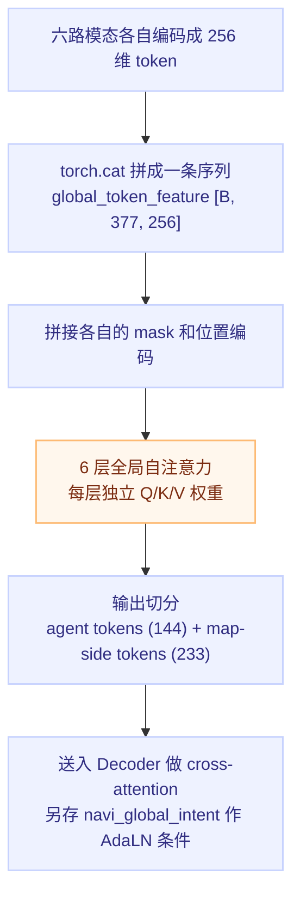

# 六路 token 注意力编码：端到端轨迹预测的 Encoder

## 一句话理解

把自动驾驶场景里 6 类异构信息（agents / map / polygons / lights / arrows / navigation）各自编码成 256 维 token，**拼成一条 377 token 的序列**丢进同一个 Transformer 自注意力池——没有按模态分支，而是一条序列里的 6 类元素互相交换信息。6 层之后，"前车在减速""前方红灯""导航要左转""本车道只能直行"被融合进同一个特征。

## 为什么重要

- 这是"注意力机制怎么用在结构化多模态输入上"的一个具体、可数、有真实 shape 的范例——比抽象讲 Q/K/V 好懂得多
- "开会类比"（每个 token 是参会者，拿名片和笔记）是理解 Q/K/V 最直觉的入口之一
- 展示了异构输入统一的工程套路：**变长补齐成固定 shape + 特征维度统一到 d_model**，之后一切交给注意力

## 开会类比：Q / K / V

| 概念 | 角色 | 一句话 | 驾驶场景例子 |
|---|---|---|---|
| Query | 提问 | "我现在最需要什么信息？" | 自车在找：谁挡我、能不能走、导航让干嘛 |
| Key | 名片 | "我能提供什么信息？" | 前车说"我会动"，红灯说"我是灯"，导航说"我是路线" |
| Value | 内容 | "我具体携带什么？" | 前车的速度、红灯的位置、导航的方向和距离 |

$$
\text{匹配度} = \mathrm{softmax}\!\left(\frac{Q_{\text{自车}} \cdot K_{\text{对方}}}{\sqrt{d}}\right)
$$

$$
\text{自车新笔记} = \sum \text{匹配度} \times V_{\text{对方}} \;\; \to \;\; \text{残差叠加} + \text{FFN 整理}
$$

关键点：真实模型里**所有 token 同时互相看**，动画只高亮自车视角是为了好懂。

## 六路输入与 token 数

每路先由各自的编码器压成"每单元 1 个 token"：

| 模态 | 输入 shape | 每单元特征 | token 数 | 编码后 |
|---|---|---|---|---|
| Agents | $[B, 144, 11, 30]$ | 30 维 × 11 帧 | 144 | $[B, 144, 256]$ |
| Map Polylines | $[B, 128, 20, 8]$ | 8 维 × 20 点 | 128 | $[B, 128, 256]$ |
| Polygons | $[B, 32, 4, 3]$ | 3 维 × 4 点 | 32 | $[B, 32, 256]$ |
| Traffic Lights | $[B, 40, 7]$ | 7 维 | 40 | $[B, 40, 256]$ |
| Arrows | $[B, 32, 15]$ | 15 维 | 32 | $[B, 32, 256]$ |
| Navigation | $[B, 200, 22] + [B, 14]$ | 22 维/点 + 14 维 TTS | 1（max-pool） | $[B, 1, 256]$ |

$$144 + 128 + 32 + 40 + 32 + 1 = 377 \text{ tokens}$$

各模态的压缩手法：

- **Agents（11 帧 → 1 token）**：三路 Conv1D（k=1/3/5）+ LSTM，各取最后时刻，拼成 3×256 再过 MLP
- **Map（20 点 → 1 token）**：逐点 MLP + max-pool 得到折线级特征，PointNet 风格
- **Navigation（200 点 → 1 token）**：逐点编码后 max-pool 压成整条路线 1 个 token；TTS 14 维做 AdaLN 条件

为什么是 377：padding 位置虽然占 shape，但被 mask 掉，不参与注意力。

## 全局自注意力的数据流



代码映射（真实仓库）：

```python
# 1. 六路 token 拼成一条序列
diffusion_encoder.py:582
global_token_feature = torch.cat((obj, map, polygon, light, arrow, navi), dim=1)
# 2. 每路自己的 mask 也拼起来：padding 位置不参与注意力
diffusion_encoder.py:594
global_token_mask = torch.cat((...), dim=1)
# 3. 位置编码：告诉注意力"谁在哪里"
diffusion_encoder.py:606
global_token_pos = torch.cat((...), dim=1)
# 4. 6 层全局自注意力
diffusion_encoder.py:618 / :214
apply_global_attn(x, x_mask, x_pos)
# 5. 切成两组供解码器 cross-attention
diffusion_encoder.py:638
obj_features_out / map_features_out
```

细节：自车状态被编码后放到 agent token 的第 0 位，所以"自车"和"其他车"走同一套交互机制。

## 我的理解

- **"六个分支"是个误解**：这不是六个独立的编码分支最后 concat，而是一条序列里 6 类元素在同一个注意力池里互相交换信息。每层都在上一层的理解上继续修正。
- **编码不等于压缩变小**：377×256 ≈ 377 KB（float32 单样本），比原始输入还大。"编码"是换成模型好用的格式，不是省空间。
- **mask 和内容同等重要**：变长输入靠 mask 才能拼成 batch；被 mask 的位置既不参与注意力也不产生 loss。
- **导航是唯一 max-pool 成单 token 的模态**——因为意图本来就是全局量，不需要逐点保留。

## Limitations

- 权重数值在讲解页里是构造的示意值，不是模型 dump 的真实注意力
- 结构、维度、行号对齐 `v2_5_12_f2_13` 配置，随实验配置变化
- 单一全局注意力池意味着 token 数增长时开销平方级上升（377 尚小，但扩到全量 BEV token 就是另一回事）

## Related Knowledge

- [锚点扩散解码器：64 条锚点怎么变成 6 条轨迹](./anchor-diffusion-decoder.md) — 本篇 Encoder 输出的下游
- [轨迹预测的 Loss 与评测指标](./trajectory-loss-and-metrics.md) — 模型到底在学什么、好坏怎么量化
- [Attention 头变体：MHA/MQA/GQA/MLA](../ai/attention-head-variants.md) — Attention 公式本身的变体谱系
- [DDIM](../ai/foundations/diffusion/ddim-paper.md) — 解码器推理时用的 1 步采样器
- [自动驾驶训练数据管理](./data-management.md) — 上游数据从哪来
