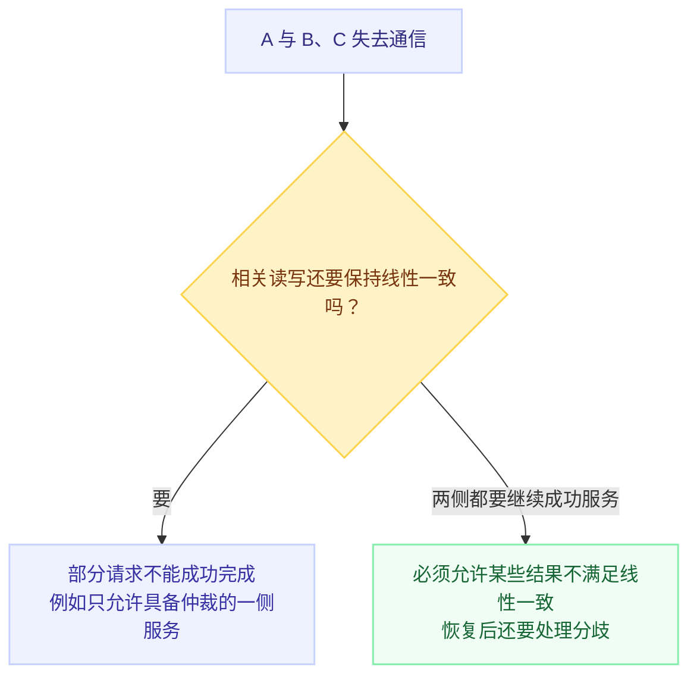

<script setup>
import LamportClockDemo from '../../.vitepress/components/LamportClockDemo.vue'
import VectorClockDemo from '../../.vitepress/components/VectorClockDemo.vue'
</script>

# 分布式系统核心理论基础

## 从一个问题开始：为什么“多存几份”没有想象中简单？

假设你和同事使用一个共享笔记网站。里面有一条会议通知：

> 周六上午 10 点讨论。

最开始，网站把它存在一台服务器 A 上。你保存修改，其他人再来读取，这件事并不难理解。

但有一天，A 的硬盘坏了。为了不再因为一台机器故障就丢失笔记，我们增加 B、C 两台服务器，三台各保存一份：

```text
                   共享笔记网站
                  /     |     \
                 A      B      C
                 |      |      |
               笔记副本 笔记副本 笔记副本
```

看起来只多了两次复制，问题却马上出现了：

- 你已经把会议改到周日，为什么同事打开仍然看到周六？
- A 与 B、C 断开连接，两边还能不能继续修改？
- A 一直不回复，究竟是宕机了，还是只是很慢？
- A 刚说“保存成功”就故障了，新接手的 B 会不会把修改弄丢？

**分布式系统理论，就是帮助我们逐一回答这些问题的工具。** 先看见问题，再学习它的名字，会比一开始背 CAP、FLP、Raft 更容易理解。

### 怎么读这篇教程

- **第一遍读第 1～5 节**：跟着同一份共享笔记，理解副本、读写承诺、网络断开和主节点切换。
- **第二遍读第 6～10 节**：再看读写集合、时钟、数据分片、转账和旧任务恢复。
- **最后读第 11～12 节**：把这些问题对应到 Ceph、训练数据和 checkpoint，并用练习检查自己是否真的理解。

不需要先背英文全称。每遇到一个术语，先问：**如果没有它，我们的笔记网站具体会出什么问题？**

::: info 示例约定
A、B、C 是三台服务器；“客户端”是向服务器发请求的网页或程序。“副本”是一份数据的拷贝。

除特别说明外，例子只考虑机器停止工作、消息延迟或网络断开，不考虑服务器故意伪造消息。例子是机制示意，不是某个产品的完整协议或性能测试。
:::

## 1. 我已经点了保存，为什么同事还看到旧内容？

### 1.1 先决定“保存成功”这四个字代表什么

你把会议通知改成：

> 周日上午 10 点讨论。

一种很自然的实现方式是：

1. 网页把新内容发给 A。
2. A 保存后，立即向你返回“成功”。
3. A 在后台把修改发给 B、C。

注意第 2 步和第 3 步之间的空隙。假设这时同事的请求被分配到 B：

| 时刻 | A 上的内容 | B 上的内容 | C 上的内容 | 用户看到什么 |
|---|---|---|---|---|
| 修改前 | 周六 | 周六 | 周六 | 大家看到相同内容 |
| A 返回成功后，复制尚未完成 | 周日 | 周六 | 周六 | 你看到周日，同事可能看到周六 |
| 复制完成后 | 周日 | 周日 | 周日 | 大家又看到相同内容 |

**不是“有三份副本”就自动保证任何时刻读到的都一样。** 你还必须决定：什么时候向用户报成功，以及之后允许从哪里读取。

这里的做法叫**异步复制**：发出成功响应时，其他副本可能还没有完成更新。它减少了前台等待，但把一部分同步工作留给了后台。

### 1.2 “等所有副本都写完”是不是就解决了？

你可能会说：那就等 A、B、C 都保存好，再返回成功。

这确实能避免前面那一次“成功后马上读到落后副本”的情况，但代价也很具体：

- C 的磁盘慢了，所有保存都要等 C。
- C 宕机了，如果坚持等齐三份，新的保存就无法成功。
- 用户与 A 在同一个机房，C 却在远端，保存需要等待远端通信。

而且，即使都写了，还需要处理并发修改、缓存、读请求的路由等问题。**“多等几台机器”是设计的一部分，不是完整的正确性证明。**

先记住一个问题：**系统返回成功时，究竟已经完成了哪些事？** 后面的共识和 Quorum 都会反复回到这里。

## 2. 我们究竟希望读取满足什么承诺？

“一致性”听起来抽象，但从使用者的角度看，它是在规定：**哪些读取结果可以出现，哪些不可以。**

继续使用“周六改周日”的例子。

### 2.1 最终一致：现在可能不同，以后要收敛

如果允许刚保存后的短时间里，有人读到周六、有人读到周日，但要求在停止修改、通信恢复并完成同步后，副本最终收敛，这就是**最终一致性**。

它没有单独承诺“最多 100 毫秒就同步好”。要得到明确的时间目标，还需要额外的工程约束和监控。

更重要的是：如果断网期间一边改成周日，另一边改成周一，那么“最终一样”还需要一个冲突处理规则。它不等于系统天然知道哪一条更符合人的意图。

### 2.2 读己之写：至少别让我看不到自己刚保存的内容

你刚把通知改为周日，刷新页面，却又看到周六。即使其他同事暂时看到旧内容可以接受，这个体验也很糟糕。

**读己之写**要求：在相应会话保证下，你后续的读取不能落到自己已经完成的写入之前。

这是一种针对同一使用者的承诺，不代表所有使用者立刻都能看到你的修改。类似地，**单调读**要求一个会话已经读到较新状态后，不要又退回更旧的状态。

### 2.3 线性一致：成功以后再来读，不应读回旧值

现在提出更强的要求：

1. 你提交“周日”。
2. 系统明确返回保存成功。
3. 同事在成功响应之后，才发起读取。
4. 假设中间没有其他修改，同事不能再读到“周六”。

这体现了**线性一致性（Linearizability）**的实时顺序要求。可以把它想成：每次操作似乎都在“发起到返回”的某个瞬间生效，所有操作能排列成一条符合对象规则、也尊重真实先后关系的顺序。

但如果同事的读取与你的修改发生重叠，读取返回旧值还是新值，需要看它在这条合法顺序中排在哪里，不能一概说“任何读取永远看到最新值”。

### 2.4 “顺序一致”和“因果一致”又在补什么？

先各看一个区别，不急着背完整分类。

- **顺序一致性**：大家的操作能解释成同一条顺序，并保留各个进程自己的操作顺序，但不额外要求保留跨进程的真实时间先后。只要求顺序一致时，仅凭“甲保存已返回，乙随后才发起读”这一跨进程事实，不一定能排除旧值；线性一致则要尊重它。
- **因果一致性**：同事先看到“改到周日”，再回复“收到，周日见”。对其他观察者，不能先让回复可见，却把它所依赖的修改藏在后面。没有因果关系的两个独立修改，不一定要求所有人以相同顺序看到。

这里的“先看到”指系统的可见性规则，不是说人必须先点开某条消息。

::: tip 先问需求，不要先给系统贴标签
“别人晚一点看到点赞数”与“锁已经转交给新任务，旧任务却还继续写”，对正确性的要求不同。一致性不是越弱越先进，也不是越强越适合所有负载。

另外，一致性与持久性是两个问题：读写顺序正确，不等于断电后一定不丢数据；有多份持久副本，也不等于读取一定满足线性一致。
:::

## 3. 两边断网了，还能不能都正常服务？——从这里理解 CAP

现在让 A 与 B、C 失去通信：

```text
一侧：A         × 网络中断 ×         另一侧：B、C
```

这叫**网络分区**：不是某个文件分成几块，而是一些节点之间暂时无法正常交换消息。

你能访问 A，同事只能访问 B。大家最初看到的都是“周六”。

### 3.1 如果两边都坚持成功处理请求

设想下面这段过程：

1. 你在 A 上把通知改成周日。
2. A 向你返回保存成功。
3. 同事随后从 B 读取。
4. B 收不到 A 的新内容，只能按本地信息回答“周六”。

这与上一节的线性一致要求冲突。

B 能不能等 A 回复再回答？可以，但网络一直不恢复时，这个读取就可能一直等不到结果。B 能不能返回错误？也可以，但这不满足“这个有效请求成功得到服务”的要求。

**在这种分区执行中，不能既保证所有相关请求继续成功完成，又保证这些读写都符合线性一致。**

### 3.2 把经历过的问题命名：CAP

现在再看三个字母，就不再是一句口诀：

- **C，Consistency**：这里指线性一致，不是泛指“最后数据会一样”。
- **A，Availability**：发给未故障节点的请求最终得到符合服务规格的响应；这不是日常说的“99.9% 在线率”，也不承诺固定毫秒级延迟。仅仅回复一个错误，不能当作完成了原本的读写服务。
- **P，Partition tolerance**：分析时必须允许节点之间发生网络分区，不能假定这种情况绝不会出现。

实际设计可以选择：



这不是“整个网站必须全部停机或全部继续”的二选一。具备多数派的一侧可能继续处理某些操作，另一侧拒绝写入；不同接口也可以采用不同策略。讨论时要明确操作、对象和故障范围。

### 3.3 没断网，也可能需要等待——PACELC

假设 A 在本地，B、C 在远端。网络没断，只是往返比较慢。

- 如果 A 写完就返回，用户等待较少，但其他副本可能还落后。
- 如果需要额外的远端确认才能满足某种一致性承诺，保存就得等待相应通信。

**PACELC**提醒我们：发生分区时讨论可用性与一致性；没有分区时，也常常要讨论延迟与一致性。它是分析设计取舍的框架，不是说每个强一致系统的每种请求都固定更慢。

## 4. A 一直没回复，为什么不能直接认定它死了？——从这里理解 FLP

你向 A 发请求，等了很久仍没有回复。至少有三种可能：

1. A 真的宕机了。
2. A 还活着，但正在磁盘阻塞或长时间暂停。
3. A 已经发出回复，消息却在网络里被延迟了。

**客户端只看见“没收到回复”，无法仅凭这一点确定是哪一种。**

### 4.1 超时是怀疑，不是证明

假设规定“超过 3 秒没回复，就尝试换主”。如果 A 只是暂停了 4 秒，系统就会误判。把超时改成 30 秒也没有从根本上解决：它仍可能暂停更久。

这就是为什么我们在讨论算法前，要说清楚自己假设了怎样的世界：

- **同步模型**：可以依赖约定的处理、通信时间上界。
- **异步模型**：不能依赖这样的时间上界；消息可以非常慢。这不等于每条消息都永久丢失。
- **部分同步模型**：常见的一类假设是系统最终进入足够稳定、延迟有界的时期，但事先不知道何时开始。

“现实系统采用部分同步假设”是一种建模选择，不是保证现实中的任意网络都会最终恢复。若关键节点始终无法互通，算法不能凭空继续推进。

### 4.2 FLP 到底说“不可能”的是什么？

把任务改成“几台服务器必须就一个值达成一致”。我们既不允许它们决定出互相矛盾的值，又希望它们最终一定决定下来。

**FLP 不可能性结果**说：在纯异步模型下，即使通信可靠、最多只有一个进程可能崩溃，也不能让一个确定性的共识算法对所有允许的执行，都保证最终作出决定。

关键是“对所有执行保证终止”，不是“每次执行都会失败”，也不是“工程上不能实现共识”。

Raft、Paxos 等工程实现通常这样处理：

- 尽力确保**安全性**：即使消息延迟或重排，也不要决定出冲突结果。
- 在额外条件成立时提供**活性**：例如多数派能够通信，网络和节点最终足够稳定，系统才能持续推进。

超时和心跳帮助系统怀疑故障、尝试选举，**它们本身不会推翻 FLP，也不是唯一可能的理论出路**。随机化算法等采用了不同的条件，不能简单概括成“加一个超时就打破不可能性”。

### 4.3 如果服务器会撒谎呢？

以上主要考虑“停止工作或变慢”。如果 A 还可能向 B、C 发互相矛盾的消息，甚至伪造结果，就需要更强的**拜占庭故障**模型。

普通 Raft/Paxos 不是为任意作恶节点设计的。拜占庭问题也不只存在于区块链；不可信参与者、多组织协作或某些安全敏感系统同样可能需要考虑。

## 5. A 保存后宕机了，B 怎么接手才不会弄丢修改？——从这里理解共识

回到笔记网站。这次我们先指定 A 负责给修改排序，B、C 跟随它复制。

A 是 **Leader（主节点）**，B、C 是 **Follower（跟随节点）**。这叫单 Leader 复制，但**“有一个主”不自动保证主故障后的安全性**。

### 5.1 为什么不能随便找一台服务器接手？

假设 A、B 已保存“周日”，C 还停留在“周六”。如果 A 向用户报告成功后宕机，而系统随便选 C 接手并覆盖 B，那么已经确认的修改就可能被抹掉。

因此，系统需要的不只是“挑一个还活着的节点”，而是共同遵守一套规则：

> 哪些修改已经确定不能反悔？接任者必须保留哪些历史？

让多台机器就一个决定达成一致，是**共识**问题。这里至少要守住三件事：不能决定出彼此冲突的结果，决定必须符合允许的提议规则，并在算法要求的推进条件成立时最终作出决定。对一连串修改确定统一顺序，并让副本按相同顺序执行，可以构建**复制状态机**。

“共识”是内部如何作出决定；“线性一致”是对外允许观察到什么。前者可以帮助实现后者，但二者不是同一个定义。

### 5.2 跟着一次 Raft 写入走完

Raft 把这个问题组织成选主、日志复制和安全约束。这里的“日志”不是给人看的调试输出，而是待执行操作的有序记录。

假设当前任期为 8，A 是主节点。你提交的修改成为日志第 21 条：

```text
日志第 21 条，任期 8：把会议通知改为“周日”
```

这是一个**当前任期的新日志条目**，简化过程如下：

```mermaid
sequenceDiagram
    participant U as 客户端
    participant A as A：Leader
    participant B as B：Follower
    participant C as C：Follower
    U->>A: 保存“周日”
    A->>A: 持久记录当前任期的日志第 21 条
    A->>B: 复制第 21 条
    A->>C: 复制第 21 条
    B->>B: 持久记录第 21 条
    B-->>A: 确认
    Note over A,B: A、B 已构成三节点中的多数派
    A->>A: 推进提交并应用操作
    A-->>U: 保存成功
    Note over C: C 可以稍后追上
```



现在即使 A 故障，Raft 的选举资格、任期、日志匹配和提交规则也会共同约束后续 Leader，防止这条已提交修改被随意覆盖。B 可以成为合适的接任者；缺少必要日志的 C 不能绕过投票规则随意当选。

**多数派交集只是这套安全机制的一部分。** 不能只取出“任意两台存过就行”，丢掉其余规则。特别是旧任期条目的提交，不能一概用“数够多数派”来描述；Raft 对直接按副本数量推进提交有当前任期限制，旧条目可随后被间接提交。

固定的三节点配置通常需要两票才能推进，五节点配置通常需要三票。这意味着在其余条件成立时，三节点可在一台故障后继续，五节点可在两台故障后继续；不是所有网络分布和故障组合都能保持服务。

### 5.3 网络断开后，会不会有两台都认为自己是主？

会有这种“认知暂时重叠”的可能。例如旧主 A 被隔离，B、C 选出了新主 B，而 A 还不知道。

安全机制的目标不是让所有机器在每一瞬间都拥有相同认知，而是：**旧主不能在缺少必要确认的情况下继续提交冲突修改。** 线性一致读取也不能仅凭“我以前是主”就随意返回本地状态；需要相应的读协议确认。

### 5.4 保存请求超时了，能不能确定没保存？

也不能。可能是日志已经提交，但“成功”响应丢了。

因此请求超时后，客户端面对的可能是**结果未知**，不只是明确失败。重试、查询结果和去重标识都需要为这种情况设计，第 9 节会继续用它。

### 5.5 Paxos 放在哪里理解？

Paxos 也解决共识问题，常见的 Multi-Paxos 用于连续决定多个日志位置。可以把一个重要直觉记成：**新一轮提议不能不顾前面可能已被选定的值，直接另起炉灶。** 它通过提议轮次和接受者反馈等规则约束这一点。

Raft 与 Paxos 解决相关问题，但不是同一个算法，也不能简单把 Raft 说成“Paxos 换了几个名字”。初学时先理解共识为什么必要，再选一种算法深入即可。

::: details 延伸：是不是所有系统都必须只有一个主？
不是。前面为了讲清提交和接管，选择了单 Leader 路线。

如果两个站点都希望在本地接收写入，也可以设计**多 Leader 复制**。但甲在 A 改成周日、乙在 B 改成周一时，就要处理双方复制时的冲突，不能直接套用“一个主统一排序”的推理。

也有**无 Leader 复制**：不为这组数据指定一个长期统一排序的主，而由请求协调者把读写发给多个副本，并结合版本和修复协议处理结果。下一节会解释其中常用的集合交集思路。无 Leader 不等于没有任何协调，也不自动意味着更强或更弱的一致性。
:::

## 6. 不总是问主节点，能不能靠“多问几份”读对？——理解 Quorum

现在换一种设计思路：把同一份数据放在固定的 A、B、C 上，写入等其中两份确认，读取也询问其中两份。

假设没有并发写入，也没有正在进行的半途写入：

1. 新值“周日”已写入 A、B，写操作完成。
2. C 仍是“周六”。
3. 后续读取需要取回两份结果，再按可靠的版本规则选择。

无论读取选择哪两台，都能碰到保存新值的成员：

| 读取集合 | 与写入集合 A、B 的交集 |
|---|---|
| A、B | A、B |
| A、C | A |
| B、C | B |

这叫 **Quorum（法定集合或法定人数）** 的交集思路。

### 6.1 现在再看公式

设：

- $N$ 是同一个固定副本集合中的副本总数。
- $W$ 是一次写操作成功前，需要确认的副本数。
- $R$ 是一次读取需要取得结果的副本数。

如果：

$$
W + R > N
$$

那么任意这样的写确认集合与读响应集合必然相交。例子中 $N=3$、$W=2$、$R=2$，两组各取两台，无法在三台机器内完全错开。

**这个公式证明的是集合相交，不是单独证明整个读写协议满足线性一致。** 上面的“读到已完成写入”推理还依赖固定成员、适当的版本处理，以及我们暂时排除的并发和半途写入条件。

### 6.2 一个反例：读到新值以后又退回旧值

考虑一个只有“读两份，选版本较新者”的简化协议：

1. 开始时 A、B、C 都是版本 1。
2. 一次版本 2 的写入只到达 A，还没取得两份确认，所以仍未完成。
3. 第一次读询问 A、C，选择版本 2 并返回。
4. 第一次读返回后，第二次读询问 B、C，选择版本 1 并返回。

这里配置仍是 $N=3$、$W=2$、$R=2$，但两次先后读取发生了倒退。单靠“读集合与已完成写集合相交”，无法处理这个尚未完成却已被读到的写入。

要实现更强的保证，还需要相应的协议，例如可靠的版本排序、读写回或其他协调机制，并分析并发写入和故障。**Quorum 也不是“无 Leader 系统专用”：Raft 的多数派本身就是一种 quorum。**

## 7. 两个人同时修改，能不能看时间戳决定谁更新？

假设你的电脑时钟快了几分钟：

| 实际发生顺序 | 事件 | 机器上记录的时间 |
|---|---|---|
| 先 | 你改为周日 | 10:05 |
| 后 | 同事看到你的修改，再改为周一 | 10:01 |

如果系统只比较这两个不可靠的物理时间戳，可能把前一个修改误判成更新。

真正有用的线索是：**同事已经看过你的修改，后一个操作依赖前一个操作。** 这是一种因果关系，不需要先知道两台机器谁的钟更准。

### 7.1 Lamport 时钟：给因果先后一个不会颠倒的编号

先别想“时钟”，把它想成**每台机器自己的事件计数器**：发生事情就往前记一笔；什么也没发生时，即使等了一分钟，它也不必变化。

先看动画中的 P、Q 两台机器。建议先把“有消息”播放完，再切换到“没消息”，比较圆圈编号和消息箭头。

<LamportClockDemo />

**先跟着“有消息”的一轮算：**

1. P 修改笔记：自己的计数器从 0 加到 1。
2. P 发送通知：发送也是一次事件，从 1 加到 2，通知携带编号 2。
3. Q 收到通知：它本来还是 0，但不能把“收到”记在“发送 2”之前。因此取本地 0 与消息 2 的较大者，再加 1，得到 3。
4. Q 回复：从 3 加到 4；P 收到回复后，取本地 2 与消息 4 的较大者，再加 1，得到 5。

本地事件、发送事件都先把自己的计数器加 1；接收事件则用下面的规则更新。设 $c$ 是接收前的本地计数器，$t$ 是消息携带的发送事件编号，$c'$ 是接收后给这次事件分配的编号：

$$
c' = \max(c,t) + 1
$$

这样，同一进程的后续事件编号更大，收到消息的事件编号也一定大于发送它的事件。沿这些关系连接成的路径，叫这里的**因果路径**。编号不必连续：Q 从 0 跳到 3 是正常的，并不是遗漏了两次本地事件。

**再看“没消息”的反例：**P 独立修改标题，编号为 1；Q 独立修改字体，再改字号，编号依次为 1、2。P 的 1 小于 Q 的 2，但 Q 并不知道 P 做过什么，两边也没有消息路径。因此“1 小于 2”本身，不能证明 P 的修改导致或先行于 Q 的修改。

这时再看符号就更直观：如果事件 $a$ 在因果上先于事件 $b$，那么 $L(a) < L(b)$。这里 $a$、$b$ 是两个事件，$L(e)$ 表示事件 $e$ 的 Lamport 编号。**这个推理只能正着用，不能从编号大小反推因果。**

这里的“并发”是**因果上互不先行**，不要求两个事件恰好同时发生。Lamport 编号也可能相同；若需要给所有事件排出一条确定顺序，可以再结合进程标识打破平局，但排出的顺序仍然不是因果关系的证明。

### 7.2 向量时钟：区分“后来的修改”和“互不知道的修改”

上一节的问题是：一个数字只告诉你“编号有多大”，却丢掉了**它知道哪些人的进展**。这次把一个数字换成一张分列的进度表，就有了**向量时钟（Vector Clock）**。

仍然只有甲、乙两个人，但要注意：**甲有自己的表，乙也有自己的表，不是两个人共用一个数组。** 表的列顺序事先约定为：

$$
[\text{已知的甲的事件进展},\ \text{已知的乙的事件进展}]
$$

例如，甲持有 $[2,0]$，表示它已记录甲这边前两次事件，但尚未获知乙的新事件。第二格为 0 **不代表乙实际上没做事**，只是甲还不知道。

先看动画。建议先点“看两次独立修改”，再点“看收到消息之后”，最后点“通信后重看原修改”。图下的对照区会逐格说明为什么是并发或先后。

<VectorClockDemo />

**第一幕：没通信，各自只改自己的格。**

1. 最初甲、乙各持有 $[0,0]$。
2. 甲独立把通知改成周日，只把自己的第一格加 1，记录为 $[1,0]$。
3. 乙没收到甲的消息，独立改成周一，只把自己的第二格加 1，记录为 $[0,1]$。

比较这两次修改：第一格甲的记录更大，但第二格乙的记录更大。没有哪张表包含另一张表的全部进展，所以不能说一次修改在因果上先于另一次；**两次修改因果并发**。不是比较两格的总和，也不是只看第一格。

**第二幕：收到消息，先逐格合并，再记下自己的接收事件。**

甲发送通知也是一次事件，因此从 $[1,0]$ 变成 $[2,0]$，消息携带这张表的快照。乙收到时，本地还是 $[0,1]$：

| 更新步骤 | 甲的进展这一格 | 乙的进展这一格 | 得到什么 |
|---|---|---|---|
| 逐格取较大者 | 本地 0、消息 2，取 2 | 本地 1、消息 0，取 1 | 中间表 $[2,1]$ |
| 记下本次接收 | 不是乙自己的格，不增加 | 乙自己的格，再加 1 | 接收事件为 $[2,2]$ |

现在乙知道甲的前两次事件了，但不是“乙替甲执行了两次修改”。乙自己的第二格计的是“独立修改”和“收到消息”两个事件，也不等于业务上改了两次通知。

接着乙回复，变成 $[2,3]$；甲收到回复，将本地 $[2,0]$ 与消息 $[2,3]$ 逐格合并，再增加甲自己的第一格，得到 $[3,3]$。**向量把“从别人那里了解到的历史”带到了后续事件里。**

**第三幕：为什么这次可以判断先后？**

比较“甲最初修改”的 $[1,0]$ 与“乙收到通知”的 $[2,2]$：前者每一格都不大于后者，且至少一格更小。沿图也能找到“甲修改 → 甲发送 → 乙接收”的因果路径。

一般地，设 $V(a)$、$V(b)$ 分别是事件 $a$、$b$ 的向量，$n$ 是固定参与者数量，$i$ 是从 $1$ 到 $n$ 的分量位置，$V(a)_i$ 是事件 $a$ 在第 $i$ 个位置的值。在所有相关事件和消息都正确执行这套协议、没有遗漏通信路径的模型中，事件 $a$ 因果先于事件 $b$ 的比较条件是：

$$
\left(\forall i\in\{1,\ldots,n\},\ V(a)_i\le V(b)_i\right)
\quad\text{且}\quad
\left(\exists j\in\{1,\ldots,n\},\ V(a)_j<V(b)_j\right)
$$

这里 $j$ 也是分量位置，用来指出至少一个严格较小的分量。若两个不同事件的向量在两个方向都不满足上述条件，就因果并发。**这不是把任意两个数组拿来就能推断真实因果：参与者、事件计数和通信都必须遵守协议。**

::: tip 传播历史，不等于解决业务冲突
乙后来收到甲的消息，不会改写两次原始修改的事件快照：它们仍是 $[1,0]$ 与 $[0,1]$，仍然并发。动画最后可以重新比较它们。

向量时钟能帮助系统识别“这两份修改没有因果先后，不能简单当作后者覆盖前者”，但会议最终选周日还是周一，仍需要用户选择或业务合并规则。参与者越多，向量的长度和维护成本也会增加。
:::

### 7.3 HLC：想靠近真实时间，又想保留因果单调性

**混合逻辑时钟（HLC）**把物理时间与逻辑部分结合，便于得到大致贴近真实时间、又遵守相应因果推进规则的时间戳。

它不像完整向量时钟那样，仅凭两个时间戳就能识别所有并发关系。也不要把本节总结成“物理时钟完全不能用于分布式系统”：有些系统会使用有界时钟误差、额外等待或协议约束，只是不能无条件假定普通机器时钟已经给出了可靠的全局顺序。

## 8. 笔记越来越多，三台都存全部数据太贵怎么办？

前面三台存的是**同一份数据的副本**。现在笔记总量大到单台放不下，需要解决另一个问题：把不同数据分给不同机器。

### 8.1 复制和分片是两件事

假设再加入 D、E、F 三台服务器：

```text
第一组笔记 → A、B、C，各存一份
第二组笔记 → D、E、F，各存一份
```

- **分片（Sharding）**：第一组与第二组是不同数据，解决容量和负载分担。
- **复制（Replication）**：同一组在多台机器上保存，解决冗余和故障恢复。

二者可以同时使用。注意它们与第 3 节的**网络分区**不同：网络分区指连通性故障，数据分片指主动的数据布局设计。

### 8.2 怎么决定一条笔记放在哪组？

先看三种常见思路：

1. **按范围**：编号靠前的笔记放第一组，后面的放第二组。范围查询直观，但某个热门范围可能特别忙。
2. **按哈希**：把笔记标识转换成哈希值，再据此选组。一般更容易分散负载，但相邻编号不再自然落在一起。
3. **一致性哈希**：让数据与节点在同一个映射空间中定位，目标之一是在节点增减时，不必重新安排全部数据。虚拟节点是常用的均衡手段，不是定义里必须有的东西。

一致性哈希不意味着每次都要向一台中心服务器查位置，也不意味着必须通过分布式网络逐跳寻找；客户端可以根据已知映射本地计算。Redis Cluster 使用哈希槽分配，不应直接当作经典一致性哈希环的例子。

### 8.3 Ceph 的 PG 和 CRUSH 怎么接上来？

在 Ceph 中，可以先把许多对象归入放置组 **PG（Placement Group）**，再根据当前集群映射和放置规则，确定服务这些 PG 的 OSD 集合。

```text
文件的一部分 → RADOS 对象 → PG → 负责它的 OSD 集合
```

**CRUSH**是 Ceph 用来计算数据放置的重要机制，英文全称是 Controlled Replication Under Scalable Hashing。它能把主机、机架等拓扑和权重纳入规则。

例如，你希望一个对象的三份副本不落在同一台物理机上，就应配置相应的主机故障域规则，而不是只把“副本数”设为三。

客户端拿到必要的池配置和当前 OSDMap 等信息后，可以计算对象的放置位置，而不必逐对象查询中心位置表。具体定位还可能涉及映射调整，不能把它简化成“只有对象名字就能永远算出固定三台机器”。

PG 是放置、恢复等操作的重要组织单位，**不是说数据只能整组同时搬动，或不能按对象进行恢复与传输**。扩容通常会改变一部分数据的放置，但实际迁移量取决于配置和集群状态。

想看真实读写路径，可接着阅读 [CephFS：并行访问、部署、挂载与网络](./distributed-storage/cephfs-deployment-and-mount.md)。

## 9. 两份数据必须一起改，复制日志就够了吗？

为了看清这个新问题，暂时把笔记换成一笔跨两个数据分片的转账：

| 账户 | 转账前 | 正确完成后 |
|---|---|---|
| 甲 | 1000 元 | 900 元 |
| 乙 | 500 元 | 600 元 |

如果甲已经扣掉 100 元，系统却在给乙加钱前故障，钱就暂时“消失”了。

即使每个分片内部都用共识保护自己的日志，也不能仅凭这一点保证**跨分片的两项修改一起提交**。内部复制与跨参与者事务协调，是不同层次的问题。

### 9.1 两阶段提交：先问大家能否保证，再决定一起提交

**两阶段提交（2PC）**可以先这样理解：

1. **准备阶段**：协调者问两个分片：“你们能否准备好这次修改，并保留承诺需要的状态？”
2. **决定阶段**：满足提交条件后，协调者形成并传达提交决定；否则决定中止。参与者依据决定完成操作。

准备就绪不是随口说“我现在看起来没问题”，通常涉及持久化记录、保留资源或锁等协议动作。

难点是：参与者已经准备好，但联系不上协调者，又不知道最终决定时，可能只能等待。不能因为“等得久”就擅自中止，否则其他参与者也许已经获知提交决定。

这就是传统 2PC 的阻塞风险。协调者可以通过复制等方式提高可用性，但不能因此跳过事务协议本身的正确性要求。

### 9.2 Saga：业务允许时，用补偿处理已经完成的步骤

有些流程不适合长时间锁住资源。例如订行程：先订机票，再订酒店。酒店失败后，可以发起退票作为补偿。

这种把流程拆成可独立完成步骤、再为失败设计补偿的思路，叫 **Saga**。

补偿不是让时间倒流：可能有退票手续费，已经发出的通知也不能当作从未发生。Saga 不会自动提供与数据库原子事务相同的隔离和回滚语义。

### 9.3 重试之前，先想“会不会扣两次？”

回到请求超时：你不知道转账究竟成功了没有。直接重新发送“再扣 100 元”可能造成重复扣款。

可以为同一次业务操作使用稳定的请求标识，服务端持久记录它是否已经处理，再把重复请求对应到同一次结果。这是实现**幂等**的重要方式。

但“检查标识”和“实际扣款”本身也要正确地协调，不能先检查没有记录、扣完钱却在记录标识前宕机。**幂等与重试不能单独替代跨分片事务的原子性。**

::: details 延伸：3PC 在哪里？
**三阶段提交（3PC）**在典型的两阶段结构之间引入 pre-commit 等阶段，试图在更强的通信与时间假设下减少阻塞。它不是“多问一轮就能在任意网络分区下保证所有事情都成功”，也不是这篇入门教程建议优先掌握的生产方案。

先分清 2PC 的协调问题、Saga 的业务补偿和幂等重试，收益更大。
:::

## 10. 旧任务恢复后，还能继续写吗？——租约与 fencing

回到共享存储。这次 A 是负责生成笔记索引的后台任务，而不是前面 Raft 示例中的服务器角色。

1. A 获得了执行权限，开始生成索引。
2. A 长时间暂停，系统认为需要换一个任务。
3. B 接手并生成了新索引。
4. A 恢复，继续把过时结果写进存储。

只说“我们已经选了 B”并不能阻止第 4 步，因为 A 可能不知道自己过期了。

### 10.1 租约：权限不是永久有效的

**租约（Lease）**给权限加上有效期限，持有者需要续约。它有助于让失联任务的权限最终失效，但正确使用需要相应的时钟、期限和执行规则。

“系统判断租约已过期”与“旧任务物理上再也不能发请求”不是同一件事。

### 10.2 fencing：让真正保存数据的一方拒绝旧任务

一种常见做法是给每次授权一个递增的 **fencing token**，可以理解为授权序号：

- A 持有旧授权 42。
- B 获得新授权 43。
- 存储端已经接受或安装了新授权 43 后，拒绝携带旧授权 42 的写入。

关键不是 A、B 自己口头承诺谁更新，而是**执行受保护操作的资源端确实校验这些授权**。没有资源端配合，单独发一个编号并不能防止旧任务覆盖数据。

同样，“心跳超时”只能让系统怀疑任务，“选出新任务”决定谁接手，“fencing”限制旧任务还能做什么。它们协作，但不是同一件事。

发生故障后，还可能需要补足副本、回放日志、校验损坏数据。降级为只读或暂时拒绝高风险写入，也可能是比继续错误执行更正确的选择。

## 11. 现在回头看 Ceph 和训练系统，应该问什么？

不要先问一个产品究竟属于“强一致”还是“弱一致”，先把观察对象缩小：是哪种操作、哪个接口、什么故障条件？

| 你关心的场景 | 更具体的问题 |
|---|---|
| Ceph 集群状态变更 | MON 如何就关键集群状态达成一致？Ceph Monitor 使用 Paxos，不是 Raft |
| etcd 中的协调状态 | Raft 如何保护已提交日志？读取使用了什么一致性模式？ |
| CephFS 文件读写 | 元数据、文件数据、客户端缓存和持久化分别由谁协调？不能把整个路径套成一条通用读写 Quorum 公式 |
| 训练数据集 | 训练任务是否固定在一个已发布版本？对象是否不可变？缓存能否按版本失效？ |
| checkpoint | 所有分片是否写完并满足持久性要求？什么时候才发布“可恢复”的完成标记？ |
| 分布式训练中的进程失联 | 集合通信是否会超时？怎么重启任务、恢复训练状态？不是说每一步训练都必须运行一次 Raft |

例如，checkpoint 可以按下面的思路发布：

1. 先把各个分片写到这次 checkpoint 专用的位置。
2. 确认所需分片完整，并满足使用的存储接口的持久性要求。
3. 最后再通过适当的发布协议，让读取者知道这个版本已经完整可用。

具体方案可能使用同一文件系统内具备相应保证的 rename，也可能使用不可变对象、清单和条件更新等机制。要核对接口和故障恢复语义，不能笼统说“checkpoint 必须用 PFS，对象存储一定不行”。

**要保证的是恢复协议能识别完整、有效的版本，而不是只挑一个听起来足够强的存储标签。**

## 12. 用几个小问题检查理解

先自己回答，再展开答案。

::: details 练习 1：A、B 保存了修改，C 还没收到。是不是整个系统一定不一致？
不能只看内部副本暂时不同就下结论。如果读协议不会向客户端暴露违反承诺的旧结果，系统仍可能对外提供线性一致服务。

要问：写是否已完成？读从哪里取？读写是否重叠？系统承诺了哪一种一致性？
:::

::: details 练习 2：三台机器都活着，但分成 A 与 B、C 两侧。为什么 A 不能继续像以前一样提交 Raft 写入？
“进程活着”不等于“可以形成多数派”。A 单独一台无法取得三节点配置所需的多数派确认。它可能还自认为是主，但不能据此安全地继续提交冲突修改。
:::

::: details 练习 3：写等两份、读也问两份，为什么仍不能直接宣布线性一致？
集合相交没有独自解决并发写、未完成写、版本判断和读后倒退。第 6 节的版本 2 只到 A 的例子，就是“读两份选最大版本”仍然可能出问题的反例。
:::

::: details 练习 4：系统给新任务发了授权 43，旧任务 42 为什么还可能写坏数据？
如果实际存储不校验授权，或者尚未通过相应协议安装新的授权边界，旧任务仍可能把请求写进去。fencing 的效果依赖受保护资源端执行拒绝旧授权的规则，不只依赖协调端生成了新编号。
:::

::: details 练习 5：一次保存超时，是成功还是失败？
单凭超时无法确定。可能请求没到，也可能已经提交，只是响应丢了。调用方需要稳定请求标识、结果查询或其他合适的重试协议，而不是把“没收到成功”直接解释成“肯定没发生”。
:::

## 把问题与术语对上号

读到这里，这张表才适合用来复习，而不是当作教程开头：

| 遇到的问题 | 对应工具或概念 |
|---|---|
| 保存后别人还能看到旧内容吗？ | 一致性模型、复制与读取协议 |
| 网络分区时，两侧还能否都成功处理相关请求？ | CAP |
| 没断网时，为什么仍需要等待远端？ | PACELC 的分析视角 |
| 怎么区分很慢与已故障？ | 系统模型、故障检测、FLP 的边界 |
| 主故障后，已确认的修改如何不被推翻？ | 共识、Raft/Paxos、复制状态机 |
| 多问几份副本为什么有帮助，又为什么还不够？ | Quorum 交集与完整读写协议 |
| 两次修改是谁影响了谁？ | Lamport 时钟、向量时钟、HLC |
| 容量不够，数据应该放哪？ | 分片、一致性哈希、CRUSH 与 PG |
| 两个分片的修改怎样一起完成？ | 分布式事务、2PC；业务允许时考虑 Saga |
| 请求超时后怎样安全再试？ | 结果未知、幂等与去重 |
| 旧任务恢复后怎样阻止它写坏数据？ | 租约、fencing、资源端校验 |

## 我的理解

> 我现在更愿意把分布式系统看成一套“在信息不完整时仍然守住承诺”的设计方法：没收到回复不等于对方死了，有两份数据不等于已经提交，选了新主不等于旧主立刻停手，返回成功也必须有明确的含义。
>
> 先说清楚承诺，再讨论消息、确认、日志和故障；术语是对这些问题的命名，而不是理解的起点。

这是本教程采用的理解框架；上面的具体例子是教学模型，不是生产故障或压测记录。

## 继续阅读

- [NFS：部署、挂载与计算节点连接](./distributed-storage/nfs-deployment-and-mount.md) — 把请求、网络、缓存和文件路径对应到实际机器
- [CephFS：并行访问、部署、挂载与网络](./distributed-storage/cephfs-deployment-and-mount.md) — 看清 MON、MDS、OSD 各自负责什么
- [副本、纠删码与放置](./distributed-storage/replication-erasure-coding-placement.md) — 进一步理解冗余和故障域
- [元数据与性能瓶颈](./distributed-storage/metadata-and-performance.md) — 理解为什么吞吐问题不总在磁盘
- [面向 AI 训练与多云场景的存储工程地图](./distributed-storage/ai-training-and-multicloud-storage-map.md) — 用作后续主题索引，而非替代具体协议分析
- [PyTorch](../ai/systems/pytorch/) — 分布式训练的工程场景，不能把集合通信直接等同于存储共识

## 参考资料

- [《数据密集型应用系统设计》（DDIA）](https://dataintensive.net/) — 第 5～9 章可与复制、分片、事务和共识部分对照阅读
- [Raft 论文与可视化资源](https://raft.github.io/) — 本文日志提交与选举解释的主要参考
- [FLP 原论文](https://groups.csail.mit.edu/tds/papers/Lynch/jacm85.pdf) — 注意纯异步、确定性算法、可能崩溃与终止保证这些前提
- [Jepsen：Linearizability](https://jepsen.io/consistency/models/linearizable) — 对照实时顺序与操作重叠的含义
- [Dynamo 论文](https://www.allthingsdistributed.com/files/amazon-dynamo-sosp2007.pdf) — 对照副本集合、版本和冲突处理，避免只背读写人数公式
- [Lamport：Time, Clocks, and the Ordering of Events](https://lamport.azurewebsites.net/pubs/time-clocks.pdf) — 逻辑时钟与因果关系
- [Ceph：Monitor 服务与 Paxos](https://docs.ceph.com/en/squid/rados/configuration/mon-config-ref/) — 区分 MON 状态共识与 OSD 数据读写路径
- [PACELC](https://en.wikipedia.org/wiki/PACELC) — 分区和正常运行下两类取舍的概括
