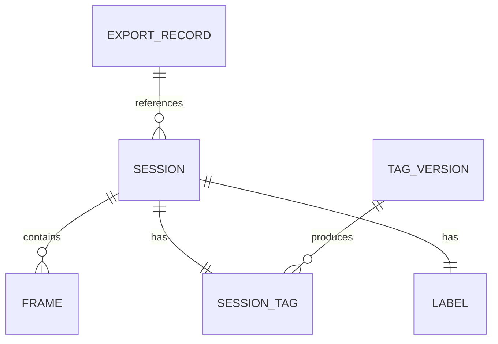

# 自动驾驶数据集 Meta 信息管理数据库 V2：设计解析

## 一句话理解

一个只管**元数据**、不管数据本体的 MongoDB 索引层：Session（采集会话）、Frame（帧）、Label（七类标注的版本条目）、SessionTag（会话级标签）、ExportRecord（导出事件）五类 collection，把"训练集"从数据团队手工维护的 pickle 变成**数据库里可筛选、可版本化、可追溯的查询结果**——`export unified-pkl` 一条命令按最新 ready label 版本生成训练 annotation。

## 为什么重要（V1 的痛点 → V2 的目标）

| V1 痛点 | V2 的解法 |
|---|---|
| 数据分布未知：不同 lidar type、是否含 fn、车型混杂，出问题无法溯源 | Session 顶层字段（`lidar_type`/`has_fn`/`car_type`/`gpsID`）+ 分布统计接口 |
| 训练集 = 数据团队维护的 pickle，改一份做 A/B 很麻烦 | 多条件 filter（日期/GPS/tag/label 版本）→ 确定性抽样 → 导出新训练集 |
| 冷热不分：不合格数据"只进不出" | ExportRecord 记录每次导出引用的 session；窗口期内未被引用 = 冷数据 → 软归档 |
| 无可视化 | 只提供数据模型与查询，前端交给 fiftyone（划边界） |

## 数据模型：五个实体



| 实体 | 主键 | 职责 | 关键设计 |
|---|---|---|---|
| Session | `session_id`（稳定 ID，形如 `PLATE_YYYYMMDDHHMMSS`） | 采集会话元数据 | 顶层带训练/推理两个闭区间帧窗口（`subsequence_start/end`、`subsequence_inference_start/end`）；数据根目录在 `metadata.root_path` |
| Frame | ObjectId | 单帧路径与时间戳 | 仅路径，不含图像本体 |
| Label | `_id = session_id`（每 session 一文档） | 七类 label 的版本管理 | 每类一个字段，值为结构化版本条目数组 `[{version, status, created_at}]` |
| SessionTag | `_id = session_id`（每 session 一文档） | 会话级 tag 历史 | `versions` 数组嵌入；tag 条目 `[start_frame, end_frame, name, ratio]` 表达帧覆盖，**不设独立 FrameTag collection** |
| ExportRecord | ObjectId | 一次导出事件 | 筛选条件 + 引用的 session_id 列表 + 统计；冷数据识别的数据源 |

**Label 的 status 生命周期**：`draft`（入库未验收）→ `ready`（可用于训练）→ `invalidated`（已作废，须带 reason）。

**"某 session 某类型的最新可用版本"** = `status=ready` 条目中 `created_at` 最大者。版本串**原样存储、不做归一化、禁用字符串排序**（版本串非 semver，同一物理版本存在短名 `v8.4` 与长名 `annotations_velocity_v8.4_4.2.6` 并写）。

## 核心设计决策（Alternatives 取舍）

### 1. Label：单 collection + 类型独立字段（vs 每类一表 / 内嵌 Frame）

三个方案对比后的选择：

- **每类独立 collection**：7 张表结构高度重复，新增类型要 DDL，跨类型查询要 union → 不选
- **内嵌 Frame 文档**：label 版本持续迭代会让 Frame 文档不可控膨胀（MongoDB 单文档 16MB 限制），且无法独立管理版本状态 → 不选
- **单 collection，每 session 一文档，每类一个字段**：一次查询获取某 session 全部类型 label；新增类型只需在类型注册表（`label_types.py`）加一行；文档规模与 session 数同量级（十万级）→ **采用**

其中"每 session 一文档"替代了最初的"每帧一文档 + 平行数组"：calibration 这类 session 级数据不再按帧冗余；平行数组（`xx_data_prefix[]` 与 `xx_version[]` 按下标对应）换成结构化条目数组，单版本可独立携带 status 与时间戳，作废某版本只改该条目，无双数组下标错位风险。

### 2. 版本条目结构化（vs 平行数组）

```
平行数组:  object_versions: ["v8.4", "v8.4_fix"]     ← 下标隐式对应
          object_prefixes: ["/a/...", "/b/..."]      ← 错位即事故

结构化:   object.versions: [
            {version: "v8.4",     status: "ready", created_at: "..."},
            {version: "v8.4_fix", status: "ready", created_at: "..."}
          ]
```

### 3. SessionTag：每 session 一文档 + versions 嵌入（vs 每 (session, version) 一文档）

典型使用是"按 session 读取全部 tag 版本"，嵌入数组一次查询即得完整历史；版本数量受控，不会逼近 16MB 上限。代价是单版本更新需 `arrayFilters` + multikey 索引。帧级覆盖由 tag 条目的 `[start, end, name, ratio]` 表达，因此**取消独立 FrameTag collection**（其信息与 SessionTag 重复）。

### 4. MongoDB vs PostgreSQL

V1 已基于 MongoDB；元数据场景对强一致性要求不高；Document 模型天然适合嵌套 metadata 与动态字段（新增 label 类型无需 DDL）。代价：入库无跨 collection 事务，中途失败可能留下部分写入。

## 两个 pkl 契约（容易混淆）

| | row-wise unified pkl（入库输入） | expanded unified pkl（训练输出） |
|---|---|---|
| 来源 | 数据团队交付 | 数据库生成 |
| 版本字段 | 每条 row 独立保存，可为 `None` | 该类型最新 `ready` 版本；从未注册时输出 `None` |
| 帧窗口 | 训练 + 推理两个窗口 | 只输出训练窗口 |
| session 顺序 | 保持输入顺序 | 按稳定 `session_id` 排序 |

导出的失败语义值得记住（**不生成不完整的训练集**）：

- 注册过但没有任何 `ready` 条目 → 导出失败
- 缺顶层训练窗口 / `root_path` / `jpeg_version` / `metadata.sequence_id` → 导出失败
- 该类型从未注册 → 版本字段输出 `None`（合法，对应没做过此类标注的 session）

## 运维与安全边界

- **软归档**：常规删除 = `archived=true`，默认查询排除；Meta DB 不是物理删数工具
- **确定性抽样**：`limit + seed` 在去重排序后的候选集上抽样，相同条件得到相同结果（实验可复现）
- **凭据不落盘**：Mongo URI 只经环境变量 `AV_META_MONGO_MONGO_URI`（`AV_META_MONGO_URI`）注入，不进脚本/pkl/JSON/仓库
- **pickle 是代码**：所有 `--pkl` 参数只接受可信来源——pickle 反序列化可执行任意代码
- **幂等入库**：Session upsert、同 version 条目跳过；但新 version 追加后旧 version 不会自动 invalidated（有意为之：多版本并存便于追溯）
- **并发约定**：批量注册由单一任务执行（ingestion 单写者），条目幂等兜底重跑

## 我的理解

- **这个系统的本质是"把数据集从文件变成视图"**。V1 时代数据集是一个具体的 pkl 文件，版本管理靠文件名；V2 之后数据集是 `filter + label version 选择规则` 的函数，pkl 只是它的物化。ExportRecord 把"哪些数据被哪些实验用过"也变成了一等公民——这是冷数据治理和实验归因的基础。
- **"每 session 一文档"贯穿全部实体是有意的模式统一**：Session、Label、SessionTag 三个 collection 的 `_id` 都是 session_id。一次查询定位一个 session 的全部元数据，天然规避跨文档 join，代价是文档内嵌数组需要 multikey 索引支撑。
- **版本管理把"最新"定义权交给 created_at 而不是版本号字符串**，这是务实的选择——标注版本命名在现实中永远不会是干净的 semver。类似地，导出失败语义（宁可不输出也不输出半成品）是把"训练集完整性"从约定变成机制。
- **取舍上最值得注意的是"设计文档与实现刻意保持张力"**：文档里明确记录了"repository 尚未迁移到方案 B"“ExportRecord 未自动写入"等实现落差，而不是粉饰成已实现。设计文档作为对齐基准的价值正在于此。
- 冷数据治理的闭环设计：ExportRecord（用过的记录）→ cold-data report（没用过的列表）→ 软归档（退出查询范围但不删）→ 人工确认后才物理处理。"只进不出"问题的解法不是授权自动删除，而是**让"未被使用"变得可见**。

## Limitations / Open Questions

- ExportRecord 靠调用方主动写入，没有自动导出器——忘写则冷数据统计失真
- 入库无跨 collection 事务，中途失败留部分写入，靠重跑幂等性兜底
- 版本串不归一化 + 命名规范由数据 owner 统一——统计口径分裂的风险仍在
- 设计与实现存在已声明的落差（SessionTag repository 未迁移方案 B），代码迁移待执行
- 可视化依赖外部 fiftyone，tag 分布与标注质量的一站式查看尚不完整

## Related Knowledge

- [自动驾驶训练数据管理最佳实践](../autonomous-driving/data-management.md) — 本项目落地的通用原则版（存储分层、版本化、清单驱动）
- [MongoDB 与 PyMongo 入门](./mongodb-pymongo-getting-started.md) — 底层存储选型与文档建模基础
- [Fenwick Tree 与动态加权采样](./fenwick-tree-weighted-sampling.md) — tag ratio 加权采样的候选数据结构
- [黑芝麻模型训练平台架构](./mlops-platform/black-sesame-training-platform.md) — 同为工作项目，训练侧基础设施视图
- [端到端轨迹预测的训练闭环与数据管线](../autonomous-driving/e2e-training-pipeline.md) — 数据管线的消费端（summary.pkl → rank shards → 训练）
