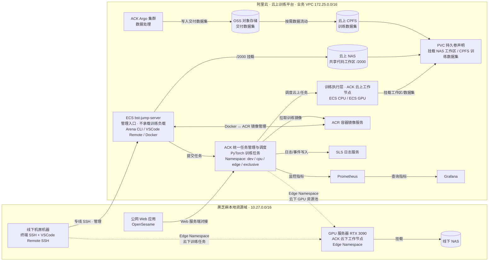

# 黑芝麻模型训练平台架构解析

> 解析对象：一张混合云模型训练平台架构图（[原图](./black-sesame-training-platform-architecture.jpg)，下方 Mermaid 为按原图重绘的等价架构图）。
> 平台定位：**混合云架构 / 双入口管理 / 统一调度 / 开发与训练分离**——云上算力与云下 GPU 统一管理。

## 一句话理解

这是一个典型的 **AI 训练基础设施（Training Platform / ML Infra)**：把本地机房的 GPU 服务器和阿里云 ACK 上的 ECS GPU 抽象成**统一的 Kubernetes 资源池**，开发者通过两条独立入口（SSH → Jump Server → Arena CLI，或办公网 → OpenSesame Web → ACK）提交 PyTorch 训练任务，任务按 Namespace 隔离调度到云上或云下节点，代码/数据集/镜像分别由 NAS/CPFS/OSS/ACR 四类存储承载。

## 为什么值得记录

- **混合云统一调度**是 AI Infra 的核心难题：云下 GPU 服务器如何接入云上调度器？答案是 Edge Namespace（ACK 云下工作节点）
- **双入口设计**（CLI 管理入口 + Web 任务入口）覆盖两类工作流：日常运维与任务提交
- **开发与训练分离**：管理节点（Jump Server）不承载训练负载，训练 Pod 只在专用节点运行
- **存储分层**：NAS（代码工作区）/ CPFS（训练数据集）/ OSS（交付数据集）/ PVC（统一挂载抽象）是教科书级的云上存储选型

## 架构总览

## 逐层拆解

### 1. 接入层：双入口、独立访问链路

| 入口 | 链路 | 用途 |
|---|---|---|
| **CLI 入口** | 机房终端 → 专线 SSH → `bst-jump-server`（按 Linux User 登录）→ Arena CLI | 任务管理：提交 / 查询 / 停止 PyTorch 任务；VSCode Remote SSH 远程开发（NAS /2000 工作区） |
| **Web 入口** | 办公终端 → 公网（白名单）→ OpenSesame → ACK | 任务提交与对接 ACK，面向不走机房的办公侧用户 |

两类入口**互相独立**：专线故障不影响办公网入口，反之亦然。Jump Server 是**管理入口，不承载训练负载**——这是"开发与训练分离"原则的体现。

### 2. 调度层：ACK 统一任务管理与调度

- **任务形态**：PyTorch 训练任务，接收 Arena CLI / OpenSesame 提交（Arena 是阿里云基于 Kubeflow/ACK 的训练任务 CLI）
- **资源池逻辑隔离**：用 Namespace 划分资源池——`dev` / `cpu` / `edge` / `exclusive` 等
- **关键设计——Edge Namespace**：`edge` Namespace 把**线下机房 GPU 服务器（RTX 3090）注册为 ACK 云下工作节点**，调度组件可以对它下发训练任务。这就是"混合云统一调度"的实现机制：调度平面在云上（ACK），执行平面横跨云上 ECS 和云下 GPU
- **任务组件**：PyTorch 任务管理、排队、调度组件负责排队与绑核分配

> 我的理解：`edge` Namespace 本质上是用 Kubernetes 的控制平面收敛了异构算力。云下节点通过专线加入 ACK 集群（大概率是注册节点/自建节点接入方式），对用户来说"提交任务"不感知训练发生在云上还是云下——Namespace 是唯一的调度意图表达。

### 3. 执行层：训练节点与存储挂载

**训练执行层**：

- 云上：ECS · CPU / ECS · GPU，ACK 纳管的训练 Pod
- 云下：GPU 服务器（RTX 3090，Edge Namespace 训练任务），挂载线下 NAS

**存储是这套架构里分层最清晰的部分**：

| 存储 | 角色 | 谁用 | 为什么 |
|---|---|---|---|
| 云上 NAS | 共享代码工作区（/2000） | Jump Server 管理节点 + 云上训练 Pod | 代码编辑低吞吐，NAS 够用且便宜；管理节点与训练 Pod 共享同一份代码 |
| 云上 CPFS | 训练数据集 | 训练 Pod | 并行文件系统，高吞吐高 IOPS，扛得住多 Pod 并发读数据 |
| OSS | 交付数据集 | Argo 数据处理集群产出 | 对象存储做冷数据/交付层，按需流动到 CPFS |
| 线下 NAS | 云下 GPU 的训练数据 | 云下 GPU 服务器挂载 | 云下训练不跨专线读数据，避免带宽瓶颈 |
| PVC | 统一挂载抽象 | 训练 Pod | 声明式挂载 NAS 工作区 / CPFS 数据集，任务 YAML 不感知后端 |

数据流：**ACK Argo 集群做数据处理 → 产出交付数据集写入 OSS → 按需流动到 CPFS → 训练 Pod 通过 PVC 挂载**。这条"数据加工与交付"流水线和训练流水线解耦。

### 4. 镜像层：Docker ↔ ACR

- Jump Server 上 Docker 默认连接 ACR 镜像仓库：构建/维护训练镜像
- 训练 Pod 从 ACR **拉取训练镜像**
- 镜像流：本地构建 → 推送 ACR → ACK 拉取 → 训练 Pod 运行

训练环境以镜像为载体固化，保证云上云下环境一致。

### 5. 可观测性：日志、指标、大盘

| 组件 | 职责 |
|---|---|
| SLS（日志服务） | ACK 任务日志与事件的写入与查询 |
| Prometheus | ACK 监控指标的接收与存储 |
| Grafana | 任务监控大盘，Prometheus 数据源 |

三者是阿里云可观测全家桶的标准接法：任务事件 → SLS，指标 → Prometheus → Grafana。

### 6. 网络底座：双专线互联

- 机房网段 `10.27.0.0/16` ↔ 业务 VPC `172.25.0.0/16`，两条 **10 Gbps 专线**
- 控制与任务管理流量均走双专线（SSH、VSCode Remote、任务下发）
- 办公网走公网白名单进 OpenSesame，不占专线

## 设计原则提炼

1. **统一调度**：一套 ACK 控制平面管云上 ECS + 云下 GPU，用户面向 Namespace 而非具体机器
2. **开发与训练分离**：Jump Server 只做管理与开发（不承载训练负载），训练只在训练节点
3. **双入口容灾**：CLI（专线）与 Web（公网）独立访问链路
4. **存储按访问模式分层**：代码（NAS）/ 热数据（CPFS）/ 冷数据与交付（OSS）/ 云下自挂载（线下 NAS），PVC 做统一抽象
5. **环境即镜像**：Docker + ACR 固化训练环境

## Limitations / 值得追问的点

- **专线是单点风险**：双专线若同路由中断，云下 GPU 节点脱离调度平面，Edge 任务会受影响（K8s 对失联节点的 eviction 行为需要额外策略）
- **云下 NAS 是孤岛**：线下 NAS 未参与云上 PVC 抽象，云上云下数据同步（如代码提交、数据回传）图中未体现
- **GPU 服务器配置较轻**：RTX 3090（24GB）适合中小模型/调试，大模型训练仍依赖云上 GPU
- **OpenSesame 与 ACK 的对接方式**（直连 API Server？经 Arena 后端？）图中未展开

## My Understanding

- 这套架构的本质是**用 Kubernetes 把"算力位置"抽象掉**：用户表达意图（Namespace + 资源请求），调度器决定在哪跑。这是所有混合云训练平台（包括各大厂内部平台）的共同收敛点
- 存储选型上它体现了"**按数据的温度和访问模式选存储**"：编辑代码（低吞吐、元数据敏感）用 NAS，读数据集（高吞吐并发）用 CPFS，交付沉淀用 OSS——与[面向 AI 训练与多云场景的存储工程地图](../../distributed-systems/distributed-storage/ai-training-and-multicloud-storage-map.md)中多级存储的思想一致
- 双入口、开发训练分离，反映的是**平台工程中"角色-链路"匹配**：算法工程师日常走 SSH + CLI（灵活），任务提交方走 Web（低门槛）

## Related Knowledge

- [Kubernetes 入门 Wiki](../kubernetes/) — ACK 的底层：Pod、调度、PV/PVC/CSI、Namespace
- [面向 AI 训练与多云场景的存储工程地图](../../distributed-systems/distributed-storage/ai-training-and-multicloud-storage-map.md) — NAS/CPFS/OSS 分层选型的通用原理
- [并行文件系统](../../distributed-systems/distributed-storage/parallel-file-systems.md) — CPFS 属于此类
- [对象存储](../../distributed-systems/distributed-storage/object-storage.md) — OSS 属于此类
- [块存储、文件存储与对象存储对比](../../distributed-systems/distributed-storage/block-file-object-comparison.md) — 三类存储语义
- [PyTorch 分布式训练](../../ai/systems/pytorch/pytorch-distributed.md) — 平台承载的负载形态
