# 千卡集群网络拓扑与 NCCL 排查

## 一句话理解

千卡集群的网络排查不是寻找一张“最快的网卡”，而是建立并验证一条完整映射：**GPU → PCIe/NUMA → HCA/NIC → 网卡接口 → Leaf/Spine 交换网络 → 目标 GPU**，再确认实际训练中的 NCCL 是否沿着预期路径通信。

## 前置知识：一条通信路径上的几个概念

先把这条链路拆成三层：

```text
硬件层：GPU → PCIe / NUMA → HCA / NIC
操作系统层：HCA / NIC → Linux 网卡接口
网络层：网卡接口 → Leaf / ToR → Spine → 目标节点
Kubernetes 层：Pod 决定任务在哪台节点运行，以及容器能看到哪些设备
```

### 1. PCIe：主机内部的高速设备总线

**PCIe（Peripheral Component Interconnect Express）不是网络交换机**，而是服务器主板内部连接 CPU、GPU、HCA/NIC、NVMe 等设备的高速总线。

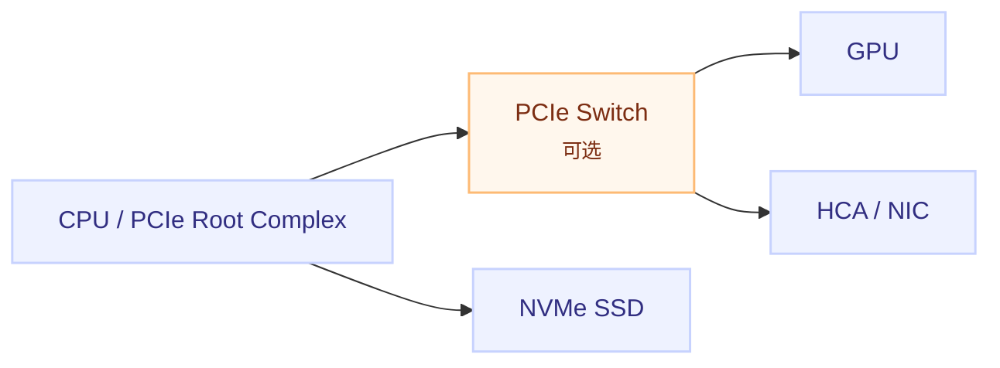

GPU 和 HCA 之间要传输数据时，数据可能经过同一个 PCIe switch，也可能经过更远的 PCIe bridge、CPU 或 NUMA 互连。路径越远，通常延迟越高、可用带宽越复杂，因此 `nvidia-smi topo -m` 会用 `PIX`、`PXB`、`PHB`、`SYS` 等标记描述相对距离。

### 2. NUMA：CPU、内存和 PCIe 设备的“局部性”

**NUMA（Non-Uniform Memory Access）**表示一台多路 CPU 服务器中，不同 CPU socket 各自更靠近一部分内存和 PCIe 设备：

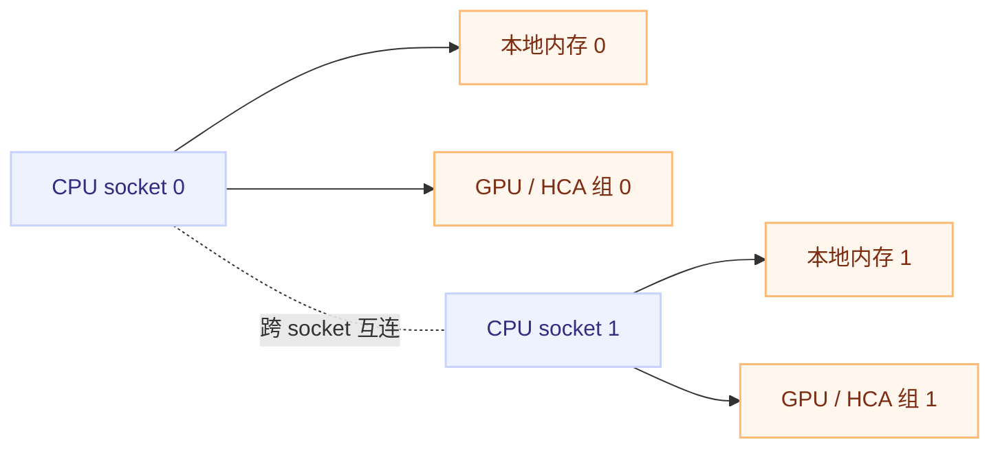

在分布式训练里，理想情况是：负责某张 GPU 的 CPU 线程、内存和 HCA 尽量位于同一个 NUMA 节点。若 GPU0 挂在 NUMA 0，却让它频繁通过 NUMA 1 的 HCA 通信，数据可能需要跨 socket，出现额外延迟或带宽损失。

可以把 NUMA 先理解成：

> **同一台机器内部也有“近处”和“远处”；近处的数据通路通常更适合绑定在一起。**

### 3. HCA 与 NIC：两种容易混淆的叫法

- **NIC（Network Interface Controller）**是泛称：负责把服务器连接到网络的网络适配器。
- **HCA（Host Channel Adapter）**通常指面向高性能互连的适配器，常见于 InfiniBand 或 RoCE/RDMA 场景。
- HCA 可以看作一种面向 RDMA 的高性能 NIC，但具体设备、驱动和命名方式要以实际环境为准。
- `mlx5_0` 是 Linux/RDMA 视角中的 HCA 设备名；它的某个 port 可能映射到 `ens5f0np0` 这样的 Linux 网卡接口名。

```text
GPU → PCIe → HCA port 1（例如 mlx5_0:1）→ Linux 接口（例如 ens5f0np0）
```

这几个名字不是同一套命名：

| 名字 | 所在视角 | 示例 | 主要回答 |
|---|---|---|---|
| HCA | RDMA / 高性能互连设备 | `mlx5_0` | 哪个 RDMA 设备在工作 |
| HCA port | 设备端口 | `mlx5_0:1` | 使用 HCA 的哪个端口 |
| NIC | 网络适配器的泛称 | Ethernet / InfiniBand adapter | 这是不是一张网络设备 |
| Linux 网卡接口 | 操作系统网络接口 | `ens5f0np0`、`ib0` | IP、路由和 Socket 走哪个接口 |

因此不能看到 `nvidia-smi topo -m` 里的 `NIC0`，就直接断定它一定叫 `eth0` 或 `mlx5_0`；需要用 PCI 地址、`ibdev2netdev`、`rdma link show` 和 sysfs 把它们对应起来。

### 4. 网卡接口：操作系统看到的“门牌号”

网卡接口是 Linux 给网络设备暴露的操作对象，例如：

```bash
ip -br addr
rdma link show
ibdev2netdev
```

你会分别看到类似下面的关系：

```text
mlx5_0 port 1 ==> ens5f0np0 (Up)
ens5f0np0     10.10.0.11/24
```

可以把它理解为：

```text
物理设备：HCA / NIC
        ↓ 驱动映射
操作系统接口：ens5f0np0
        ↓ 配置 IP / 路由
网络通信：去往某个目标 IP 时选择的出口
```

`ip route get <目标IP>` 只能说明普通 IP 路由会选择哪个 Linux 接口；NCCL 是否最终使用该接口对应的 RDMA HCA，还要看 NCCL 日志和 RDMA 配置。

### 5. Leaf / ToR 与 Spine：机架之间的网络交换层

- **Leaf** 是连接服务器的接入交换机；在机架顶部部署时也常称 **ToR（Top of Rack）**。
- **Spine** 是更上层的汇聚交换机，连接多个 Leaf。
- 一台服务器的 HCA/NIC 先接入本机架的 Leaf；访问另一个机架的服务器时，通常需要经过 Spine 再到目标 Leaf。

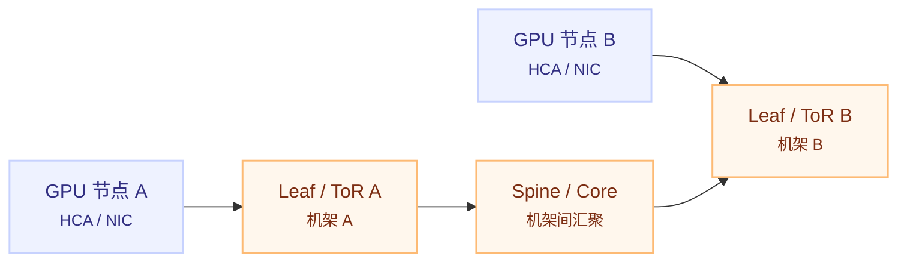

同一 Leaf 下的两个节点，可能只需要走机架内交换路径；跨 Leaf 或跨机架时，会经过更高层的汇聚网络。千卡任务中的 all-reduce、all-to-all 会同时产生大量跨节点流量，因此交换机上联带宽、过度汇聚和拥塞会直接影响训练速度。

### 6. Pod：Kubernetes 中的任务包装和调度单位

**Pod 不是一台物理服务器，也不是单独一个进程。**它是 Kubernetes 的最小调度单位，包含一个或多个需要共同运行的容器。基础概念另见 [Pod 与多容器模式](../kubernetes/04-pods-and-container-patterns.md)：

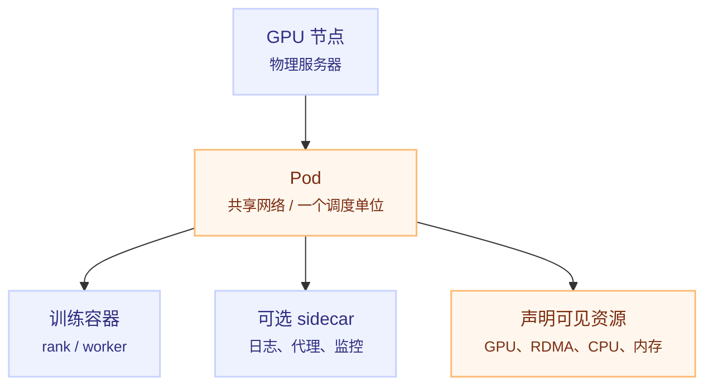

同一个 Pod 内的容器共享网络命名空间、Pod IP 和端口空间；但不同 Pod 之间要经过 Pod 网络。对于分布式训练，Pod 还可能只看到被 device plugin、RDMA 设备插件或容器运行时暴露出来的部分 GPU/HCA 设备。

所以要区分三种视角：


例如，宿主机上存在 `mlx5_0`，不代表训练 Pod 一定能访问它；Pod 内能看到某个 IP 接口，也不代表 NCCL 一定会用它做 RDMA。排查时必须在**实际任务所在的 Pod**中验证设备可见性、路由和 NCCL 日志。

### 7. 把整条链路串起来

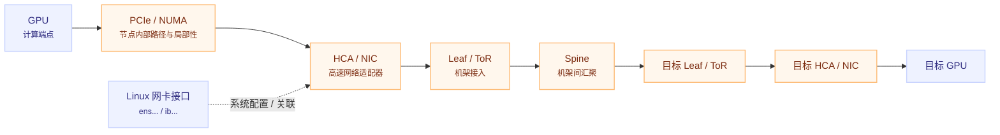

这张图是概念映射，不代表每条路径都必须经过 Spine；虚线表示 Linux 接口与设备的关联，不表示 RDMA 数据必须经过 Linux 内核网络协议栈。具体路径取决于硬件、网络和软件配置。

这条链路中：

- PCIe/NUMA 主要描述**单台服务器内部**的设备连接和内存局部性；
- HCA/NIC 是**连接服务器与外部网络**的硬件；
- Linux 网卡接口是操作系统配置 IP、路由和网络状态的入口；
- Leaf/Spine 是**多台服务器之间**的交换网络；
- Pod 是 Kubernetes 对训练进程的**逻辑包装和调度单位**，它决定任务落在哪台节点，以及容器能看到哪些资源。

## 为什么千卡规模要换一种看法

两机八卡时，可以登录两台机器手工查看 `nvidia-smi topo -m`；千卡规模通常包含数百台服务器、多个机架和多层交换机，问题会从“某张网卡是否可用”升级为：

- 某类节点是否缺少 HCA、端口降速或固件不一致；
- GPU 与 HCA 是否跨 NUMA，rail 是否错配；
- 某些任务是否跨机架、跨 Leaf 或跨网络 fabric；
- NCCL 是否从 RDMA 回退到了 Socket；
- 少数慢节点或拥塞链路是否拖慢整个任务。

### 先建立三层心智模型

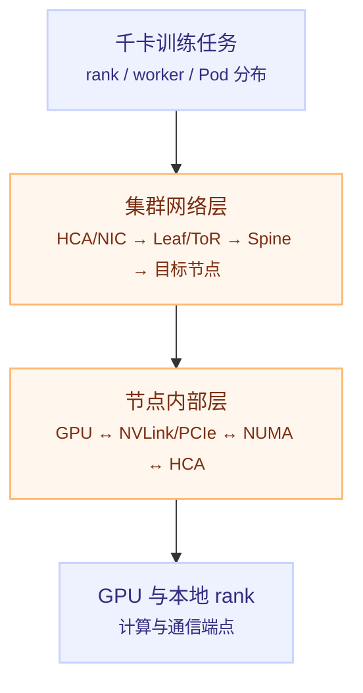

排查时不要把下面三个问题混在一起：

| 问题 | 主要证据 | 能回答什么 |
|---|---|---|
| 硬件如何连接 | `nvidia-smi topo -m`、PCI 地址、NUMA、交换机端口表 | 哪个 GPU/HCA/交换机端口彼此更近 |
| IP/RDMA 如何选路 | `ip route get`、`rdma link`、IB/RoCE 状态、交换机配置 | 去往目标节点时会经过哪个接口和 fabric |
| 任务实际如何通信 | NCCL 日志、`nccl-tests`、端口计数器 | NCCL 是否使用预期 HCA、协议和链路，性能是否达标 |

## 一、完整拓扑应该长什么样

### 节点内部

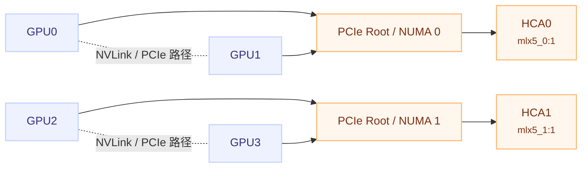

重点不是图画得漂亮，而是能回答：

- GPU 到 GPU 是 NVLink、同一 PCIe switch，还是跨 NUMA；
- GPU 到 HCA 是否经过较近的 PCIe 路径；
- 每张 GPU 是否有预期的本地 HCA/rail；
- 是否有某类节点的硬件布局与其他节点不同。

### 集群网络层

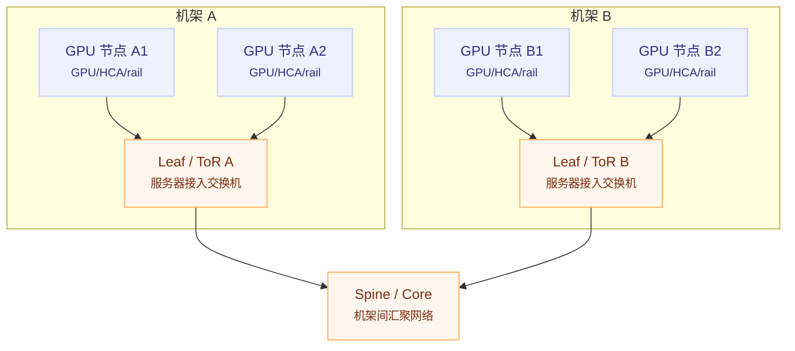

如果没有交换机管理权限，仅靠服务器通常只能确认“本机到网卡”的关系，无法完整还原 Leaf、Spine、端口和跨机架路径。千卡集群必须把主机侧信息与网络侧端口资产表结合起来。

## 二、节点内拓扑：先按节点类型抽样

不必一开始登录每台机器。先按以下维度建立节点类型清单：

- 服务器型号和主板布局；
- GPU 型号、数量和 PCIe 插槽布局；
- HCA/NIC 型号、数量和速率；
- BIOS、GPU 驱动、OFED/rdma-core、固件版本；
- 机架、网络 fabric 和交换机接入方式。

每种硬件类型至少抽查一台；如果同一型号分布在多个机架且布线可能不同，再按机架抽查。

### 1. 看 GPU、GPU 和 NIC 的相对位置

```bash
nvidia-smi topo -m
numactl -H
lspci -tv
```

`nvidia-smi topo -m` 重点看两类关系：

```text
GPU ↔ GPU：NV# / PIX / PXB / PHB / NODE / SYS
GPU ↔ NIC：GPU 到 NIC/HCA 的路径距离
```

常见含义以命令输出末尾的 Legend 为准，不能只凭缩写猜测。一般来说，`NV#` 表示存在 NVLink 路径，`PIX`/`PXB`/`PHB`/`SYS` 反映 PCIe、Host Bridge、NUMA 和系统互连路径的远近。

### 2. 建立 GPU PCI 地址清单

```bash
nvidia-smi \
  --query-gpu=index,name,pci.bus_id \
  --format=csv
```

PCI BDF 是连接不同工具输出的关键。建议至少记录：

| 字段 | 示例含义 |
|---|---|
| GPU index | 任务看到的 GPU 编号 |
| GPU PCI BDF | `0000:31:00.0` |
| GPU 型号 | A100、H100 等 |
| NUMA 节点 | `0`、`1` 等 |
| 节点类型 | 服务器型号或硬件 profile |

### 3. 建立 HCA 与 Linux 网卡清单

```bash
ibdev2netdev
rdma link show
ip -br addr
```

典型映射可以整理成：

```text
mlx5_0 port 1 ==> ens5f0np0 (Up)
mlx5_1 port 1 ==> ens5f1np1 (Up)

mlx5_0:1  ↔  ens5f0np0
mlx5_1:1  ↔  ens5f1np1
```

再查看 HCA 的 PCI 路径：

```bash
readlink -f /sys/class/infiniband/mlx5_0/device
readlink -f /sys/class/infiniband/mlx5_1/device
```

最终应能填写出：

| GPU | GPU PCI BDF | 较近 HCA | HCA port | Linux 接口 | NUMA |
|---|---|---|---|---|---|
| GPU0 | 实际值 | `mlx5_0` | `1` | `ens5f0np0` | `0` |
| GPU1 | 实际值 | `mlx5_1` | `1` | `ens5f1np1` | `0` |
| GPU2 | 实际值 | `mlx5_2` | `1` | `ens6f0np0` | `1` |

这张表比单独看 `NIC0` 更可靠，因为 `NIC0` 是 `nvidia-smi topo -m` 中的局部标签，不能直接当作 `eth0`、`ib0` 或 `mlx5_0`。

## 三、理解 rail：千卡集群的关键映射

如果一台机器有 8 张 GPU 和 8 个 HCA，常见的 rail-optimized 设计会尽量让 GPU 与对应 HCA、交换机路径保持稳定映射：

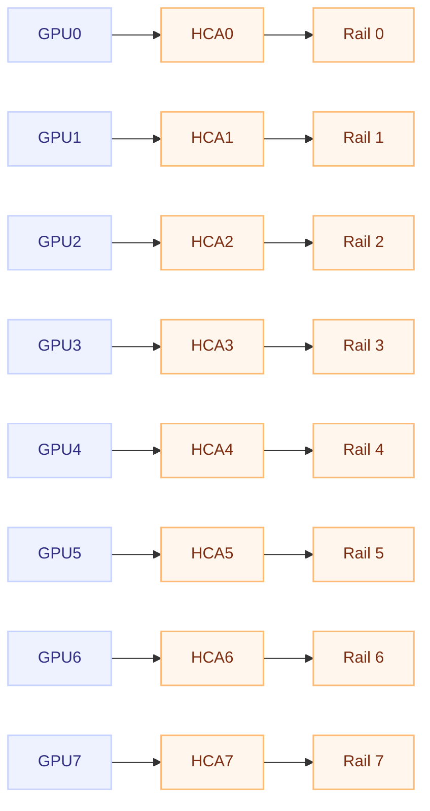

这里的“rail”是工程上的并行通信通道，不是 Linux 的固定设备名。具体映射由服务器 PCIe 布局、HCA 数量、交换机布线、NCCL 和网络插件共同决定。

重点排查：

- GPU0 是否被迫使用远端或跨 NUMA 的 HCA；
- 某个 rail 是否缺少 HCA、端口降速或接入了不同 fabric；
- 不同节点的 GPU/HCA 编号是否具有一致含义；
- `NCCL_IB_HCA` 等约束是否把任务限制到了少数 HCA；
- 某个 rail 是否在交换机侧形成热点。

## 四、节点间网络：InfiniBand 与 RoCE

### InfiniBand

常用工具：

```bash
ibstat
iblinkinfo
ibnetdiscover
ibdiagnet
```

主要确认：

- HCA 端口是否为 `Active`；
- 端口速率、链路宽度是否符合预期；
- 节点是否接入预期的 Leaf/Spine；
- 是否有 `Down`、`Disabled`、降速、错误计数或异常重传；
- fabric 中是否存在单链路、单交换机或局部故障。

### RoCE

RoCE 运行在以太网上，不能只依赖 IB 工具。应结合：

```bash
ip -br link
rdma link show
IFACE='ens5f0np0'  # 替换成实际接口名
ethtool "$IFACE"
ethtool -S "$IFACE"
lldpctl
```

重点关注：

- 链路是否 `UP`，速率是否为预期的 100G/200G/400G；
- CRC、丢包、pause、重传等计数器是否异常；
- PFC、ECN/DCQCN 等配置是否符合网络设计；
- LLDP 能否确认对端交换机和端口。

服务器命令可以说明本机看到什么，但交换机端口利用率、拥塞和跨机架路径仍需要网络设备侧指标。

## 五、确认任务实际选了什么

静态拓扑只能说明“硬件上可以怎么走”，不能证明当前训练真的这么走。启动实际任务时，临时打开 NCCL 日志：

```bash
export NCCL_DEBUG=INFO
export NCCL_DEBUG_SUBSYS=INIT,NET,GRAPH
export NCCL_DEBUG_FILE=/tmp/nccl.%h.%p.log
```

查看各节点日志：

```bash
grep -E 'NET/|mlx5|Socket|IB|GRAPH|HCA' /tmp/nccl.*.log
```

重点关注：

```text
NET/IB      通常表示使用 IB/RDMA 网络路径
NET/Socket  通常表示使用 TCP Socket，或 RDMA 路径未被使用
```

同时检查：

- NCCL 发现了哪些 HCA 和端口；
- 是否发生 RDMA 初始化失败或回退；
- 不同 rank 是否选择了不一致的接口；
- GPU Direct RDMA、网络插件和协议是否按预期启用；
- NCCL 日志中的节点名、rank 和通信图是否与任务分布一致。

NCCL 日志格式会随版本、网络插件和配置变化，不能只凭一行 `NET/IB` 判定性能一定正常。排查结束后取消临时变量：

```bash
unset NCCL_DEBUG NCCL_DEBUG_SUBSYS NCCL_DEBUG_FILE
```

如果确实需要约束接口，先理解两者边界：

| 变量 | 约束对象 |
|---|---|
| `NCCL_SOCKET_IFNAME` | IP 网络接口，例如用于 bootstrap 或 Socket 通信 |
| `NCCL_IB_HCA` | IB/RDMA HCA 设备及端口 |

不要直接复制其他集群的环境变量。千卡集群通常应先按节点类型建立 profile，再为同一 profile 使用经过验证的配置。

## 六、Kubernetes / Volcano 中的拓扑

任务实际运行在 Pod 中，因此需要同时观察宿主机、Pod、调度器三层：

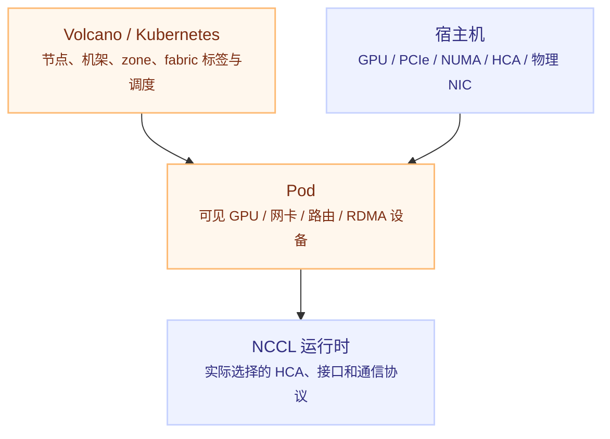

先确认 worker Pod 分布在哪些节点：

```bash
kubectl get pods -A -o wide
kubectl get nodes --show-labels
```

建议给节点维护可调度的拓扑标签，例如：

```text
infra.example.com/rack=rack-03
topology.kubernetes.io/zone=zone-a
infra.example.com/gpu-model=h100
infra.example.com/network-fabric=fabric-a
infra.example.com/rail-count=8
```

大规模任务需要结合节点亲和性、拓扑分布、Volcano PodGroup 和 gang scheduling 设计调度约束。**GPU 数量够了，不代表通信拓扑适合任务**：任务可能被分散到多个机架、多个 Leaf，甚至不同网络 fabric。

如果容器内没有 `ip`、`rdma` 或 `nvidia-smi`，只能说明镜像没有包含这些工具，不能直接推断设备不可用。应在宿主机、具备工具的诊断镜像和实际训练日志之间交叉验证。

## 七、测试策略：不要做千卡全对全

如果集群有约 1000 张 GPU，GPU 两两关系数量为：

$$
\frac{1000 \times 999}{2} = 499{,}500
$$

没有必要逐对测试。应采用分层抽样：

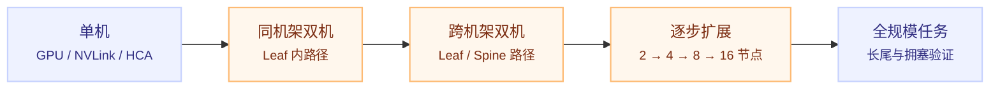

### 单机测试

使用 `nccl-tests` 验证每种节点类型的单机路径：

```bash
./build/all_reduce_perf -b 8 -e 8G -f 2 -g 8
```

实际参数应按 GPU 数量、消息大小和测试目标调整。重点记录 NCCL 版本、节点类型、HCA 数量、GPU 数量和有效带宽。

### 双机与逐步扩展

至少选择以下节点对：

- 同一机架内两节点；
- 相邻机架两节点；
- 跨 Leaf 两节点；
- 跨 Spine 两节点；
- 不同硬件 profile 的节点。

之后从 1 节点逐步扩展到 2、4、8、16 节点，再到全规模。每个规模记录：

- all-reduce 和 all-to-all 有效带宽；
- 初始化时间、p99 延迟和超时；
- GPU 利用率与 NCCL kernel 时间；
- HCA/交换机端口利用率；
- 丢包、重传、错误和最慢 rank。

分布式任务通常受最慢 rank 限制：

$$
T_{step} \approx \max_i T_{step}^{(i)}
$$

因此千卡集群不能只看平均带宽，还要关注尾部节点、尾部链路和异常 rail。

## 八、常见现象如何定位

| 现象 | 优先检查 |
|---|---|
| 日志出现 `NET/Socket` | RDMA/HCA 状态、NCCL 网络插件、容器设备权限、`NCCL_IB_HCA` |
| 单机正常，跨机明显变慢 | HCA 端口速率、Leaf/Spine 路径、RoCE 拥塞、交换机计数器 |
| 只有少数 rank 很慢 | 异常节点、异常 rail、GPU-HCA 跨 NUMA、端口降速 |
| 任务规模增大后扩展效率骤降 | oversubscription、跨机架流量、网络热点、任务放置不均 |
| 某些节点不能加入通信 | 节点软件/固件版本、路由、MTU、RDMA port 状态、防火墙 |
| GPU 利用率低但 CPU 正常 | NCCL 通信等待、数据加载、网络带宽或通信重叠失败 |

## 九、推荐的排查顺序

```text
1. 确认任务 rank / Pod 分布和节点、机架、fabric
2. 按节点类型抽样检查 GPU、HCA、驱动和固件版本
3. 用 nvidia-smi topo -m 建立节点内 GPU-NIC-NUMA 关系
4. 用 ibdev2netdev / rdma link 建立 HCA-网卡关系
5. 从交换机资产表确认 Leaf/Spine 端口和机架路径
6. 检查所有 HCA/NIC 端口状态、速率和错误计数
7. 查看 NCCL INIT/NET/GRAPH 日志确认实际选择
8. 运行单机 nccl-tests
9. 运行同机架、跨机架双机测试
10. 逐步扩大规模，比较平均值、p99 和最慢 rank
11. 最后运行全规模测试并关联交换机监控
```

## 我的理解

- **拓扑不是一张图，而是一条可验证的映射链**：硬件拓扑回答“能怎么走”，路由和 fabric 回答“网络怎么走”，NCCL 日志和基准测试回答“任务实际怎么走”。
- **rail 一致性比单张网卡的峰值更重要**：千卡任务会同时产生大量通信，GPU、HCA、交换机端口和机架路径的均衡性决定尾部性能。
- **千卡性能问题经常是长尾问题**：平均节点都正常时，少数降速端口、错误 HCA 或跨机架放置也足以拖慢整个任务。
- **Kubernetes 调度是拓扑的一部分**：节点数量满足资源请求只是第一步；机架、fabric、GPU 型号和 HCA profile 也可能需要进入调度约束。

## Related

- [局域网多服务器搭建 Volcano 集群](./lan-volcano-cluster.md) — Kubernetes、Volcano 与 GPU 任务的部署验证顺序
- [PyTorch 分布式训练](../../ai/systems/pytorch/pytorch-distributed.md) — 分布式训练的进程组、通信和并行方式
- [集合通信原语](../../ai/systems/pytorch/pytorch-collective-communication.md) — all-reduce、all-gather、all-to-all 等通信原语
- [PyTorch 分布式训练性能分析](../profiling/07-pytorch-distributed-profiling.md) — NCCL、通信重叠和基准测试方法
- [Kubernetes 资源、调度与自动扩缩容](../kubernetes/09-resources-scheduling-and-autoscaling.md) — 节点资源、调度和拓扑约束基础

## References

- [NVIDIA NCCL 环境变量](https://docs.nvidia.com/deeplearning/nccl/user-guide/docs/env.html)
- [NVIDIA nccl-tests](https://github.com/NVIDIA/nccl-tests)
- [NVIDIA GPU Deployment and Management Documentation](https://docs.nvidia.com/datacenter/)
