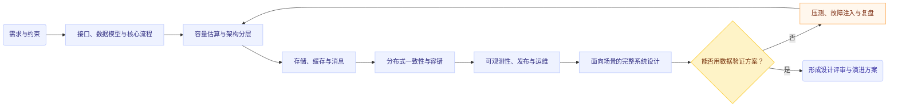

# System Design 学习路线图

> 目标：建立从需求分析、容量估算、架构建模，到分布式系统落地、性能优化与生产运维的完整系统设计能力。
>
> 这不是“背组件”的清单，而是一条**从问题建模到工程权衡**的训练路线。每个阶段都要求产出设计文档、接口定义、容量模型、故障分析或可运行原型。

## 1. System Design 到底包含什么

System Design（系统设计）是把一个业务或技术问题转化为一组可运行、可演进、可观测、可恢复的系统结构。它关注的不是单个类或函数，而是多个服务、数据存储、网络、计算资源和运维机制之间的协作。

一个完整的系统设计通常至少回答以下问题：

1. **系统解决什么问题**：用户、场景、边界和成功指标是什么？
2. **系统提供什么能力**：核心用例、API、数据模型和状态变化是什么？
3. **系统如何承载规模**：QPS、并发数、数据量、带宽、容量和增长率是多少？
4. **系统如何保持正确**：一致性、幂等性、事务边界、顺序性和数据完整性如何保证？
5. **系统如何保持可用**：故障域、冗余、超时、重试、熔断、降级和恢复路径是什么？
6. **系统如何保持可扩展**：哪些组件可以水平扩展？瓶颈在哪里？扩展的代价是什么？
7. **系统如何被观察和运维**：日志、指标、Trace、告警、审计、发布和回滚如何设计？
8. **系统如何演进**：版本兼容、数据迁移、灰度发布、容量增长和技术债如何处理？

### 1.1 四个层次

可以把 System Design 分成四个相互连接的层次：

| 层次 | 关注点 | 典型问题 |
|---|---|---|
| 需求与约束 | 业务目标、用户、SLO、合规和预算 | “什么叫成功？”“哪些约束不可违反？” |
| 逻辑架构 | 服务边界、调用关系、数据流和状态机 | “哪些能力应该放在一起？” |
| 物理架构 | 机器、容器、网络、存储和部署拓扑 | “系统如何真正运行？” |
| 运行与演进 | 监控、故障、发布、迁移和容量增长 | “坏了怎么办？变更怎么办？” |

### 1.2 System Design 与相邻领域的区别

- **软件设计**：更多关注模块、类、接口和代码内部结构。
- **System Design**：关注跨进程、跨机器、跨服务的协作与权衡。
- **系统架构**：偏向长期结构、边界和原则；System Design 更强调具体方案和可验证性。
- **分布式系统**：是 System Design 的重要理论与技术基础，但不是全部。单机缓存、数据库索引、批处理系统同样属于系统设计。
- **平台工程 / SRE**：关注系统交付、运行和可靠性，是系统设计必须纳入的生产视角。

## 2. 总体学习地图



建议按“先建立通用框架，再进入专题，再通过完整项目反复练习”的顺序学习。不要一开始就从某个热门架构图或某个中间件源码开始，否则容易把组件名称误认为设计能力。

## 3. 学习前置：建立最小基础

### 3.1 编程与工程基础

至少能够熟练完成以下工作：

- 使用一种主力语言实现 HTTP / RPC 服务。
- 理解进程、线程、协程、文件描述符和基本的并发模型。
- 使用 Git、Linux 命令、容器和基本的 CI 流程。
- 能够编写单元测试、集成测试和简单压测脚本。
- 能够阅读服务日志、查看 CPU / 内存 / 磁盘 / 网络指标。

### 3.2 计算机系统基础

需要掌握的不是所有操作系统细节，而是它们如何影响系统行为：

- CPU、缓存、内存、NUMA 与上下文切换。
- 磁盘、SSD、顺序 IO、随机 IO、fsync 与写放大。
- TCP 连接、拥塞控制、连接复用、超时和半连接。
- DNS、负载均衡、TLS、HTTP、HTTP/2、HTTP/3 的基本行为。
- 进程隔离、容器、资源限制和 Linux cgroup 的基本概念。

### 3.3 数据库基础

至少掌握：

- B-Tree、LSM-Tree、哈希索引和范围扫描。
- 事务、隔离级别、MVCC、锁和死锁。
- 主从复制、日志、故障恢复和备份恢复。
- 分片、分区、热点、二级索引和数据迁移。
- SQL 数据库与 KV / 文档 / 对象存储的适用边界。

## 4. 分阶段 Roadmap

下面按 8 个阶段组织。每个阶段都可以用 2～4 周完成一次基础学习与实践；如果是全职系统学习，可压缩时间，如果是业余学习，建议保留完整的实验周期。

---

## Phase 0：建立系统设计思维

**建议周期：1 周**

### 学习目标

把“画一张架构图”转化为“提出问题、明确约束、做出可解释的权衡”。

### 核心内容

- 需求分解：功能需求、非功能需求、显式约束、隐含约束。
- 参与者与边界：用户、外部系统、内部服务、数据所有者。
- 关键用例：主流程、异常流程、重试流程、补偿流程。
- 设计权衡：一致性 vs 可用性、延迟 vs 吞吐、成本 vs 可靠性、简单性 vs 灵活性。
- 设计层次：上下文图、容器图、组件图、部署图、数据流图、时序图。
- 设计假设：哪些是已知事实，哪些是估算，哪些需要验证。

### 练习

选择一个熟悉系统，例如文件上传、任务队列或模型训练平台，写一页设计前置说明：

- 目标用户与核心场景。
- 关键功能与明确不做的功能。
- 规模假设。
- SLO 草案。
- 主要风险和待确认问题。

### 阶段产出

- 一份《需求与约束说明》。
- 一张系统上下文图。
- 一张核心请求的时序图。
- 一份“假设—证据—待验证项”表格。

---

## Phase 1：接口、数据模型与核心流程

**建议周期：2～3 周**

### 学习目标

能够从业务动作推导 API、状态模型、数据表和错误处理，而不是先挑选中间件。

### 核心内容

#### API 设计

- REST、RPC、异步消息接口的适用场景。
- 资源建模、命名、分页、过滤和排序。
- 请求 ID、幂等键、版本号和兼容性。
- 错误码、错误分类、重试提示和可观测字段。
- 同步响应与异步任务的边界。

#### 数据建模

- 实体、关系、生命周期和所有权。
- 状态机：状态、转移、触发条件、非法转移。
- 规范化与反规范化。
- 读模型、写模型和查询视图。
- 软删除、审计字段、版本字段和租户隔离。

#### 端到端流程

- 正常路径。
- 重复请求。
- 部分成功。
- 超时但服务端已成功。
- 客户端重试造成的重复执行。
- 下游不可用时的排队、降级和补偿。

### 实践项目：任务提交系统

实现一个最小任务系统：用户提交任务，服务持久化任务状态，后台 Worker 执行任务，用户可以查询、取消和重试。

必须包含：

- `POST /tasks`，支持幂等提交。
- `GET /tasks/{id}`，返回状态和结果。
- 任务状态机：`created`、`queued`、`running`、`succeeded`、`failed`、`cancelled`。
- Worker 重启后的任务恢复。
- 失败重试上限和死信任务。
- 请求日志、任务事件和基本指标。

### 阶段产出

- API 文档。
- ER 图和状态机图。
- 错误处理矩阵。
- 端到端时序图。
- 一个可运行的单机版本。

---

## Phase 2：容量估算、分层与瓶颈分析

**建议周期：2 周**

### 学习目标

能够用数量级估算判断方案是否可行，并提前识别容量瓶颈。

### 核心内容

#### 容量估算

至少估算以下指标：

- 日活、峰值并发和峰值请求率。
- 读写比例。
- 平均请求大小和 P99 请求大小。
- 每日新增数据、保留周期和总容量。
- 网络入口、内部带宽和出口带宽。
- CPU、内存、连接数、磁盘 IOPS 和吞吐量。
- 副本数、压缩率、纠删码开销和预留容量。

常用估算关系：

$$
QPS_{peak} = QPS_{avg} \times peak\ factor
$$

$$
Storage_{total} = data_{daily} \times retention_{days} \times replicas \times (1 + overhead)
$$

$$
Bandwidth = request\ rate \times average\ payload\ size
$$

估算不需要假装精确。重要的是写清楚假设、上下界、数量级和验证方法。

#### 分层设计

- 接入层、业务层、数据层和异步处理层。
- 热路径、冷路径和离线路径。
- 控制面与数据面。
- 在线请求与批处理任务。
- 强一致路径与最终一致路径。

#### 延迟预算

把端到端延迟拆给各层：

- DNS / TLS / 网络。
- 网关和鉴权。
- 业务逻辑。
- 缓存。
- 数据库。
- 下游服务。
- 序列化与排队。

不要只看平均延迟，要重点分析 P95、P99 和超时比例。

### 实践项目：短链接或图片元数据服务

要求完成：

- 估算 10 倍流量增长后的资源需求。
- 设计读多写少场景下的缓存策略。
- 说明热点 Key、缓存穿透、击穿和雪崩的处理方式。
- 给出数据库索引和分片键选择。
- 设计压测方案并记录实际数据。

### 阶段产出

- 一份容量估算表。
- 一份延迟预算表。
- 一张瓶颈树：入口、计算、存储、网络、下游依赖。
- 压测报告和估算偏差复盘。

---

## Phase 3：存储、缓存、消息与搜索

**建议周期：3～4 周**

### 学习目标

能够根据访问模式选择存储系统，而不是根据技术流行度选择数据库。

### 3.1 数据库与存储

- 关系型数据库：事务、索引、连接池、读写分离。
- KV 存储：点查询、TTL、原子操作、热点分布。
- 文档数据库：半结构化数据和聚合查询。
- 对象存储：大对象、Multipart、生命周期和元数据。
- 分布式文件系统：目录、元数据、条带化、锁和吞吐。
- OLTP 与 OLAP 的边界。
- 数据湖、列式存储和离线计算的基本关系。

可以结合仓库中的[分布式存储基础总览](../distributed-systems/distributed-storage/)和[面向 AI 训练与多云场景的存储工程地图](../distributed-systems/distributed-storage/ai-training-and-multicloud-storage-map/)学习。

### 3.2 缓存

- Cache-aside、Read-through、Write-through、Write-back。
- TTL、主动失效、版本化 Key 和双删。
- 缓存一致性与数据库一致性的关系。
- 热点 Key、缓存击穿、穿透和雪崩。
- 本地缓存、分布式缓存和 CDN 的边界。
- 缓存不是永久事实源：如何处理缓存丢失和重建。

### 3.3 消息与异步系统

- 队列、发布订阅、日志型消息系统的差异。
- 至少一次、至多一次和“有效一次”处理语义。
- 消费者幂等、顺序、分区、背压和消费位点。
- 延迟队列、重试队列、死信队列。
- 事件驱动架构与领域事件。
- Outbox、CDC 和数据变更传播。

### 3.4 搜索与索引

- 倒排索引、分词、相关性和过滤。
- 写入延迟与查询延迟的权衡。
- 索引构建、重建、别名切换和版本迁移。
- 搜索结果不是唯一事实源时的数据一致性策略。

### 实践项目：事件驱动订单或数据处理系统

设计并实现：

1. API 服务写入主数据库。
2. 通过 Outbox 或可靠事件机制发布事件。
3. 消费者更新搜索索引、统计视图和通知系统。
4. 消费失败进入重试队列和死信队列。
5. 支持从事件或主库重建派生数据。

### 阶段产出

- 存储选型决策记录（ADR）。
- 缓存一致性说明。
- 消息语义与幂等性说明。
- 事件 Schema 和兼容策略。
- 重建、回放和数据修复方案。

---

## Phase 4：分布式系统核心

**建议周期：4～6 周**

### 学习目标

理解网络不可靠、机器会失败、时钟不可靠、消息会重复或乱序时，系统如何仍然保持可接受的正确性与可用性。

### 核心内容

#### 一致性模型

- 强一致、线性一致、顺序一致、因果一致和最终一致。
- Read-your-writes、单调读、单调写。
- 一致性与可用性的业务含义。
- 何时必须强一致，何时可以异步收敛。

#### 复制与共识

- 主从复制、多主复制和无主复制。
- Quorum、读修复、反熵和冲突解决。
- Raft 的 Leader、Term、Log、Commit 和 Snapshot。
- Paxos 的基本思想与工程实现差异。
- Leader 选举、租约、fencing token 和脑裂。

#### 分区与扩展

- Hash 分片、范围分片和一致性哈希。
- Rebalancing、迁移期间的读写行为。
- 热点分片与负载倾斜。
- 跨分片查询、聚合和事务。

#### 故障与时间

- 崩溃故障、网络分区、延迟故障、拜占庭故障的区别。
- 超时不等于失败。
- 逻辑时钟、向量时钟和混合逻辑时钟。
- 重试风暴、级联故障和故障放大。

#### 分布式事务

- 两阶段提交及其阻塞问题。
- Saga、补偿事务和状态机。
- TCC 的适用边界。
- 事务消息、Outbox 和最终一致性工作流。

推荐结合仓库中的[分布式系统核心理论基础](../distributed-systems/distributed-systems-foundations.md)学习。

### 实践项目：简化版复制 KV 存储

按以下顺序实现：

1. 单机内存 KV。
2. WAL 和崩溃恢复。
3. 主从复制。
4. 复制位点和重放。
5. Leader 选举或基于租约的主节点切换。
6. 快照与日志压缩。
7. 网络分区和节点重启测试。

不要求一开始实现工业级算法，重点是记录每一步的状态机、故障假设和不变量。

### 阶段产出

- 故障模型说明。
- 一致性模型选择说明。
- 复制协议时序图。
- 正确性不变量列表。
- 故障注入测试报告。
- “哪些保证做不到”的边界说明。

---

## Phase 5：可靠性、可观测性与安全

**建议周期：3～4 周**

### 学习目标

把“服务能跑”提升为“服务可被运营、可被诊断、可被恢复”。

### 5.1 可靠性设计

- 可用性、可靠性、耐久性和一致性的区别。
- SLI、SLO、SLA 与错误预算。
- 超时、重试、指数退避和抖动。
- 熔断、限流、舱壁隔离和负载 shedding。
- 降级、优雅关闭、健康检查和流量摘除。
- 冗余、故障域、跨可用区和灾备。
- RTO、RPO、备份、恢复演练和数据校验。

### 5.2 可观测性

- 结构化日志：请求 ID、Trace ID、租户、任务 ID、错误原因。
- Metrics：吞吐、延迟、错误率、饱和度、队列深度、消费延迟。
- Tracing：跨服务调用、异步消息关联和采样。
- RED：Rate、Errors、Duration。
- USE：Utilization、Saturation、Errors。
- 高基数标签、采样策略和观测成本。
- 告警要指向可执行动作，而不是单纯制造噪声。

### 5.3 安全

- 身份认证、授权和最小权限。
- 服务间身份、密钥管理和证书轮换。
- 输入校验、限流、防重放和审计。
- 多租户隔离、数据加密和敏感信息脱敏。
- 供应链、镜像、依赖和构建产物安全。

### 实践项目：给 Phase 1 或 Phase 3 的系统做生产化

补齐：

- SLO 和错误预算。
- 统一日志、指标和 Trace。
- 限流、超时、重试和熔断。
- 备份与恢复演练。
- 灾难场景 Runbook。
- 一次故障注入和事后复盘。

### 阶段产出

- SLO 文档。
- 监控面板设计。
- 告警规则和处理手册。
- 灾备与恢复演练记录。
- 一份 Incident Review。

---

## Phase 6：部署、平台与持续交付

**建议周期：3～4 周**

### 学习目标

理解系统从代码到生产环境的完整生命周期。

### 核心内容

- 服务打包、镜像、配置和密钥注入。
- 容器、编排、Service Discovery 和负载均衡。
- 滚动发布、蓝绿发布、金丝雀发布。
- 数据库 Schema 迁移与向后兼容。
- 自动扩缩容、资源请求、限制和调度。
- 多环境管理：开发、测试、预发布、生产。
- 配置中心、特性开关和回滚。
- IaC、审计和环境可复现性。

可以结合仓库中的 [Kubernetes 入门 Wiki](./kubernetes/) 和 [MLOps 平台专题](./mlops-platform/)学习部署、调度、存储与训练平台场景。

### 实践项目：部署一个可灰度发布的服务

要求：

- 容器化服务和依赖。
- 声明资源请求与限制。
- 配置与密钥分离。
- 健康检查和优雅终止。
- 自动化测试与镜像构建。
- 灰度发布、指标观察和回滚。
- 数据库迁移支持 expand / migrate / contract。

### 阶段产出

- 部署架构图。
- CI/CD 流程图。
- 发布与回滚 Runbook。
- 资源容量与扩缩容策略。
- 兼容性和迁移计划。

---

## Phase 7：AI、数据与训练系统设计

**建议周期：4～6 周**

这是面向 AI 基础设施、模型训练平台和数据平台的专项阶段。它把前面的通用 System Design 能力应用到高吞吐、强资源约束、长任务和大规模数据场景。

### 7.1 AI 系统的特殊约束

- GPU / NPU 等加速器是稀缺资源。
- 单个任务生命周期长，失败成本高。
- 计算、网络、存储之间容易互相成为瓶颈。
- 数据集、代码、镜像、模型和 checkpoint 需要版本化。
- 分布式训练存在同步点、集合通信和 straggler 问题。
- 训练与推理在吞吐、延迟、成本和弹性方面目标不同。

### 7.2 训练平台设计

- 用户、项目、队列、配额和优先级。
- Job / Task / Worker / Attempt 的实体模型。
- 资源申请、调度、抢占和公平共享。
- 控制面与训练数据面的分离。
- 数据预处理、缓存、数据加载和存储分层。
- Checkpoint、断点续训和故障恢复。
- 多租户隔离、权限、审计和成本归属。
- 训练指标、日志、Trace 和实验元数据。

仓库中已有的相关材料：

- [黑芝麻模型训练平台架构解析](./mlops-platform/black-sesame-training-platform.md)
- [局域网 Volcano 集群](./mlops-platform/lan-volcano-cluster.md)
- [千卡网络拓扑与 NCCL](./mlops-platform/thousand-gpu-network-topology.md)
- [PyTorch 分布式与集合通信专题](../ai/systems/pytorch/)

### 7.3 推理系统设计

- 在线推理、批量推理和流式推理。
- 模型加载、热更新、版本路由和回滚。
- 动态 batching、请求排队和 token 级调度。
- KV Cache、显存管理和多副本扩展。
- 延迟、吞吐、成本和模型质量之间的权衡。
- 限流、配额、优先级和降级模型。

### 实践项目：小型模型训练平台

至少包含：

1. 用户提交训练 Job。
2. API 服务持久化 Job 与 Attempt 状态。
3. 调度器根据资源、队列和优先级分配 Worker。
4. Worker 上报心跳、日志、指标和 checkpoint。
5. 处理超时、节点失联、重试和取消。
6. 提供训练历史、实验元数据和成本统计。
7. 使用对象存储或共享文件系统保存数据与 checkpoint。

### 阶段产出

- 训练平台上下文图、部署图和数据流图。
- Job 状态机与故障转移表。
- 资源调度策略说明。
- 存储分层与带宽预算。
- 训练失败恢复方案。
- 一次小规模压测和故障演练。

---

## Phase 8：完整系统设计与架构评审

**建议周期：持续进行**

### 学习目标

能够在信息不完整、约束互相冲突、时间有限的情况下，形成清晰、可验证、可演进的方案。

### 推荐练习题目

按难度递进：

#### 入门级

- URL Shortener。
- 文件上传与下载。
- 限流器。
- 任务队列。
- 配置中心。
- 日志聚合服务。

#### 中级

- 新闻流 / 时间线。
- 聊天系统。
- 搜索建议。
- 订单与库存系统。
- 通知平台。
- 分布式锁服务。
- 对象存储元数据服务。

#### 高级

- 多租户工作流平台。
- 分布式调度系统。
- 推荐 / 特征平台。
- 多区域数据同步系统。
- 大规模日志与指标平台。
- 模型训练平台。
- 在线推理平台。
- 数据湖元数据与查询服务。

### 每个题目的标准输出

1. 需求、用户和边界。
2. 功能需求与非功能需求。
3. 规模估算和容量模型。
4. API、事件和数据模型。
5. 高层架构图。
6. 一个关键请求的时序图。
7. 存储与缓存设计。
8. 一致性、幂等和事务边界。
9. 扩展、分片和热点处理。
10. 故障模型、降级和恢复。
11. 可观测性和 SLO。
12. 安全、成本和合规。
13. 发布、迁移和回滚。
14. 主要替代方案及其取舍。
15. 尚未验证的假设和下一步实验。

## 5. 一套可重复的 System Design 解题流程

### Step 1：先问问题，不要先画图

明确：

- 谁在什么场景使用系统？
- 最重要的三个用例是什么？
- 哪些功能明确不在范围内？
- 规模、延迟、可用性、数据保留和预算约束是什么？

### Step 2：写出核心不变量

例子：

- 一个幂等键不能产生两个有效任务。
- 已确认的订单不能无故回退。
- 已提交的 checkpoint 必须可被恢复任务读取。
- 已被消费的消息不能因为消费者重启而产生不可控的副作用。

不变量比组件列表更能约束架构。

### Step 3：画最小可行架构

先只画：

- 客户端。
- 入口层。
- 核心业务服务。
- 主数据存储。
- 必要的异步组件。
- 外部依赖。

不要一开始加入十几个缓存、队列和服务。

### Step 4：按数据流展开

对每条关键请求回答：

- 请求在哪里进入？
- 谁负责鉴权？
- 数据在哪里写入？
- 哪些操作同步完成？
- 哪些操作异步完成？
- 客户端如何知道异步操作结果？
- 失败后谁负责重试或补偿？

### Step 5：做容量估算

从流量、数据量、带宽、IOPS、并发连接和队列长度开始。把“可能很大”变成数量级。

### Step 6：识别瓶颈和故障域

至少检查：

- 单点。
- 共享资源。
- 热点 Key 或热点分区。
- 下游慢请求。
- 队列堆积。
- 网络分区。
- 数据库连接池耗尽。
- 发布期间的数据格式不兼容。

### Step 7：明确一致性和失败语义

对每个关键数据写清楚：

- 谁是事实源？
- 允许多长时间不一致？
- 是否允许重复？
- 是否允许丢失？
- 是否需要顺序？
- 失败后如何重试、补偿和人工介入？

### Step 8：加入可观测性和运维路径

没有监控、告警、备份、回滚和恢复演练的设计，只是架构草图，不是生产系统设计。

### Step 9：比较替代方案

至少保留一个替代方案，并说明：

- 什么时候它更合适？
- 它增加了什么复杂度？
- 它的成本和迁移代价是什么？
- 当前方案未来如何演进到它？

## 6. 设计文档模板

每次练习可以复制下面的结构：

```markdown
# [系统名称] 设计文档

## 1. 背景与目标
- 用户与场景：
- 要解决的问题：
- 不在范围内：

## 2. 需求与约束
### 功能需求
### 非功能需求
### 规模假设
### SLO / SLA

## 3. 核心用例与不变量
### 用例
### 关键状态机
### 正确性不变量

## 4. 总体架构
### 上下文图
### 容器 / 服务图
### 部署拓扑

## 5. API、事件与数据模型
### API
### 事件 Schema
### 数据表 / 索引

## 6. 核心数据流
### 正常路径
### 重试路径
### 补偿路径

## 7. 一致性、幂等与事务

## 8. 容量估算与性能预算

## 9. 扩展与热点处理

## 10. 故障模型与恢复

## 11. 可观测性与告警

## 12. 安全与权限

## 13. 发布、迁移与回滚

## 14. 成本与替代方案

## 15. 风险、假设与待验证项

## 16. 实验结果与后续演进
```

## 7. 能力检查清单

### 初级：能描述系统

- [ ] 能把需求拆成核心用例。
- [ ] 能画出边界、服务和主要数据存储。
- [ ] 能设计基本 API 和数据模型。
- [ ] 能解释同步与异步的区别。
- [ ] 能做简单 QPS、容量和带宽估算。
- [ ] 能指出一个明显的单点和一个明显的瓶颈。

### 中级：能设计可扩展系统

- [ ] 能设计缓存、消息队列和数据库索引。
- [ ] 能解释幂等、重试、超时和死信的组合行为。
- [ ] 能选择一致性模型并说明业务理由。
- [ ] 能处理分片、热点、扩容和数据迁移。
- [ ] 能设计 SLO、指标、Trace 和告警。
- [ ] 能说明故障后的恢复路径。
- [ ] 能比较至少两个可行方案。

### 高级：能设计生产级平台

- [ ] 能建立故障模型和正确性不变量。
- [ ] 能处理跨服务、跨区域或跨集群的状态同步。
- [ ] 能设计控制面与数据面的边界。
- [ ] 能处理资源调度、配额、隔离和成本归属。
- [ ] 能设计灰度发布、Schema 演进和在线迁移。
- [ ] 能通过压测、故障注入和线上指标验证设计。
- [ ] 能明确系统当前做不到什么，以及未来如何演进。

## 8. 推荐的学习节奏

### 每周节奏

- **第 1 天：概念**——学习一个核心概念，写出自己的定义和反例。
- **第 2 天：案例**——分析一个真实系统或仓库中的已有系统。
- **第 3 天：建模**——画架构图、数据流图、状态机或时序图。
- **第 4 天：实现**——实现最小可运行版本。
- **第 5 天：验证**——压测、故障注入或检查边界条件。
- **第 6 天：复盘**——记录估算偏差、设计缺陷和替代方案。
- **第 7 天：沉淀**——将结论整理为一篇原子知识笔记，并链接相关概念。

### 每个专题的学习闭环

```text
理解问题 → 写出约束 → 设计最小方案 → 实现原型 → 测量行为
    ↑                                               ↓
    └────── 复盘假设、补充故障模型、更新设计 ──────┘
```

## 9. 最终目标：从“会画图”到“会负责系统”

System Design 的终点不是记住某个公司使用了什么组件，而是形成以下判断能力：

1. 能识别真正的问题和约束。
2. 能将业务目标翻译为技术指标。
3. 能从数据模型和不变量推导服务边界。
4. 能用数量级估算验证方案是否可行。
5. 能明确一致性、可用性、延迟、成本之间的取舍。
6. 能预见故障、热点、迁移和演进问题。
7. 能用实验、监控和故障演练验证设计。
8. 能把复杂系统解释给开发、测试、运维和业务参与者。

当一份设计文档同时包含**需求、数据、容量、故障、观测、运维和演进**时，它才真正接近生产级 System Design。

## 10. 相关知识

- [分布式系统核心理论基础](../distributed-systems/distributed-systems-foundations.md)
- [分布式存储基础总览](../distributed-systems/distributed-storage/)
- [Kubernetes 入门 Wiki](./kubernetes/)
- [MLOps 平台专题](./mlops-platform/)
- [自动驾驶数据集 Meta DB V2 设计解析](./meta-db-v2-design.md)
- [ER 图](./er-diagram.md)
- [DFD（数据流图）](./dfd.md)
- [UML 类图](./uml-class-diagram.md)
