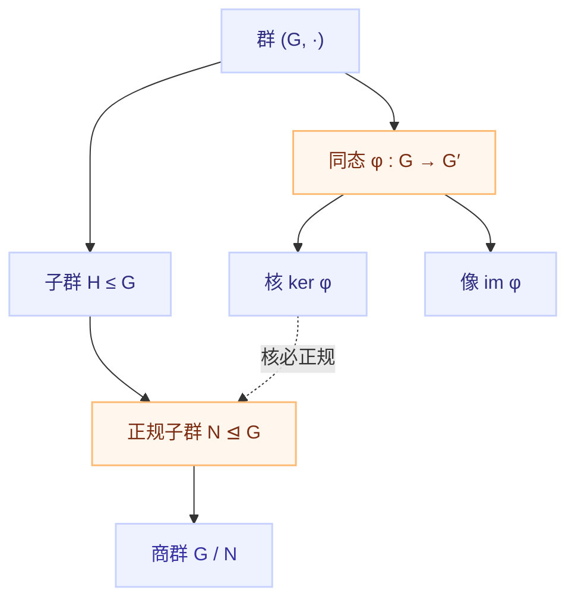

# 群论基础

## 一句话理解

群论只回答三个问题：**一个群自身长什么样**（子群、阶、生成元）、**两个群之间如何比较**（同态、核、像）、**群能对什么东西起作用**（群作用）。三条线交汇在同一个构造——**商群** $G/N$，而它的良定义性要求 $N$ 正规。

## 为什么重要

- 它是[魔方群的数学结构](./rubiks-cube-group-theory.md)的完整前置：那里的"守恒律""交换子""$|G|$ 的计算"全部是本笔记的直接应用
- $\operatorname{sgn}$、$A_n$、共轭类是[置换的符号与行列式](./permutation-sign-and-determinant.md)中符号理论的群论侧
- "良定义"这个词在代数里最典型的训练场就是商群——这个思维习惯会迁移到商空间、张量积、上同调等一切"取商"的构造

## 概念地图

左链是"结构"（子群 $\to$ 正规 $\to$ 商），右链是"映射"（同态 $\to$ 核/像）。两条链通过一条虚线相连：**核必定是正规子群**——这是第一同构定理 $G/\ker\varphi\cong\operatorname{im}\varphi$ 的支点。

## 1. 群

### 1.1 定义

**群**是一个集合 $G$ 配上二元运算 $\cdot:G\times G\to G$，满足四条公理：

| 公理 | 内容 |
|---|---|
| 封闭性 | $a,b\in G\Rightarrow ab\in G$ |
| 结合律 | $(ab)c=a(bc)$ |
| 单位元 | $\exists e\in G,\ \forall a:\ ea=ae=a$ |
| 逆元 | $\forall a\in G,\ \exists a^{-1}\in G:\ aa^{-1}=a^{-1}a=e$ |

### 1.2 三条立即推论

**命题 1.1（单位元唯一）**：若 $e,e'$ 都是单位元，则 $e=ee'=e'$。$\blacksquare$

**命题 1.2（逆元唯一）**：设 $b,c$ 都是 $a$ 的逆，则

$$
b=be=b(ac)=(ba)c=ec=c\quad\blacksquare
$$

**命题 1.3（消去律）**：$ab=ac\Rightarrow b=c$（两边左乘 $a^{-1}$）。

由此还可得到常用恒等式：$(a^{-1})^{-1}=a$、$(ab)^{-1}=b^{-1}a^{-1}$（注意顺序反转）。

### 1.3 阶

- **群的阶** $|G|$：元素个数（可为无穷）
- **元素的阶** $\operatorname{ord}(a)$：使 $a^m=e$ 的最小正整数 $m$；若不存在则为无穷

**命题 1.4**：$\operatorname{ord}(a)=m$ 时，$a^k=e\iff m\mid k$。

*证明*：写 $k=qm+r$，$0\le r<m$，则 $a^k=(a^m)^q a^r=a^r$。故 $a^k=e\iff a^r=e$，而 $r<m$ 且 $m$ 最小，故只能 $r=0$，即 $m\mid k$。$\blacksquare$

### 1.4 例子

| 群 | 运算 | 阶 | 交换？ |
|---|---|---|---|
| $(\mathbb{Z},+)$ | 加法 | 无穷 | 是 |
| $(\mathbb{Z}/n\mathbb{Z},+)$ | 模 $n$ 加法 | $n$ | 是 |
| $S_n$（对称群） | 置换复合 | $n!$ | $n\ge3$ 时否 |
| $A_n$（交错群） | 置换复合 | $n!/2$ | $n\ge4$ 时否 |
| $GL_n(\mathbb{R})$ | 矩阵乘法 | 无穷 | 否 |
| 魔方群 $G$ | 转动复合 | $\frac{8!\,12!}{2}3^72^{11}$ | 否 |

> **群不要求交换**。"非阿贝尔"才是常态，$(\mathbb{Z},+)$ 那种反而是特例。

## 2. 子群与拉格朗日定理

### 2.1 子群及实用判定

**子群** $H\le G$：$H\subseteq G$ 且自身在 $G$ 的运算下成群（同一运算、同一单位元）。

**一步判定**：$H\le G\iff H\neq\varnothing$ 且 $\forall a,b\in H:\ ab^{-1}\in H$。

*证明*：（必要性显然）（充分性）取 $a\in H$ 得 $e=aa^{-1}\in H$；取 $a=e$ 得 $b^{-1}=eb^{-1}\in H$；再由 $b^{-1}\in H$ 得 $a(b^{-1})^{-1}=ab\in H$。$\blacksquare$

**有限情形的简化判定**：若 $H$ **有限**、非空、且只对乘法封闭，则 $H\le G$。

*证明*：取 $a\in H$。由封闭性，$a,a^2,a^3,\dots$ 全部落在 $H$ 中。但 $H$ 有限，故存在 $i<j$ 使 $a^i=a^j$，消去得 $a^{j-i}=e$，于是 $e\in H$；再由 $a^{j-i}=a\cdot a^{j-i-1}=e$ 得 $a^{-1}=a^{j-i-1}\in H$。结合封闭性即 $H\le G$。$\blacksquare$

> 有限性帮我们"免费"取得了逆元。反例：$(\mathbb{Z}_{\ge0},+)$ 非空且对加法封闭，但不是 $(\mathbb{Z},+)$ 的子群——它无限，没有逆元。

### 2.2 陪集与划分

**左陪集**：$aH=\{ah:h\in H\}$。**右陪集**：$Ha=\{ha:h\in H\}$。

**命题 2.0（自我吸收）**：对任意 $h_0\in H$，有 $h_0H=H$（同理 $Hh_0=H$）。

*证明*：（$\subseteq$）若 $h\in H$，由封闭性 $h_0h\in H$，故 $h_0H\subseteq H$。
（$\supseteq$）任给 $x\in H$，写 $x=h_0\,(h_0^{-1}x)$：由逆封闭 $h_0^{-1}\in H$，再由乘法封闭 $h_0^{-1}x\in H$，故 $x\in h_0H$。

更本质地看：左乘映射 $\ell_{h_0}:H\to H,\ x\mapsto h_0x$ 是**双射**（单射由消去律，满射取 $x=h_0^{-1}y$），所以它只是把 $H$ 的元素在**内部重排**，集合本身不变。$\blacksquare$

**推论 2.0**：$aH=H\iff a\in H$。

*证明*：（$\Leftarrow$）即命题 2.0。（$\Rightarrow$）$a=ae\in aH=H$。$\blacksquare$

**命题 2.1**：$aH=bH\iff a^{-1}b\in H$。

*证明*：（$\Rightarrow$）$b=be\in bH=aH$，故 $b=ah$，即 $a^{-1}b=h\in H$。
（$\Leftarrow$）设 $a^{-1}b=h_0\in H$，则 $b=ah_0$，于是 $bH=ah_0H=aH$（因 $h_0H=H$）。$\blacksquare$

**命题 2.2（陪集构成划分）**：任意两个左陪集要么相等，要么不相交。

*证明*：设 $aH\cap bH\neq\varnothing$，取 $x=ah_1=bh_2$。则 $a=bh_2h_1^{-1}\in bH$，于是 $aH\subseteq bH$；对称地 $bH\subseteq aH$。故 $aH=bH$。$\blacksquare$

**命题 2.3**：$|aH|=|H|$（映射 $h\mapsto ah$ 是双射，逆映射 $x\mapsto a^{-1}x$）。

**等价类视角（命题 2.2 的更本质证明）**：定义关系

$$
a\sim b\iff a^{-1}b\in H
$$

它是等价关系：自反 $a^{-1}a=e\in H$；对称 $(a^{-1}b)^{-1}=b^{-1}a\in H$；传递由 $(a^{-1}b)(b^{-1}c)=a^{-1}c\in H$。而由命题 2.1，$a$ 所在的等价类恰是 $aH$。于是"陪集构成划分"只是**等价类天然构成划分**这一事实的翻译，无需额外论证。

**左陪集与右陪集一般不相等**：取 $G=S_3$、$H=\{e,(12)\}$、$a=(13)$，则

$$
(13)H=\{(13),\ (13)(12)\}=\{(13),\ (123)\},\qquad
H(13)=\{(13),\ (12)(13)\}=\{(13),\ (132)\}
$$

两者不等。换言之，"左陪集构成一个划分"与"右陪集构成一个划分"是**两套不同的划分**；它们何时一致，正是"正规子群"要回答的问题（见 §4.1）。

**两个完整的例子**

$G=\mathbb{Z}/6\mathbb{Z}$（阶 $6$）、$H=\{0,3\}$（阶 $2$）：

| 陪集 | 元素 | 代表元 |
|---|---|---|
| $0+H=H$ | $\{0,3\}$ | $0$ 或 $3$ |
| $1+H$ | $\{1,4\}$ | $1$ 或 $4$ |
| $2+H$ | $\{2,5\}$ | $2$ 或 $5$ |

$G=S_3$（阶 $6$）、$H=\{e,(12)\}$（阶 $2$）：

| 陪集 | 元素 | 代表元 |
|---|---|---|
| $H$ | $\{e,\ (12)\}$ | $e$ 或 $(12)$ |
| $(13)H$ | $\{(13),\ (123)\}$ | $(13)$ 或 $(123)$ |
| $(23)H$ | $\{(23),\ (132)\}$ | $(23)$ 或 $(132)$ |

两例都是 $3$ 块 $\times\ 2$ 个元素 $=6$，不重不漏——这就是拉格朗日定理的具体形态。

### 2.3 拉格朗日定理

**定理 2（拉格朗日）**：设 $G$ 有限、$H\le G$，则

$$
|G|=[G:H]\cdot|H|
$$

其中 $[G:H]$ 为左陪集个数（**指数**）。

*证明*：由命题 2.2 左陪集构成 $G$ 的划分，由命题 2.3 每个陪集大小都是 $|H|$，故

$$
|G|=\sum_{aH}|H|=[G:H]\cdot|H|
$$

$\blacksquare$

**推论 2.1（子群的阶整除群的阶）**：$|H|\mid|G|$。

*证明*：由定理 2，$|G|=[G:H]\cdot|H|$。而 $[G:H]$ 是左陪集个数，按定义是非负整数；又 $G$ 至少含单位元 $e$，任取 $a\in G$ 即得陪集 $aH$，故 $[G:H]\ge1$。于是 $|G|$ 是 $|H|$ 的整数倍。$\blacksquare$

**推论 2.2（元素的阶整除群的阶）**：$\operatorname{ord}(a)\mid|G|$。

*证明*：记 $m=\operatorname{ord}(a)$，令 $\langle a\rangle=\{a^k:k\in\mathbb{Z}\}$。

第一步，$\langle a\rangle\le G$：非空（含 $a^0=e$），且 $a^i(a^j)^{-1}=a^{i-j}\in\langle a\rangle$，由 §2.1 一步判定即得。

第二步，$|\langle a\rangle|=m$：

- （不超过）任取 $k$，写 $k=qm+r$（$0\le r<m$），则 $a^k=(a^m)^q a^r=a^r$，故每个幂都落在 $\{e,a,\dots,a^{m-1}\}$ 中。
- （不少于）若 $a^i=a^j$ 且 $0\le i<j<m$，左乘 $a^{-i}$ 得 $a^{j-i}=e$，而 $0<j-i<m$，与 $m$ 的最小性矛盾；故这 $m$ 个元素两两不同。

第三步，对子群 $\langle a\rangle$ 用推论 2.1：$m=|\langle a\rangle|$ 整除 $|G|$。$\blacksquare$

> 实用形态：**$|G|=n$ 时，元素的阶只能是 $n$ 的约数**——找元素的阶时不必试遍 $1..n$。

**推论 2.3（素数阶群必循环）**：$|G|$ 为素数 $\Rightarrow G$ 循环。

*证明*：设 $|G|=p$ 为素数。因 $p\ge2$，取 $a\in G$，$a\neq e$。把推论 2.1 用于 $\langle a\rangle$ 得 $|\langle a\rangle|\mid p$，故 $|\langle a\rangle|\in\{1,p\}$；但 $e$ 与 $a$ 都在其中且 $a\neq e$，所以 $|\langle a\rangle|\ge2$，只能 $|\langle a\rangle|=p$。又 $\langle a\rangle\subseteq G$ 且两者阶相同，故 $\langle a\rangle=G$，即 $G$ 由一个非单位元生成。$\blacksquare$

> - 证明只用到推论 2.1，用不到完整的定理 2。等价说法：**素数阶群没有非平凡真子群**。
> - **逆命题不成立**：$\mathbb{Z}/6\mathbb{Z}$ 循环但阶为 $6$。更强的结论是：$p$ 阶群在同构意义下只有一个，即 $\mathbb{Z}/p\mathbb{Z}$。

**推论 2.4（群论版的费马小定理）**：$\forall a\in G:\ a^{|G|}=e$。

*证明*：记 $m=\operatorname{ord}(a)$。由推论 2.2，$m\mid|G|$，写 $|G|=mq$，则

$$
a^{|G|}=a^{mq}=(a^m)^q=e^q=e
$$

$\blacksquare$

它在具体群上的两种特例：

| 群 | 群阶 | 推论 2.4 给出 | 经典名称 |
|---|---|---|---|
| $(\mathbb{Z}/n\mathbb{Z})^\times$ | $\varphi(n)$ | $a^{\varphi(n)}=e$ | 欧拉定理 $a^{\varphi(n)}\equiv1\pmod n$ |
| $(\mathbb{Z}/p\mathbb{Z})^\times$ | $p-1$ | $a^{p-1}=e$ | 费马小定理 $a^{p-1}\equiv1\pmod p$ |

> 这也解释了为什么推论 2.4 的证明只有三行，而费马小定理的初等证明往往要绕一大圈——它本质上是"群阶与元素阶的整除关系"。工程上的用途是快速幂求模逆元（如 RSA 中由 $a^{\varphi(n)-1}$ 得到 $a^{-1}$）。

## 3. 同态

### 3.1 定义与基本性质

**同态**：$\varphi:G\to H$ 满足 $\forall a,b\in G:\ \varphi(ab)=\varphi(a)\varphi(b)$。

**命题 3.1**：$\varphi(e_G)=e_H$，且 $\varphi(a^{-1})=\varphi(a)^{-1}$。

*证明*：$\varphi(e)=\varphi(ee)=\varphi(e)\varphi(e)$，两边左乘 $\varphi(e)^{-1}$ 得 $e_H=\varphi(e)$。又 $\varphi(a)\varphi(a^{-1})=\varphi(aa^{-1})=\varphi(e)=e_H$，故 $\varphi(a^{-1})=\varphi(a)^{-1}$。$\blacksquare$

### 3.2 核与像

$$
\ker\varphi=\{g\in G:\varphi(g)=e_H\},\qquad \operatorname{im}\varphi=\varphi(G)
$$

两者都是子群（核还是正规子群，见 §4.4）。

**例**：$\operatorname{sgn}:S_n\to\{\pm1\}$ 的核是 $A_n$；$\det:GL_n\to\mathbb{R}^\times$ 的核是 $SL_n$。

### 3.3 单射判据

**命题 3.2**：$\varphi$ 单射 $\iff\ker\varphi=\{e_G\}$。

*证明*：（$\Rightarrow$）$\varphi(g)=e_H=\varphi(e_G)$，单射给出 $g=e_G$。
（$\Leftarrow$）若 $\varphi(a)=\varphi(b)$，则 $\varphi(ab^{-1})=\varphi(a)\varphi(b)^{-1}=e_H$，故 $ab^{-1}\in\ker\varphi=\{e_G\}$，即 $a=b$。$\blacksquare$

> 直觉：**同态是"丢结构"的过程，核就是被丢掉的精确内容**。

## 4. 正规子群与商群

### 4.1 正规性

**正规子群**：$N\trianglelefteq G$ 定义为

$$
\forall g\in G:\ gNg^{-1}=N
$$

**命题 4.1（等价刻画）**：$gNg^{-1}=N\ \forall g\iff gN=Ng\ \forall g$。

*证明*：$gNg^{-1}=N\iff gN=Ng$（两边右乘 $g$）；而 $gN=Ng$ 即左右陪集一致。$\blacksquare$

实用判据：只需验证 $\forall g\in G,\ n\in N:\ gng^{-1}\in N$（包含关系即可，因为 $g^{-1}$ 也遍历 $G$）。

### 4.2 为什么必须正规：良定义论证

想让**陪集集合** $G/N=\{aN:a\in G\}$ 自己也成为群，自然希望定义

$$
(aN)\cdot(bN):=(ab)N
$$

但这里有个陷阱：$aN$ 的写法不唯一（任何 $a'\in aN$ 都给出同一个陪集）。若取 $a'=an_1$、$b'=bn_2$，算出的是 $(a'b')N$。要它等于 $(ab)N$，必须有 $n_1,n_2$ 被"吸收"，而

$$
a'b'=an_1bn_2=a\,b\,(b^{-1}n_1b)\,n_2
$$

于是 $(a'b')N=(ab)N\iff b^{-1}n_1b\in N$。**这恰是 $N$ 正规的定义**。

> 结论：**正是因为正规，商群的乘法才良定义**。这与有理数上定义加法需要验证"$\frac12=\frac24$ 给同一结果"是同一类工作——代数的核心关切之一就是"定义落在对象上而非表示上"。

### 4.3 商群

设 $N\trianglelefteq G$，则

$$
G/N=\{aN:a\in G\},\qquad (aN)(bN)=(ab)N,\qquad |G/N|=[G:N]
$$

单位元是 $N$ 本身，$aN$ 的逆是 $a^{-1}N$。

### 4.4 核必为正规子群

**命题 4.2**：$\ker\varphi\trianglelefteq G$。

*证明*：设 $n\in\ker\varphi$，则

$$
\varphi(gng^{-1})=\varphi(g)\varphi(n)\varphi(g)^{-1}=\varphi(g)e_H\varphi(g)^{-1}=e_H
$$

故 $gng^{-1}\in\ker\varphi$，即 $\ker\varphi$ 正规。$\blacksquare$

### 4.5 第一同构定理

**定理 4（第一同构定理）**：$G/\ker\varphi\cong\operatorname{im}\varphi$。

*证明*：记 $K=\ker\varphi$，定义

$$
\Phi:\ G/K\to\operatorname{im}\varphi,\qquad \Phi(gK)=\varphi(g)
$$

1. **良定义**：若 $gK=g'K$，则 $g^{-1}g'\in K$，于是 $\varphi(g^{-1}g')=e_H$，即 $\varphi(g)=\varphi(g')$，故 $\Phi$ 的值不依赖代表元。
2. **同态**：$\Phi(gK\cdot g'K)=\Phi(gg'K)=\varphi(gg')=\varphi(g)\varphi(g')=\Phi(gK)\Phi(g'K)$。
3. **单射**：若 $\Phi(gK)=e_H$，则 $\varphi(g)=e_H$，即 $g\in K$，故 $gK=K$（商群的单位元），由命题 3.2 单射。
4. **满射**：$\operatorname{im}\varphi$ 的定义即是。

故 $\Phi$ 是同构。$\blacksquare$

**例**：$S_n/A_n\cong\{\pm1\}\cong\mathbb{Z}/2\mathbb{Z}$。

## 5. 群作用

### 5.1 两种等价定义

**定义 A（同态式）**：$G$ 在集合 $X$ 上的作用是同态 $\rho:G\to\operatorname{Sym}(X)$。

**定义 B（映射式）**：映射 $G\times X\to X,\ (g,x)\mapsto g\cdot x$，满足
- $e\cdot x=x$
- $(gh)\cdot x=g\cdot(h\cdot x)$

两者等价：把 $\rho(g)$ 取作"$x\mapsto g\cdot x$"，其保运算性正是第二条；反之每个 $\rho(g)$ 是双射，故给出映射式的作用。

### 5.2 轨道与稳定子

$$
\operatorname{Orb}(x)=\{g\cdot x:g\in G\},\qquad \operatorname{Stab}(x)=\{g\in G:g\cdot x=x\}
$$

**命题 5.1**：$\operatorname{Stab}(x)\le G$。

*证明*：$e\in\operatorname{Stab}(x)$ 非空；若 $g,h$ 都固定 $x$，则 $(gh^{-1})\cdot x=g\cdot(h^{-1}\cdot x)=g\cdot x=x$，故 $gh^{-1}\in\operatorname{Stab}(x)$。$\blacksquare$

所有轨道也构成 $X$ 的划分（同一个证明模式：$g\cdot x=h\cdot x'\Rightarrow h^{-1}g\cdot x=x'$）。

### 5.3 轨道-稳定子定理

**定理 5**：$|\operatorname{Orb}(x)|=[G:\operatorname{Stab}(x)]$。

*证明*：考察映射 $f:G\to\operatorname{Orb}(x),\ g\mapsto g\cdot x$，它显然满射。计算纤维：

$$
f(g)=f(h)\iff g\cdot x=h\cdot x\iff (h^{-1}g)\cdot x=x\iff h^{-1}g\in\operatorname{Stab}(x)\iff g\operatorname{Stab}(x)=h\operatorname{Stab}(x)
$$

（最后一步用命题 2.1。）故纤维与 $\operatorname{Stab}(x)$ 的左陪集一一对应，$|\operatorname{Orb}(x)|$ 就等于陪集个数，即指数。$\blacksquare$

结合拉格朗日定理得：**轨道大小整除群阶**。

### 5.4 凯莱定理

**定理 6（凯莱）**：每个群 $G$ 都同构于某个对称群的子群，即 $G\hookrightarrow\operatorname{Sym}(G)$。

*证明*：取**左正则作用** $\rho:G\to\operatorname{Sym}(G)$，$\rho(g)$ 定义为 $x\mapsto gx$（由消去律，这是双射）。$\rho$ 是同态（左乘的结合性）。若 $\rho(g)=\operatorname{id}$，取 $x=e$ 得 $g=e$，故 $\ker\rho=\{e\}$，由命题 3.2 单射。于是 $G\cong\operatorname{im}\rho\le\operatorname{Sym}(G)$。$\blacksquare$

> 意义：抽象群总能具体实现为置换群。所以"置换群研究"在原则上覆盖了全部群论——这也解释了为什么 $S_n$ 和 $\operatorname{sgn}$ 如此重要。

## 6. 交换子与共轭

### 6.1 交换子

$$
[a,b]=aba^{-1}b^{-1}
$$

显然 $[a,b]=e\iff ab=ba$。**交换子度量两个元素有多不交换**。

### 6.2 换位子群

**换位子群** $G'=\langle[a,b]:a,b\in G\rangle$（所有交换子生成的子群）。

**命题 6.1**：$G'\trianglelefteq G$。

*证明*：关键是恒等式

$$
g\,[a,b]\,g^{-1}=[gag^{-1},\,gbg^{-1}]
$$

（展开右边：$(gag^{-1})(gbg^{-1})(gag^{-1})^{-1}(gbg^{-1})^{-1}=g\,aba^{-1}b^{-1}\,g^{-1}$，与左边相同。）

故共轭把交换子映为交换子，从而把它们的生成子群 $G'$ 映到自身，即 $G'$ 正规。$\blacksquare$

**命题 6.2**：$G/G'$ 是 $G$ 的最大阿贝尔商群。

*证明*：先证 $G/G'$ 阿贝尔：$[aG',bG']=[a,b]G'=G'$（商群的单位元）。
再证最大性：若 $N\trianglelefteq G$ 且 $G/N$ 阿贝尔，则 $\forall a,b$ 有 $[a,b]N=N$，即 $[a,b]\in N$，故 $G'\subseteq N$，即 $G/N$ 是 $G/G'$ 的商。$\blacksquare$

**推论**：$G$ 阿贝尔 $\iff G'=\{e\}$。

### 6.3 共轭类

$G$ 通过共轭作用在自身：$g\cdot x=gxg^{-1}$。轨道即**共轭类** $\{gxg^{-1}:g\in G\}$。

共轭保持元素的阶，也保持 $\operatorname{sgn}$（见[置换的符号与行列式](./permutation-sign-and-determinant.md) §1.4）——所以 $S_n$ 的共轭类恰由"循环型"决定。

## 7. 与本站已有笔记的对应

| 本笔记的概念 | 在魔方群论中的具体形态 |
|---|---|
| 群、阶 | 魔方群 $G$，$\lvert G\rvert=\frac{8!\,12!}{2}3^72^{11}$ |
| 生成元 | $R,L,U,D,F,B$ 生成整个 $G$ |
| 子群、指数 | $G_1=\langle U,D,R^2,L^2,F^2,B^2\rangle$ 是 Kociemba 两阶段算法的目标子群 |
| 同态、核 | $\Phi=\big(\sum o_c,\ \sum f_e,\ \operatorname{sgn}\sigma\operatorname{sgn}\tau\big)$ 的三个分量各自在 $G$ 上取固定值：$G\subseteq\Phi^{-1}(c)$，其中 $c=\Phi(e)$ |
| 第一同构定理 | 定理 4 的证明：$\lvert G\rvert=\lvert\ker\pi\rvert\cdot\lvert\operatorname{im}\pi\rvert$（用到 $G/\ker\pi\cong\operatorname{im}\pi$ 的计数形式） |
| 群作用、轨道 | 转动作用在块的位置与朝向上；可达状态集就是群作用轨道 |
| 交换子 | 命题 1（支撑集包含关系）：$[a,b]$ 只影响 $\operatorname{supp}(a)\cup\operatorname{supp}(b)$ |
| 共轭 | 命题 2（共轭即搬运）：$\operatorname{supp}(bab^{-1})=b(\operatorname{supp}(a))$ |
| $\operatorname{sgn}$、$A_n$ | [置换的符号与行列式](./permutation-sign-and-determinant.md) 整篇 |

## 我的理解

- 群论的**三层结构**（群自身 / 群之间 / 群作用）不是并列的三块，而是逐层递进：先认识对象，再建立比较工具，最后让对象"动起来"。很多教材把这个顺序打散，反而模糊了主线。
- **"核"与"商群"是同一枚硬币**：$\ker\varphi$ 衡量同态丢掉了什么，$G/\ker\varphi$ 则把"丢掉的部分"整体性剥离出来。第一同构定理 $G/\ker\varphi\cong\operatorname{im}\varphi$ 说的正是"剥掉核之后，剩下的完整保留"。
- **"良定义"是代数构造的核心关切**。商群要求 $N$ 正规、商空间要求子空间、张量积要求双线性，本质都是同一件事：让定义落在对象上而非表示上。这与我在[魔方笔记](./rubiks-cube-group-theory.md)中讨论"朝向必须良定义"是同一个思维习惯（那里用 $R^4=e$ 作为反例）。
- **凯莱定理暗示"置换群是通用模型"**：既然任何群都能实现为置换群，$S_n$ 与 $\operatorname{sgn}$ 的地位就不奇怪了。反过来说，研究具体的置换群（如魔方群）就能反过来照亮抽象理论。
- **拉格朗日定理是最划算的定理**：一个"陪集划分"的计数论证，直接给出元素阶整除群阶、费马小定理、素数阶群循环等一串结论。

## 开放问题

- **西罗定理（Sylow）**：拉格朗日定理只说子群阶整除群阶，反向不成立。西罗定理给出"素数幂子群必存在"的补充，是有限群分类的起点，本站尚未整理。
- **自由群与关系**：表达"$\langle R,L,U,D,F,B\mid R^4=\cdots\rangle$"这种生成元 $+$ 关系式的框架（自由群、商群的普遍性质）没展开。魔方群的自然描述正是这种方式。
- **群表示论**：同态 $G\to GL_n(\mathbb{C})$ 把群论问题化为线性代数问题。$\operatorname{sgn}$ 是 $S_n$ 的一维表示，$A_n$ 的不可约表示与共轭类数目相关——这条线通向 $S_n$ 的特征标理论。
- **群的上同调 / 群扩张**：如何从 $N$ 与 $G/N$ 重建 $G$？这决定"$G$ 的构造是否由正规子群和商群唯一决定"（一般的答案是不）。
- 有限单群分类与魔方群的非交换性结构的关系，是否值得单独整理？

## Related

- [魔方群的数学结构](./rubiks-cube-group-theory.md) — 本笔记的最大应用实例：守恒律、交换子、$|G|$ 的计算
- [置换的符号与行列式](./permutation-sign-and-determinant.md) — $S_n$、$\operatorname{sgn}$、$A_n$、共轭类与循环型
- [奇异值分解 SVD](../singular-value-decomposition.md) — $GL_n$、正交群等矩阵群是连续群的入口
- [Lagrangian 与约束优化](../lagrangian-and-constrained-optimization.md) — 约束结构在另一条主线上的形态

## References

- David S. Dummit, Richard M. Foote, *Abstract Algebra* — 本笔记定义的通用来源
- Michael Artin, *Algebra* — 交换子与商群部分
- J. J. Rotman, *An Introduction to the Theory of Groups* — 凯莱定理、群作用的标准处理
- 与本站两篇魔方笔记的交叉验证（守恒律、$\operatorname{sgn}$、$k$-循环符号）
